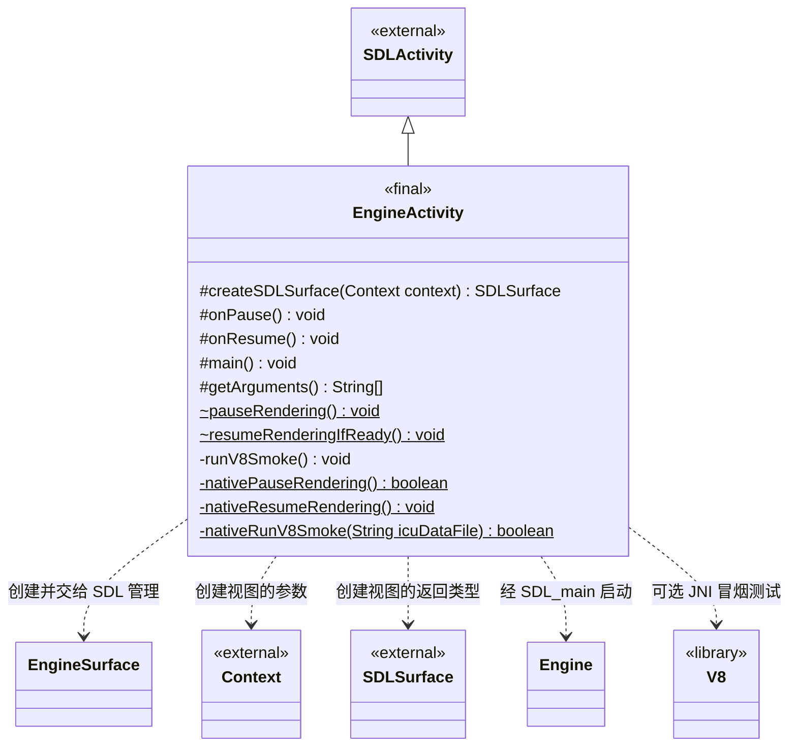
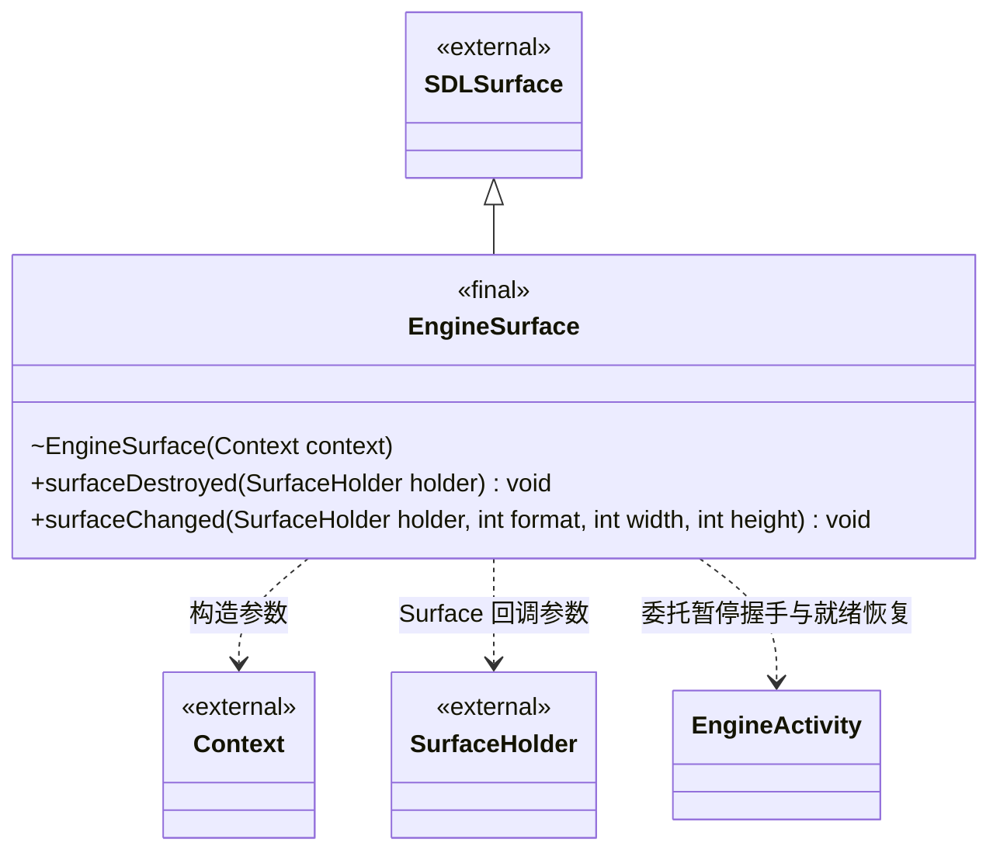

# Android 宿主

[类图索引](index.md) · [引擎与系统](engine-system.md) · [完整引用关系](references.md)

Android 使用 SDL3 自带 Activity 框架加载同版本的 `libSDL3.so` 与引擎 `libmain.so`。
宿主不建立、加载或要求编辑器项目，普通启动使用默认 `EngineConfig`。

## Activity 入口

本图只定义 `EngineActivity` 的方法；其他节点为跨图引用或 Android / SDL 类型。

- `getArguments()` 把可选的测试帧数交给原生入口；返回数组交由 SDL 使用。
- `main()` 在 SDL 原生线程上运行。普通启动调用 SDL 父类入口；只有显式传入 `v8_smoke=true` 时，才调用 `runV8Smoke()`，不创建引擎窗口或运行玩法。
- `runV8Smoke()` 把 APK 内 `assets/v8/icudtl.dat` 复制到应用私有文件目录，再将路径借给私有 JNI 方法 `nativeRunV8Smoke()`；后者通过返回值报告测试结果。读取或复制失败时记录原因并结束本次测试。
- JNI 复用桌面测试的普通自由函数，实际创建 V8 平台、isolate 与 context，验证 JavaScript、SharedArrayBuffer 的 Atomics / 十六进制 / Base64、Intl 和 Temporal。测试主体始终链接进 `libmain.so`，普通启动不执行；它不增加 `ScriptSystem` 的公共接口。
- V8 完整关闭后不能在同一进程重新初始化。测试函数只允许每个进程调用一次，重复调用返回失败；下一次测试或普通启动使用新应用进程。正常引擎退出后的 Activity 重建不执行此测试。
- `onPause()` 在调用父类之前请求暂停渲染；`onResume()` 在父类处理恢复后检查视图是否就绪。
- `pauseRendering()` 和 `resumeRenderingIfReady()` 是包内静态辅助方法，由 Activity 和视图共同使用；`~` 表示 Java 包内可见。负责渲染同步的两个私有静态 `native` 方法通过 JNI 调用平台内部同步代码，不是引擎公共接口。
- 只有 Activity 已恢复、视图存在且 Surface 已就绪时，才解除宿主暂停标志。若原生无法确认渲染已暂停，宿主记录原因并终止自身进程，不继续释放仍可能被使用的 Surface。

## Surface 边界

本图只定义 `EngineSurface` 的方法；`EngineActivity` 的方法只在上图维护。

- `EngineSurface` 为包内 Java `final` 类，构造函数同样为包内可见；Activity 创建它，视图与 Surface 的生命周期仍由 Android / SDL 管理。
- `surfaceDestroyed()` 在调用 SDL 父类之前等待渲染暂停，覆盖 Activity 仍存活时单独重建 Surface 的情况。
- `surfaceChanged()` 先让 SDL 更新原生窗口与就绪状态，再检查是否可以恢复渲染。
- Java 构造与重写方法沿用平台命名；重写方法标注 `@Override`。

## 暂停与恢复约定

- Java UI 线程先在平台内部锁下置暂停标志，阻止新的 GPU 初始化；若已有渲染器，再通过 `SDL_RunOnMainThread()` 请求 SDL 原生主线程执行关闭，并等待确认。等待期间不持有平台状态锁。
- 主线程回调发送专用用户事件；渲染系统的事件观察器在同一线程关闭 bgfx，等待其后台渲染线程退出，再释放持有的原生窗口引用并确认。UI 线程不直接调用 bgfx，也不访问渲染器裸指针。
- 关闭 SDL 自带的后台阻塞，让失焦后的事件泵继续处理主线程回调。握手不伪造 SDL 前后台事件，避免快速切换时与 SDL 合并的暂停 / 恢复事件冲突。
- 允许 SDL 在同一进程内重新创建 Activity；正常退出后再次启动通过已有的引擎关闭 / 重新初始化流程建立新窗口和渲染器。
- 初始化前收到暂停请求时暂缓 GPU 创建；已有初始化开始后才收到请求，则完成初始化或失败清理后再确认关闭。关闭与退出的确认以平台内部渲染登记已清除为准。
- 窗口可绘制性同时检查宿主暂停标志。渲染期间到达的暂停请求使本帧返回 `paused`，不进入不可恢复的 `failed` 状态；Surface 再次就绪后按需重新创建当前最小渲染资源。
- SDLActivity 管理 Activity / Surface 回调和 SDL 原生线程；所有引擎系统与 bgfx API 仍由 `SDL_main` 所在线程调用，不从 Java UI 线程调用。
- 平台辅助函数不增加引擎架构类或公开系统方法。图只定义 Android 宿主类；`Engine` 的方法与所有权仍在引擎总图维护。实际 APK、模拟器与真机验证范围见根 [README](../../README.md#编辑器职责拆分与-android)。
