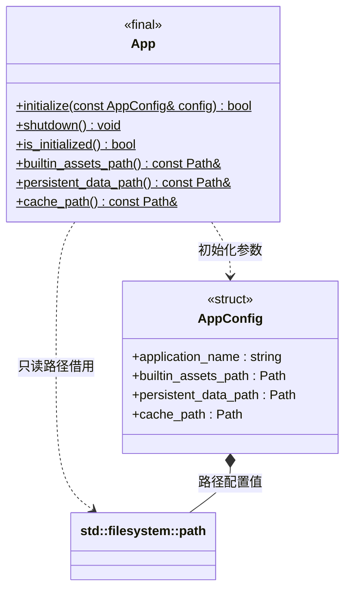

# 应用平台目录

[类图索引](index.md) · [日志系统](log-system.md)

状态：桌面平台本轮实现；Android / iOS 仅保留接口边界，本轮不增加实现。

- `App` 是不可构造的静态平台门面，不继承 `System`，不拥有项目或引擎。宿主先初始化 App，再初始化日志和引擎；所有使用者退出后关闭 App。
- `AppConfig::application_name` 默认为 `engine`。三个非空路径配置分别覆盖平台默认值，可供编辑器和测试使用；不推导或依赖项目的 `settings/cache/assets` 结构。
- 桌面内置资源根默认来自 SDL 应用资源目录；允许目录尚不存在，不在安装位置创建目录。跨平台调用者须将内置根交给资源系统解释，不能假设未来 Android 包内资源是普通磁盘路径。
- 持久数据默认来自 SDL 用户应用目录；缓存默认使用 macOS 用户 `Library/Caches`、Windows 用户 `LOCALAPPDATA` 下的应用缓存、Linux 的 `XDG_CACHE_HOME` 或用户 `.cache`。
- 持久数据和缓存初始化时创建并检查为目录；两者不能相同。初始化失败不发布部分路径，允许修正配置后重试。初始化不成功时路径为空；重复初始化返回失败且保留已发布配置。
- 路径返回值是 App 内部值的只读借用；初始化后稳定，关闭后内容清空。初始化、关闭和路径读取由宿主串行调度，运行中的使用者不得与关闭并发。
- `shutdown()` 可重复调用，不删除磁盘数据。默认日志放在持久目录的 `logs/`，可修改运行内容也必须使用持久目录；缓存允许丢失和重建。

返回状态的方法标注 `[[nodiscard]]`；关闭、状态与借用访问器为 `noexcept`。路径使用 `std::filesystem::path`，文件系统操作通过 `std::error_code` 报告错误。
