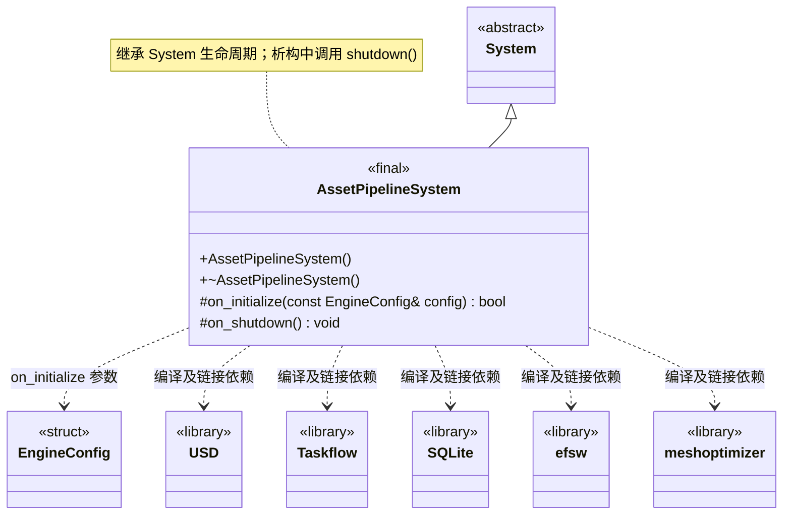

# 资源管线系统

[类图索引](index.md) · [引擎与系统](engine-system.md) · [完整引用关系](references.md)

状态：本轮最小实现。仅定义 `AssetPipelineSystem` 的方法；其他节点为跨图引用或第三方类型。

- 独立宿主模块，由资源工具宿主管理根系统生命周期；运行时不依赖 USD、文件监听器或离线处理工具。
- 当前建立局部 Taskflow 任务图、文件监听对象、SQLite 内存数据库、meshoptimizer 重映射和 USD 内存 stage，验证依赖编译与链接。局部资源在初始化探针结束时释放。
- 尚未启动目录监听线程、Taskflow 执行器或实际导入任务。构建提供的 shaderc、texturec、geometryc 属于宿主工具，不作为运行时类或资源对象。
- 公开业务接口当前只有构造与析构；继承 `System` 的公共生命周期方法，不提前增加业务方法。初始化失败和清理遵守[系统约定](engine-system.md)。
- 不重写 `on_tick()`，沿用基类默认成功的空更新；当前无逐帧业务任务。

C++ 限定符：构造、析构及 `on_shutdown()` 为 `noexcept`；析构和受保护钩子标注 `override`，返回状态的钩子标注 `[[nodiscard]]`。
