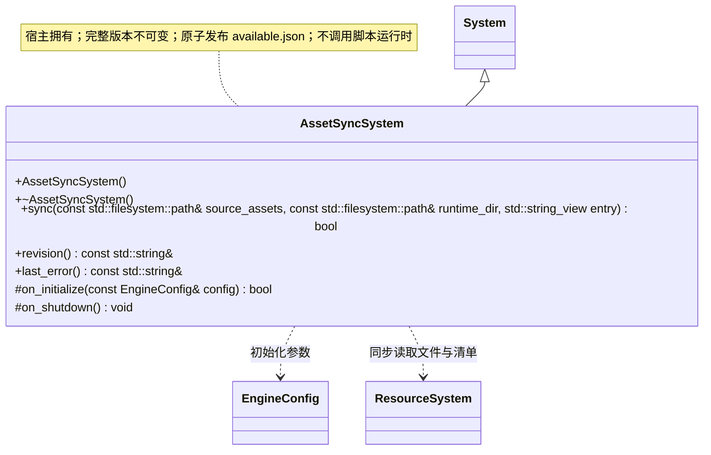

# 资源同步系统

[类图索引](index.md) · [完整引用关系](references.md)

本轮桌面编辑器实现；独立根系统由工具宿主初始化并反序关闭。跨图引用不重复定义公开方法。

`sync()` 返回是否完整发布，`revision()` 只表示可用版本，不表示脚本已经运行。相对路径拒绝越界及符号链接，版本目录不可变。`available.json` 包含 revision、entry、files（path、size、FNV-1a 64 位 hash）和累计 deleted；删除项阻止包内回退复活。失败保持旧清单，暂存不参与加载。

返回状态及只读访问方法标注 `[[nodiscard]]`；析构和清理为 `noexcept`，钩子标注 `override`。`last_error()` 与 `revision()` 为 const noexcept，只读字符串借用在下一次业务操作前有效。
