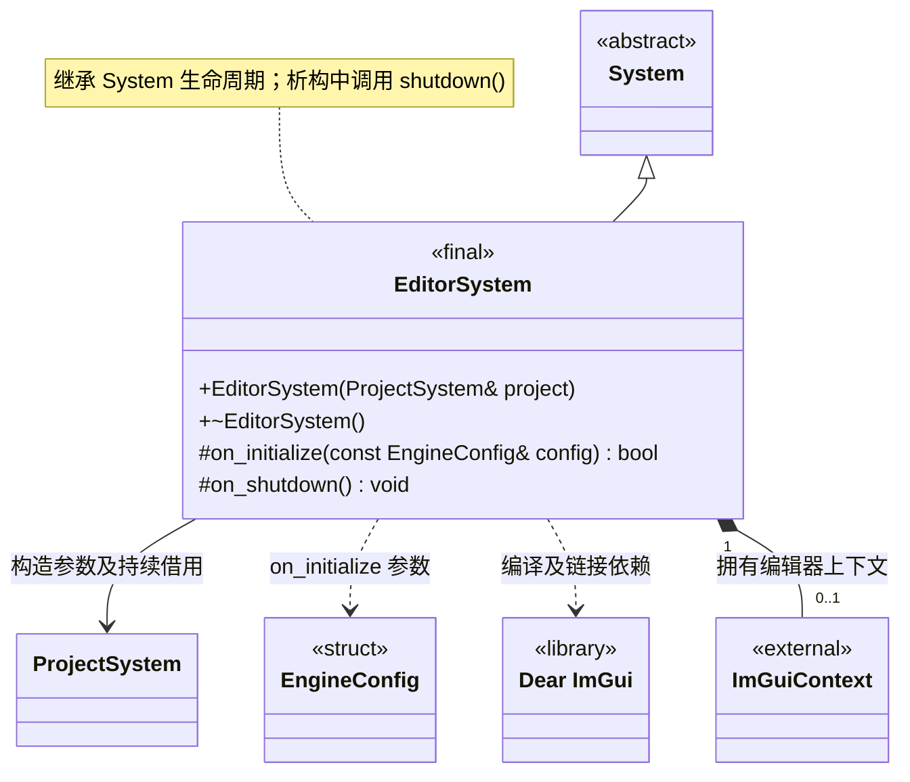

# 编辑器系统

[类图索引](index.md) · [引擎与系统](engine-system.md) · [完整引用关系](references.md)

状态：本轮最小实现。仅定义 `EditorSystem` 的方法；其他节点为跨图引用或第三方类型。

- 独立宿主模块，由编辑器宿主管理根系统生命周期；运行时 `Engine` 不拥有或依赖它。
- 构造函数借用宿主拥有的 `ProjectSystem`；项目必须先初始化，并存活且保持就绪直到编辑器关闭。项目未就绪时，编辑器初始化返回 `false`。
- `editor_app` 必须接收 `--project <path>`，依次初始化项目、引擎和编辑器，反序关闭；`engine_app` 启动不接收项目路径。编辑器仍通过继承的 `add_subsystem()` 独占和统一管理其他编辑器子系统。
- 当前创建和销毁 Dear ImGui 上下文；尚未接入窗口后端、绘制编辑器界面或引入业务工具。
- 公开业务接口当前只有构造与析构；继承 `System` 的公共生命周期方法，不提前增加业务方法。初始化失败和清理遵守[系统约定](engine-system.md)。
- 不重写 `on_tick()`，沿用基类默认成功的空更新；当前无逐帧业务任务。

C++ 限定符：构造为 `explicit`；构造、析构及 `on_shutdown()` 为 `noexcept`；析构和受保护钩子标注 `override`，返回状态的钩子标注 `[[nodiscard]]`。
