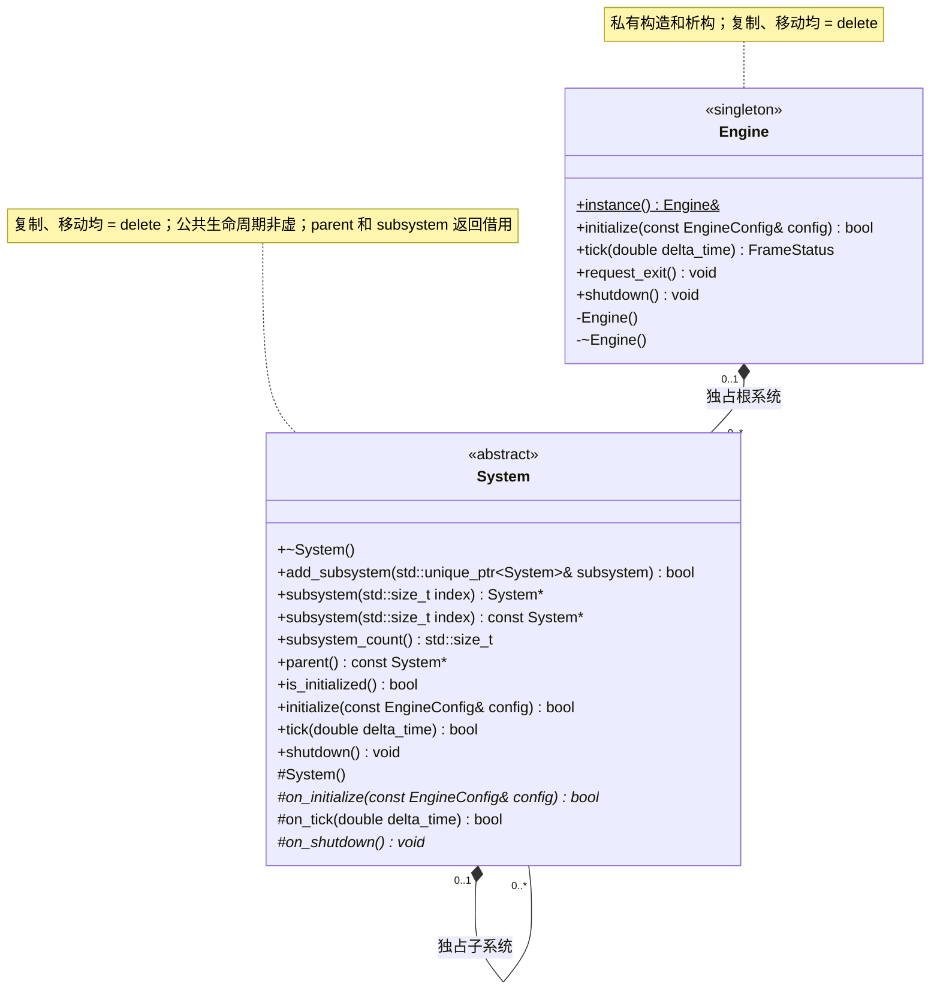

# 引擎与系统

[类图索引](index.md) · [完整引用关系](references.md)

状态：本轮最小实现的架构契约。本总图只定义 `Engine` 和 `System`；具体系统各有独立类图。

## C++ 限定符

图中按 Mermaid UML 语法写“方法(参数) 返回类型”，不把 `noexcept` 或 `override` 当作返回类型。

- `Engine` 为 `final`；`instance()` 为 `static` 且 `noexcept`。私有构造、析构、`request_exit()` 和 `shutdown()` 为 `noexcept`。单例访问、初始化和更新返回值标注 `[[nodiscard]]`。
- `System` 构造、公共虚析构、关闭和只读访问器均为 `noexcept`；`subsystem()` 同时提供普通重载与 `const` 重载，计数、父节点和初始化状态查询均为 `const`。
- `System` 的初始化、更新、挂接及访问器返回值标注 `[[nodiscard]]`；受保护 `on_initialize()` 和 `on_shutdown()` 为纯虚函数，`on_tick()` 为有默认实现的虚函数；`on_shutdown()` 为 `noexcept`。

## 接口约定

- `Engine`、窗口系统和渲染系统的初始化、更新、渲染与关闭统一在 `SDL_main` 所在线程调用：桌面为应用主线程，Android 为 SDL 原生主循环线程；不从 Java UI 回调直接调用系统接口。当前公共接口不提供跨线程安全保证。
- `Engine` 是唯一的进程级单例，通过 `std::unique_ptr<System>` 拥有根系统。系统至多属于一个引擎或一个父系统，不同时拥有两个所有者；宿主模块也可独立拥有根系统。
- 所有系统和子系统继承 `System`。公开 `initialize / tick / shutdown` 是非虚方法，统一调度当前系统及其子系统；派生类实现受保护的 `on_*` 钩子，不隐藏公共入口。
- `on_tick()` 默认成功且不做工作，没有逐帧任务的系统可以不重写。
- `initialize()` 和系统 `tick()` 成功返回 `true`，失败返回 `false`。重复初始化返回 `false`，不破坏已运行实例；首次初始化失败时回滚当前子树已创建的资源。
- `Engine::tick()` 只由宿主调用；`delta_time` 是有限且非负的秒数。未初始化、非法时间、系统更新或渲染失败返回 `failed`，正常返回 `running`，退出请求返回 `exit_requested`，窗口暂不可绘制时返回 `paused`。
- 根系统依次初始化 `WindowSystem → ResourceSystem → WorldSystem → RenderSystem`。每帧先处理窗口事件，检查退出和暂停；可绘制时更新资源、世界及渲染系统，最后调用 `render()`。暂停期间继续处理窗口恢复和退出事件。
- 平台暂停请求若在本帧检查后到达，渲染被拒绝且窗口已不可绘制时返回 `paused`，等待恢复，不将正常切后台锁定为失败。
- 引擎启动不要求项目，`EngineConfig` 不包含项目路径；`Engine` 不拥有或依赖 `ProjectSystem`。
- 编辑器宿主先初始化独立的项目系统，检查实际根目录及其 `settings/`、`cache/`、`assets/`，再启动引擎窗口和编辑器系统；项目失败时尚未打开窗口。
- `WorldSystem` 独占物理、导航、动画、界面及可选脚本子系统；编译启用 V8 时加入 `ScriptSystem`。编辑器和资源管线由各自宿主单独管理，运行时不依赖它们。
- 非法 `delta_time` 属于参数拒绝：本帧返回 `failed` 且不执行系统更新，后续传入合法时间仍可继续运行。
- 渲染返回失败时，若窗口因本帧中新到达的宿主暂停请求而不可绘制，本帧返回 `paused`，恢复后可继续。系统更新失败，或窗口仍可绘制时的渲染失败，才使引擎持续返回 `failed`，不继续推进后续帧；调用 `shutdown()` 后可重新初始化。
- 根系统关闭顺序与初始化顺序相反。具体类析构中先调用 `shutdown()`，在派生类成员销毁前关闭子树；`System` 基类析构不调用虚钩子。

## 子系统约定

- 公开 `initialize / tick / shutdown` 仅由宿主调用根系统。附属子系统的公开初始化和更新返回 `false`，公开关闭不执行；父系统通过私有递归方法统一调度子树，防止外部绕过父系统生命周期。
- `add_subsystem()` 只允许在当前系统及其祖先、待加入子树均未初始化且没有正在执行生命周期方法时调用；运行中不支持添加、移除或重新挂接。
- 调用方用 `std::unique_ptr<System>` 持有待加入对象，传入引用。成功后所有权转入父系统，调用方指针置空；失败时调用方所有权和现有系统树保持不变。
- 空指针、自身、已有父系统的对象以及会形成环的关系均返回 `false`。系统树只有一个拥有者；`parent()` 是只读借用，根系统返回 `nullptr`。
- `subsystem(index)` 返回借用指针，越界返回 `nullptr`；索引按添加顺序确定。系统关闭后保留父子结构，子对象在所属树销毁时释放。
- 初始化先执行当前系统 `on_initialize()`，再按添加顺序初始化子系统。任一步失败，反序关闭已初始化子系统，再清理当前系统的部分资源。
- 更新先执行当前系统 `on_tick()`，再按添加顺序更新子系统。失败立即向上返回，停止本帧后续调度；不会撤销已经发生的帧更新。未初始化或时间无效时返回 `false`。
- 关闭时先逆序关闭子系统，再执行当前系统 `on_shutdown()`。清理支持部分初始化，已关闭的系统不重复执行钩子；重复调用 `shutdown()` 安全。

配置和返回状态定义见[配置与状态](types.md)，跨图类型依赖见[完整引用关系](references.md)。
