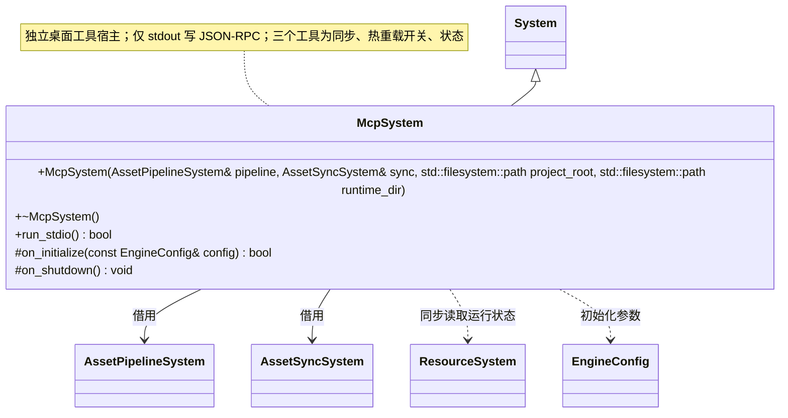

# MCP 工具系统

[类图索引](index.md) · [完整引用关系](references.md)

本轮桌面编辑器实现；独立根系统由工具宿主初始化并反序关闭。跨图引用不重复定义公开方法。

构造参数两个系统为非空借用，须先初始化且存活到 MCP 关闭。`run_stdio()` 执行换行分隔 JSON-RPC，支持 initialize、notifications/initialized、ping、tools/list、tools/call。sync_assets 先编译后同步；set_hot_reload 原子发布 script-control.json；get_status 独立读取已发布清单；引擎运行字段标明上次持久报告，不冒充实时进程存活检测，缺少运行报告时为 offline。项目和运行目录由启动参数明确指定。

返回状态的方法标注 `[[nodiscard]]`；析构和清理为 `noexcept`，钩子标注 `override`。
