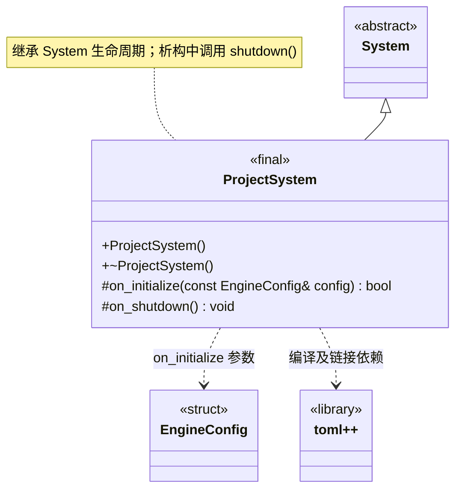

# 项目系统

[类图索引](index.md) · [引擎与系统](engine-system.md) · [完整引用关系](references.md)

状态：本轮最小实现。仅定义 `ProjectSystem` 的方法；其他节点为跨图引用或第三方类型。

- 由 `Engine` 拥有的根系统，先于窗口和其他运行时系统初始化。
- `EngineConfig::project` 指向实际项目根目录。`on_initialize()` 检查根目录及其 `settings/`、`cache/`、`assets/` 均存在且为目录；任一缺失、类型不符或无法完成检查均返回 `false`。
- 文件系统检查使用返回状态和 `std::error_code`，不使用异常。项目系统是第一个根系统，验证失败时引擎启动失败，尚未初始化窗口。
- toml++ 继续参与项目配置数据的编译与链接验证。当前完成目录结构检查，具体配置文件读取以及 APK 内部资源访问尚未实现。
- 公开业务接口当前只有构造与析构；继承 `System` 的公共生命周期方法，不提前增加业务方法。初始化失败和清理遵守[系统约定](engine-system.md)。
- 不重写 `on_tick()`，沿用基类默认成功的空更新；当前无逐帧业务任务。

C++ 限定符：构造、析构及 `on_shutdown()` 为 `noexcept`；析构和受保护钩子标注 `override`，返回状态的钩子标注 `[[nodiscard]]`。
