# 完整引用关系

[类图索引](index.md)

下图只维护拥有、借用、调用及参数类型关系；方法和字段在各自独立类图维护。同名节点指向同一个类型，宿主节点表示入口程序，不是新增 C++ 架构类。

资源核心与调用方的方向汇总见[资源调用关系](#资源调用关系)。

## 构建边界

代码和独立类图按职责使用相同分层：

| 范围   | 头文件与实现位置                                 | 文档位置        |
| ------ | ------------------------------------------------ | --------------- |
| 运行时 | `include/engine/runtime/`、`src/engine/runtime/` | `docs/runtime/` |
| 编辑器 | `include/engine/editor/`、`src/engine/editor/`   | `docs/editor/`  |
| 运行时插件 | `include/engine/plugins/runtime/`、`src/engine/plugins/runtime/` | `docs/plugins/runtime/` |
| 编辑器插件 | `include/engine/plugins/editor/`、`src/engine/plugins/editor/` | `docs/plugins/editor/` |

各范围独立类图位于其 `class-diagrams/` 子目录。平台入口与平台专用实现仍放在 `platforms/<platform>/`；TS 声明集中在 [include/engine.d.ts](../../include/engine.d.ts)。自有头文件从 `runtime/`、`editor/`、`plugins/runtime/` 或 `plugins/editor/` 开始引用。建模、MCP、资源构建与同步属于编辑器插件，资源依赖图、V8 脚本与逐类绑定属于运行时插件。插件使用核心接口，核心不 include 或链接具体插件。

每个插件在 `cmake/plugins/<scope>/<name>.cmake` 声明目标、源码及依赖；注册器按清单解析闭包，宿主只装配实际创建的目标。CMake 按 install、dependencies、plugins、core、editor、platforms 六目录分工，详见[插件登记](../plugins/plugins.md)。

| 配置 | 脚本插件 | 宿主与验证边界 |
| --- | --- | --- |
| 不选择 `runtime/script` | 不编译或装配 ScriptSystem | 窗口、场景、资源和渲染仍可运行，脚本启动明确不可用 |
| V8 依赖开启，脚本插件关闭 | 不创建脚本伪系统 | `engine_v8_smoke` 独立验证 V8 编译、链接及运行 |
| 选择 `runtime/script` | V8 运行实现及逐类绑定 | 要求 V8 和运行时依赖；可执行宿主提供创建工厂，核心只使用 ScriptRuntime |
| 选择 `editor/mcp` | 独立编辑器工具插件 | 工具通过本机目录或指定 adb 设备和包交换文件，不拥有脚本实例 |

Android 普通启动使用完整 ScriptSystem 运行项目玩法；V8 JNI 冒烟测试仍为显式触发的独立验证路径，切换测试前须停止旧进程。具体 Activity、Surface 与测试边界见[Android 宿主](../runtime/class-diagrams/android-host.md)。

## 引擎与系统所有权

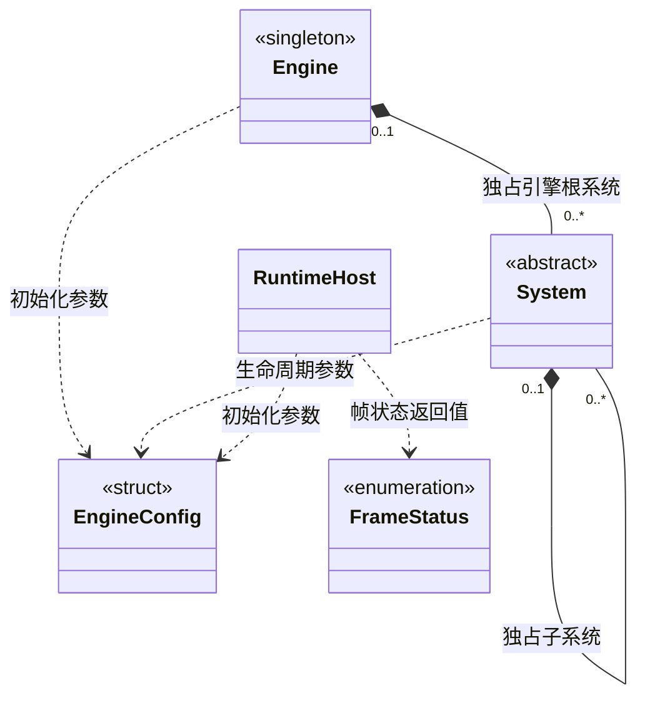

一个 System 对象只由引擎、父系统或独立宿主管理。`add_subsystem()` 成功后转移独占所有权；`parent()` 和 `subsystem()` 只返回借用。公开生命周期只接受根系统调度，子系统由父系统递归管理。

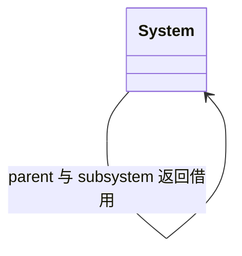

App 是静态平台门面，不继承 System。LogSystem 是进程单例及独立根系统，由宿主借用和调度，不进入 Engine 的独占系统数组。Gameplay、Game、Debug 属于脚本接口，不继承 C++ System。

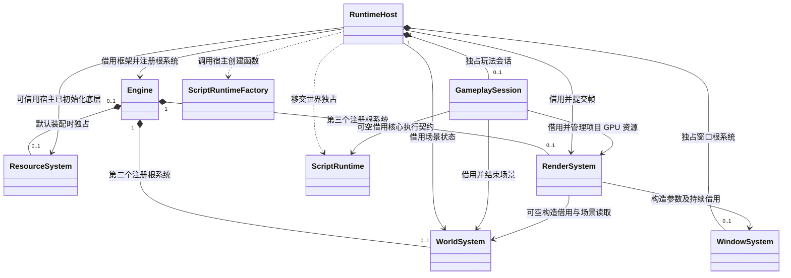

默认初始化顺序为 Window → Resource → World → Render。宿主提供资源底层时先初始化 ResourceSystem 及可选加载插件，再初始化 RuntimeHost 的窗口、世界和渲染；资源底层及加载器必须覆盖全部消费者的生命期。关闭时反序处理。RuntimeHost 拥有窗口和会话，借用渲染与世界；GameplaySession 借用脚本、世界及渲染。ScriptRuntime 实例由 WorldSystem 独占，具体实现由宿主提供。RenderSystem 借用窗口，窗口必须存活到渲染系统退出之后。

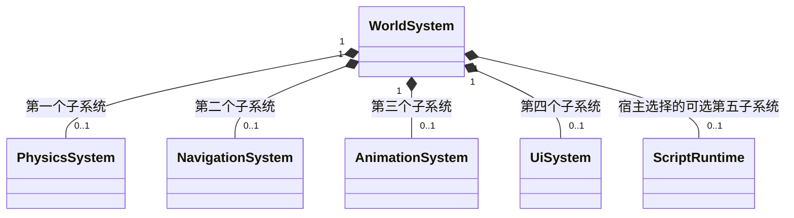

RuntimeHost 创建并装配各子系统，所有权经 System 转入 WorldSystem。父系统的更新先于子系统；当前世界推进之后才执行脚本更新。脚本实例由宿主提供的 ScriptRuntimeFactory 创建，工厂返回未初始化的抽象子系统；核心不判断 V8 或插件是否编译。

每帧先处理窗口事件，再更新其余根系统，最后提交渲染。窗口暂停时不继续执行资源、世界和脚本更新；编辑器在 RuntimeHost::tick 前处理项目启停，因此暂停不阻断停止请求。外部工具仍可发布文件，脚本版本切换等待恢复后的运行线程安全点。

## 场景对象、组件及渲染引用

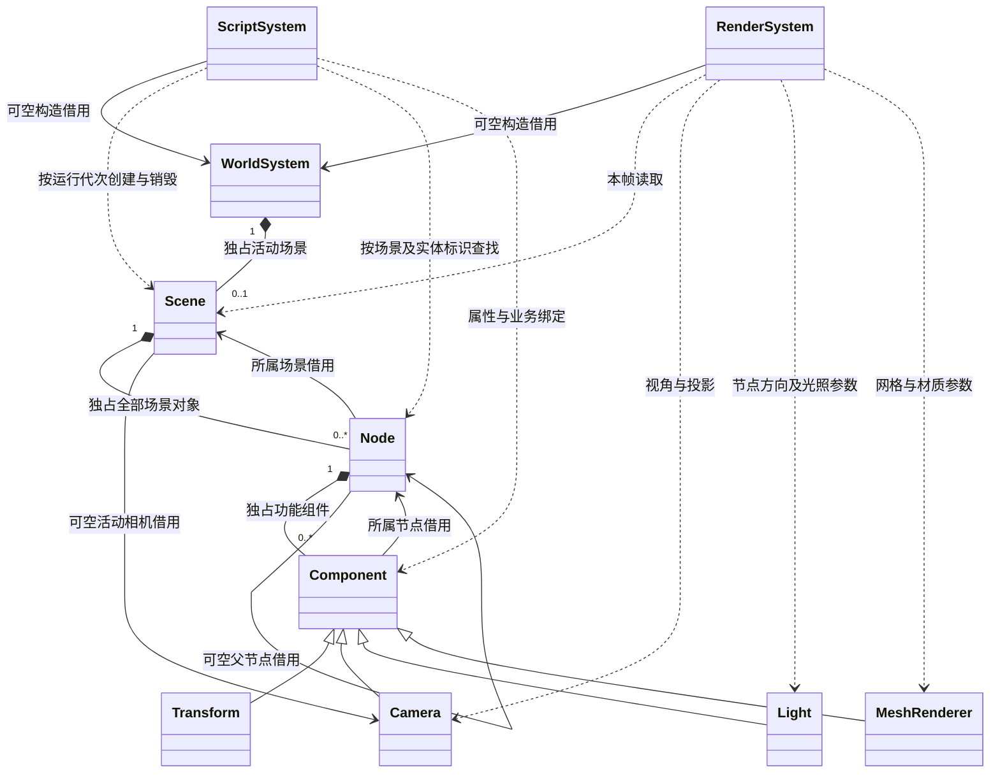

场景中的全部对象必须使用节点和组件表达。Scene 是容器，Gameplay 是场景外项目入口；Material 与 Shader 是组件数据/渲染资源，不另形成场景对象。Node 的身份来自 flecs 完整实体标识，只管理生成的 NodeInfo 与通用组件列表。局部变换由 Transform 组件持有，世界矩阵按父链上的 Transform 计算；Node 不枚举具体组件类型。场景、节点与组件以 FlatBuffers schema 为统一跨语言数据模型，组件行为直接操作生成对象；完整序列化模型只在构建内存快照时组装。材质通过类型定义和命名参数设置。ScriptSystem 的 JS 句柄保存运行/场景代次与实体标识，每次调用重新验证，停止或重载后不能访问已销毁对象。

领域模块通过 ResourceSystem 取得 ResourceLoader，按需加载 Shader、Material、Mesh 等 Resource，完整路径以 builtin/ 或 project/ 区分内置与项目。Scene、MeshRenderer 和 Material 持有实际使用资源的共享引用；MeshRenderer 独占 Material，Material 的参数实例按所持 Shader 定义校验。RenderSystem 只借用仍存活的定义，拥有本次场景使用的顶点/索引缓冲、Shader、Program、Uniform。切换场景、停止运行或图形设备重建时配对释放 GPU 资源；CPU 资源随最后一个共享引用释放；共享缓存与必要依赖保活由 ResourceGraphSystem 插件负责，核心没有缓存。Material::shader_data 直接借用自己持有的 Shader 资源，渲染器不再通过全局缓存查找定义。图形设备可在编辑器待机期间保留。参数、返回值和配置数据关系分别在[场景](../runtime/class-diagrams/scene.md)、[节点](../runtime/class-diagrams/node.md)、[组件](../runtime/class-diagrams/component.md)与[渲染](../runtime/class-diagrams/render-system.md)中维护。

## App 与日志

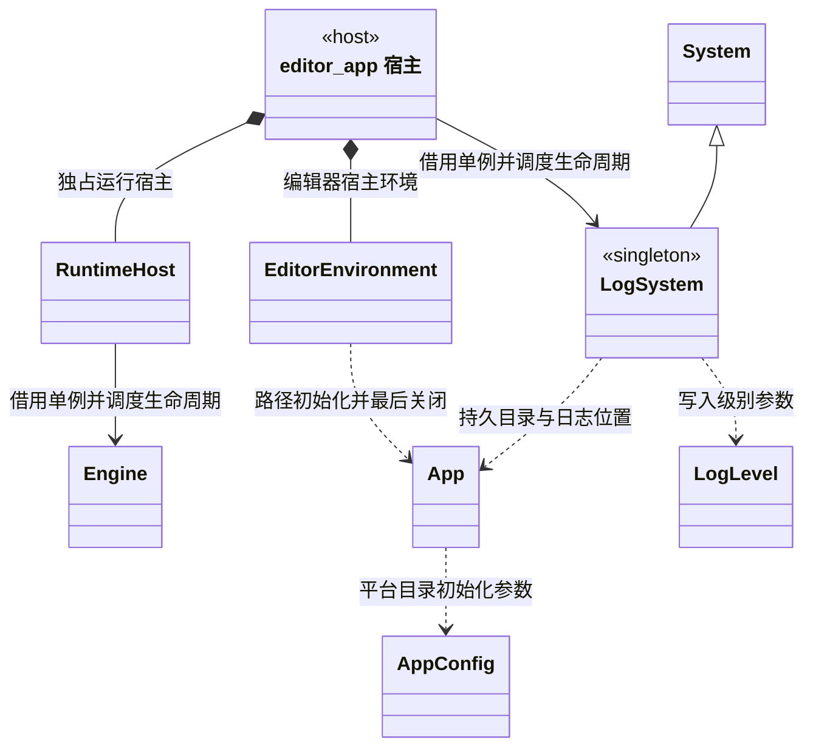

App 和 LogSystem 的生命周期由宿主负责，Engine 不反向拥有它们，也不因此获得项目依赖。AppConfig 只提供应用名及平台目录覆盖值，EngineConfig 继续只表示引擎运行配置。

App 的三个路径访问器返回内部 `std::filesystem::path` 的只读借用；LogSystem 同样借用 App 的持久目录，并拥有日志文件。日志默认写入持久目录的 `logs/engine.log`，同时输出标准错误。宿主必须先停止所有日志使用者，再刷新、关闭 LogSystem，最后关闭 App。

目录语义、失败状态和日志轮换分别见 [App](../runtime/class-diagrams/app.md) 与[日志系统](../runtime/class-diagrams/log-system.md)。内置资源根由资源系统解释；Android APK 使用逻辑路径，普通磁盘 canonical 只用于可写版本和桌面文件。

## 编辑器宿主拥有的独立系统

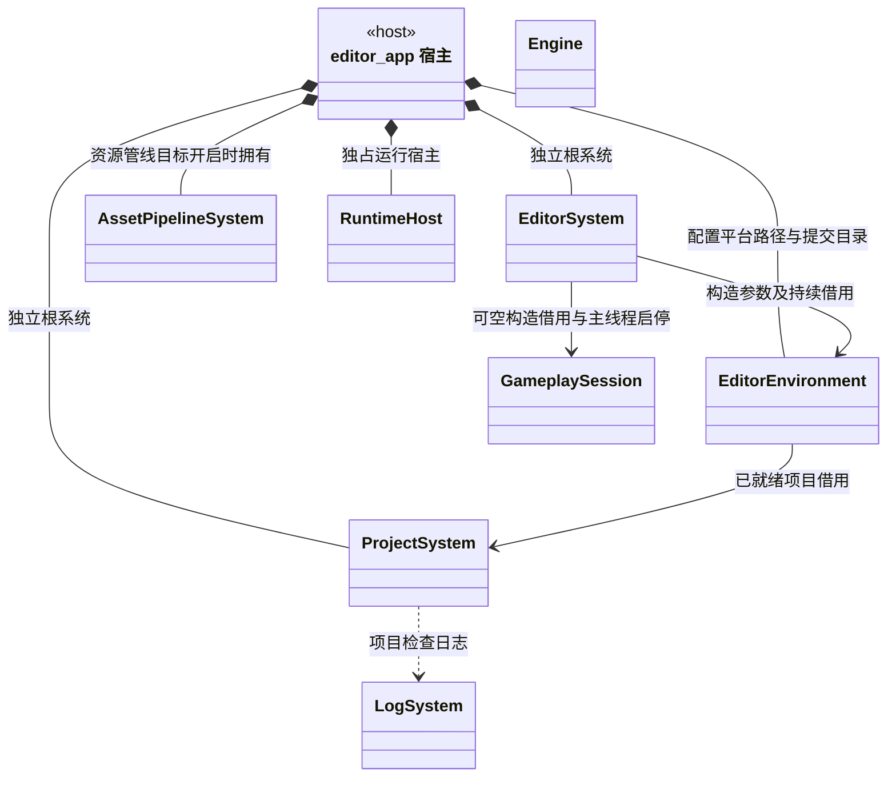

ProjectSystem、EditorSystem、AssetPipelineSystem 均为编辑器宿主拥有的独立根系统。EditorSystem 借用已初始化的 EditorEnvironment，环境借用 ProjectSystem；项目和环境必须保持就绪直到编辑器退出。ProjectSystem 没有路径 getter；运行时读取 App 路径，环境的私有项目身份仅用于会话回执。

AssetSyncSystem 由独立工具宿主装配，未挂入 ResourceSystem 子系统树。它使用 ResourceSystem 的静态读取入口，不拥有 ResourceSystem 实例，也不调用 ScriptSystem。独立类图见[项目](../editor/class-diagrams/project-system.md)、[编辑器](../editor/class-diagrams/editor-system.md)、[资源管线](../editor/class-diagrams/asset-pipeline-system.md)、[资源同步](../plugins/editor/class-diagrams/asset-sync-system.md)。

启用完整脚本运行时，`editor_app` 启动顺序为：

1. 解析项目与运行目录，初始化 ProjectSystem，检查项目根目录及 `settings/`、`cache/`、`assets/`。失败时尚未打开引擎窗口。
2. 初始化 EditorEnvironment，由环境配置 App 路径，然后初始化 LogSystem。
3. 初始化 AssetPipelineSystem 及其 TaskSystem 子系统，按项目导入线程设置转换资源，生成 `cache/gen/<完整 GUID>` 与资源目录；SQLite 索引留在 cache。
4. 宿主初始化 ResourceSystem 和选中的 ResourceGraphSystem，并注入加载接口；再初始化 RuntimeHost，借用资源底层并创建窗口、世界和渲染。EditorEnvironment 直接提交管线内存目录和 cache 挂载，再以其玩法会话初始化 EditorSystem。
5. 编辑器发布新会话状态，保持空白等待 MCP；收到本会话 start_project 后，调用 GameplaySession 入口，经 ScriptSystem 创建 Game 与场景，再准备 GPU 资源。

关闭顺序为：先结束 Game 回调，再关闭 EditorSystem、RuntimeHost；解除资源加载接口借用后关闭加载插件、ResourceSystem 和 AssetPipelineSystem；刷新并关闭 LogSystem，由 EditorEnvironment 清理宿主登记并关闭 App，最后关闭 ProjectSystem。中途失败按已成功初始化部分清理。

RuntimeHost 在关闭 Engine 根系统之前销毁玩法会话，因此 Game 的退出回调仍能使用存活的引擎系统。完整脚本运行关闭时，编辑器跳过编译、同步和玩法启动，保留项目检查、引擎及编辑器窗口流程。

桌面 `engine_app` 初始化 App、LogSystem，并在宿主处装配资源底层及已选插件，再初始化 RuntimeHost，结束时反序关闭；不要求项目、不创建 ProjectSystem，也不自动启动 Game。Android 同名宿主在引擎就绪后显式启动打包项目 Gameplay，退出顺序相同；项目选择发生在打包阶段。

## 脚本运行、资源读取与项目入口

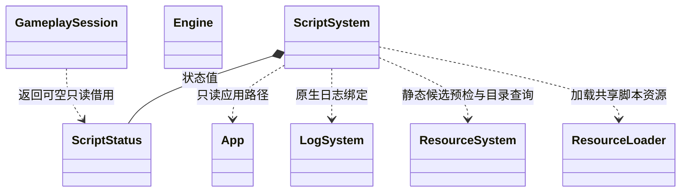

ScriptSystem 由 WorldSystem 独占；GameplaySession 通过核心 ScriptRuntime 契约协调玩法启停、部署候选选择与资源清理，具体 ScriptSystem 插件提供候选预检、运行和重建能力。ScriptStatus 是 ScriptSystem 的值成员，返回借用仅在所属系统存活期间有效，不能跨线程保留使用。

ResourceSystem 的静态读取方法不要求 System、App 或 Engine 已初始化，供脚本、资源同步和 MCP 共用。它通过 SDL3 同步读取普通文件，成功输出由调用者拥有，失败清空；不为调用者创建隐藏的 ResourceSystem 实例。路径、文本和二进制缓冲区的参数依赖见[资源系统](../runtime/class-diagrams/resource-system.md)。

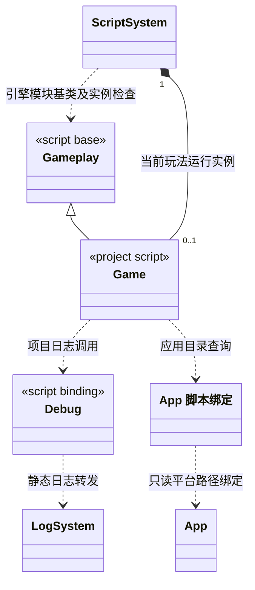

Game 是项目默认导出的 Gameplay 派生类型，是引擎与项目业务之间的胶水。ScriptSystem 持有当前运行的一个 Game 实例；项目可承载业务、组织业务对象，并选择、加载和切换场景。

Node、Component、Scene 支持动态创建和脚本绑定，场景通过 TOML 源资源导入为 FlatBuffers 二进制并加载。图中的 App 脚本绑定是 C++ App 的只读暴露，不是第二个平台所有者；Debug 直接转发原生日志，不新增 C++ Debug 或 Logger 所有者。

V8 平台按进程管理，完整退出前须先销毁全部 isolate。每个实际 ScriptSystem 拥有一个 isolate；单次玩法运行拥有独立 Context、模块缓存和 Game。热重载重建这些玩法对象，不重新初始化整个 V8 平台。具体方法及 SDK 声明见[脚本系统](../plugins/runtime/class-diagrams/script-system.md)和[玩法入口](../runtime/class-diagrams/gameplay.md)。

## MCP 宿主与跨进程文件关系

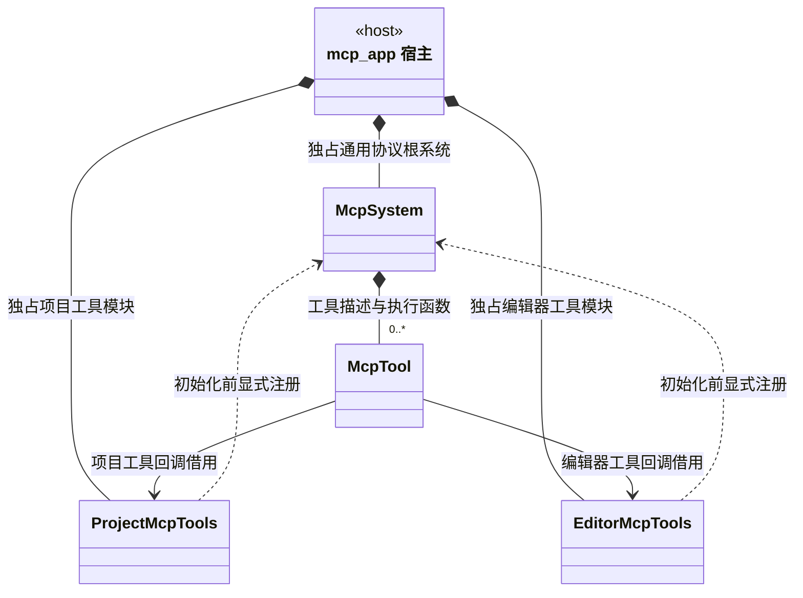

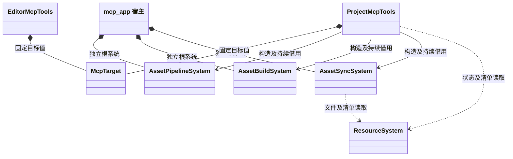

`mcp_app` 接收明确的项目根目录与 McpTarget（本机运行目录，或 adb 序列号和 Android 包名）。资产系统就绪后初始化 ProjectMcpTools，再由各工具模块向 McpSystem 注册，最后初始化并运行协议系统；关闭 MCP 后才销毁业务模块和依赖。ProjectMcpTools 的三个系统引用必须持续有效；McpSystem 自身不要求项目、资产或设备。

McpSystem 只拥有描述、输入参数模型与回调，工具列表和调用共用同一注册表；初始化后冻结列表。业务模块自行处理资源、设备或编辑器通道，不在协议系统累积工具名称分支。独立契约见[协议与注册](../plugins/editor/class-diagrams/mcp-system.md)、[项目工具](../plugins/editor/class-diagrams/project-mcp-tools.md)与[编辑器工具](../plugins/editor/class-diagrams/editor-mcp-tools.md)。

MCP 宿主不创建 Engine、WorldSystem 或 ScriptSystem，也不通过编辑器对象直接执行玩法。它使用项目路径编译资源，使用指定运行目录同步和控制；标准输出只写 JSON-RPC，构建诊断输出到标准错误。MCP 入口不初始化 App 或 LogSystem。

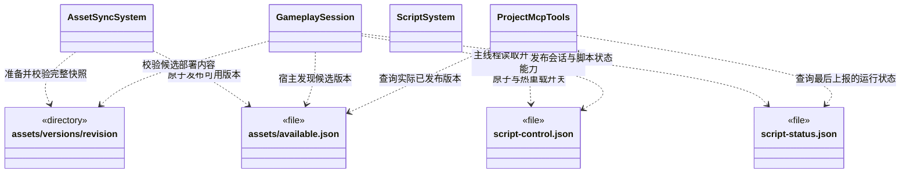

上述文件均位于目标应用的持久数据目录之下，不属于可被系统清理的 App 缓存目录。两个进程无需共享 C++ 对象：

- AssetSyncSystem 准备并校验不可变完整版本，再原子替换 `available.json`。发布成功只表示文件可用，不表示脚本已经激活。
- GameplaySession 检查候选部署清单，ScriptSystem 按入口模块预检；关闭热重载仍可接收独立版本文件及报告可用版本。
- GUID 资源版本固定一份完整 catalog，模块通过 module_path 解析到 GUID；目录中缺失模块即失败，不回退旧包内内容。编辑器直接映射 cache/gen；会覆盖该缓存的构建要求先停止项目。同步已构建的独立运行包不覆盖活动版本。
- 热重载开启后，在运行线程安全点预检候选模块。语法或静态链接失败保留旧 Game；预检通过后停止旧 Game 并执行新入口，执行失败停止此次玩法，不承诺撤销已产生的业务副作用。
- MCP 通过控制文件请求开关，由引擎读取后生效。状态查询独立读取实际发布版本；运行状态来自引擎最后上报，不作为进程实时在线证明。
- 同步使用完整版本快照；相同版本复用已有目录，变化时准备完整批次。Android 通过 adb 与 run-as 发布到 Debug 包，Release 不开放该通路；不提供独立网络服务或差量传输。

资源同步与 MCP 具体契约见[资源同步系统](../plugins/editor/class-diagrams/asset-sync-system.md)及[项目 MCP 工具](../plugins/editor/class-diagrams/project-mcp-tools.md)。

## 项目启停控制文件

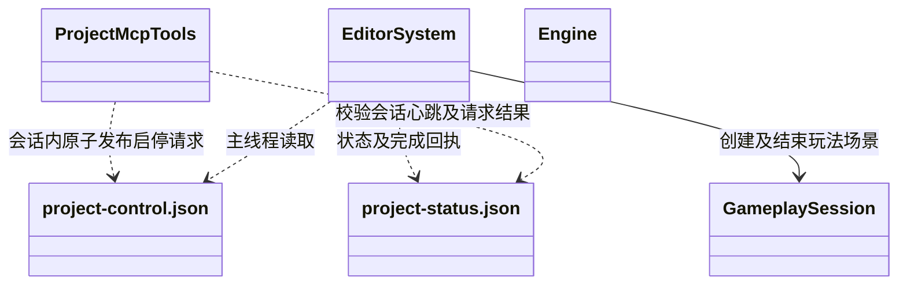

以上文件同样位于 App 持久数据目录。项目控制与脚本热重载控制分开：启动/停止只由编辑器会话消费；同步脚本或打开热重载不会让已停止项目自行启动。启停锁串行化 MCP 发布，旧会话请求不重放，超时返回未确认请求编号。Android 支持全部资源版本同步和热重载；项目启停控制仅由桌面编辑器会话消费。

## 编辑器命令与场景业务

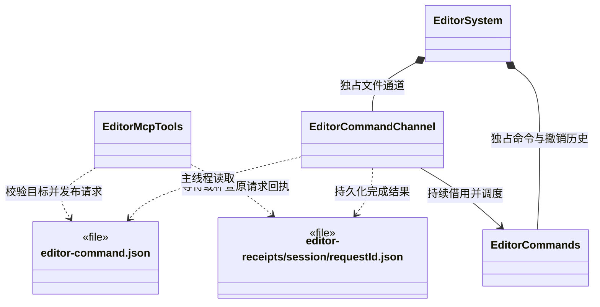

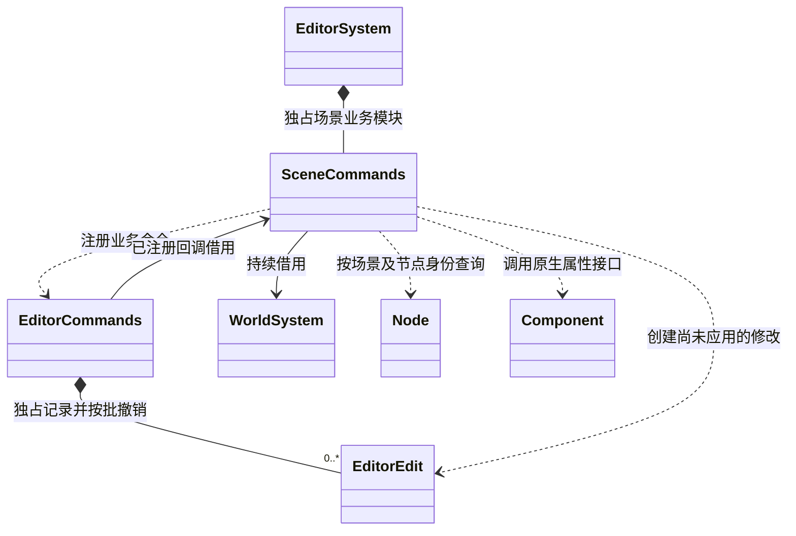

EditorMcpTools 位于工具进程，EditorCommands、SceneCommands 与 EditorCommandChannel 位于编辑器进程。文件请求带项目、会话、请求编号及业务参数；编辑器主线程执行，并保存可补查的原回执。等待超时返回 pending，不表示取消；同会话同请求不重复执行。旧项目启停通道与新编辑命令通道分别维护，不改变 Android 同步协议。

SceneCommands 负责活动场景查询、创建带 Transform 的空节点或相机/灯光节点、活动相机选择，以及 Transform、Camera、Light、材质类型/参数/贴图修改。EditorCommands 管理批量执行、失败回滚和撤销/重做，持有有界批次历史；场景代次变化清空历史。修改记录重查完整节点身份与期望值，避免使用跨场景悬空指针或覆盖脚本的新修改。Node、Component、WorldSystem 不反向依赖 MCP、编辑器命令或 JSON。方法和数据契约只在[编辑器命令图](../editor/class-diagrams/editor-commands.md)维护。

## 公共路径工具

公共 [PathUtils](../runtime/class-diagrams/path-utils.md) 位于 `runtime/utils/`，提供 UTF-8 字符串与文件系统路径之间的静态转换，不继承 System、不持有实例，也不参与生命周期调度。其方法只在独立类图定义。

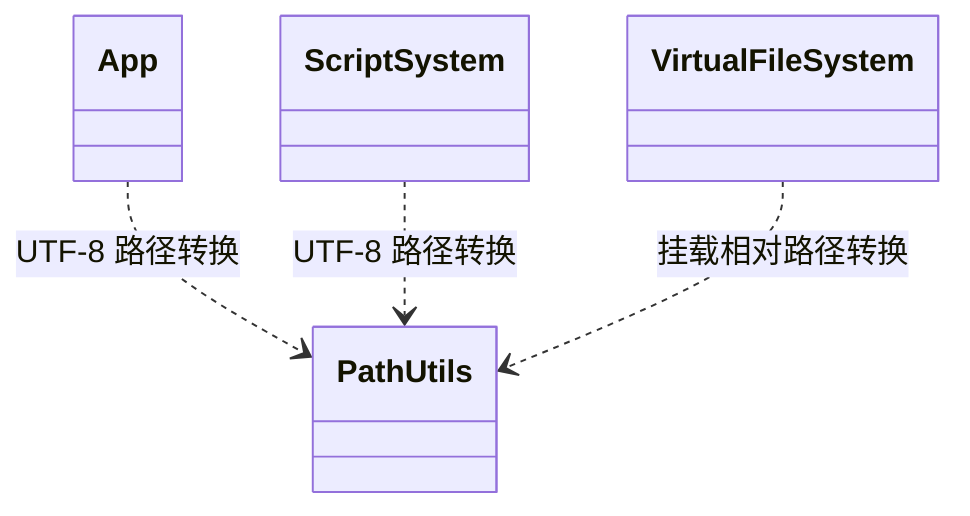

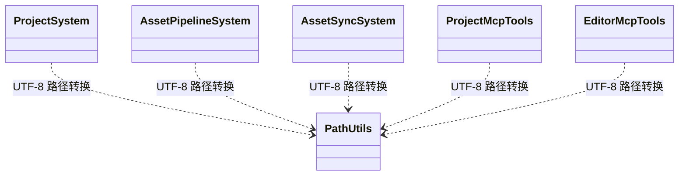

桌面 App 实现、脚本系统、项目系统、资源管线、资源同步、MCP 及编辑器/MCP 宿主使用上述公共转换。转换保留路径内容，不负责路径存在性、规范化或目录越界检查；这些判断继续由使用者完成。

VirtualFileSystem 的 SDL 打开文件操作保留原生 `path.u8string()` 编码，避免改变 Windows 扩展长度路径语义；逻辑相对路径转换仍使用 PathUtils。ResourceSystem 委托 VFS 读取实体范围，宿主与同步工具复用其流式摘要接口。

## System 继承与参数依赖

下列继承与配置关系均已实现，各类公开方法在其独立图中维护：

| 类别               | 直接继承 System 的类型                                                   | 配置与其他参数依赖                                                                             |
| ------------------ | ------------------------------------------------------------------------ | ---------------------------------------------------------------------------------------------- |
| 运行宿主独占根系统 | WindowSystem                                                             | EngineConfig 生命周期参数；由 RuntimeHost 独立管理窗口                                         |
| 引擎根系统         | ResourceSystem、WorldSystem、RenderSystem                                | EngineConfig 生命周期参数；RenderSystem 构造借用 WindowSystem 和可空 WorldSystem               |
| 世界子系统         | PhysicsSystem、NavigationSystem、AnimationSystem、UiSystem、ScriptRuntime | EngineConfig 生命周期参数；实际脚本接口还使用入口字符串及 ScriptStatus                         |
| 独立单例根系统     | LogSystem                                                                | EngineConfig、LogLevel、日志文本；返回日志路径借用                                             |
| 编辑器根系统       | ProjectSystem、EditorSystem                                              | EngineConfig；项目根目录字符串；EditorSystem 构造借用 EditorEnvironment 和可空 GameplaySession |
| 资产工具根系统     | AssetPipelineSystem、AssetBuildSystem、AssetSyncSystem                   | EngineConfig；项目、清单及运行目录 Path；AssetBuildSystem 借用管线                             |
| 运行时插件根系统 | ResourceGraphSystem | EngineConfig；借用 ResourceSystem，实现 ResourceLoader，返回 ResourcePtr |
| 编辑器协议根系统 | McpSystem                                                                | EngineConfig；McpTool 登记值、JSON 参数及 McpCallStatus 返回状态，不依赖项目                   |

App 不参与 System 继承，初始化参数为 AppConfig。McpTarget 是普通配置结构，按值保存运行目录、adb 路径、设备序列号与包名，ProjectMcpTools 与 EditorMcpTools 各自按值保存目标，字段关系见[项目工具图](../plugins/editor/class-diagrams/project-mcp-tools.md)。这两个业务模块以及 EditorCommands、SceneCommands 均不继承 System。ResourceSystem 的同步读取参数使用 Path 与调用者的文本或二进制输出缓冲区；AssetSyncSystem 返回的版本、错误字符串也是所属对象的只读借用。

## 类型登记与框架分派

脚本、组件、资源实体和资源导入分别使用本模块的最小契约。框架组织生命周期或批次，具体类型在自己的文件实现；登记表显式列出实现，不使用 RTTI、宏反射或跨模块 Manager。

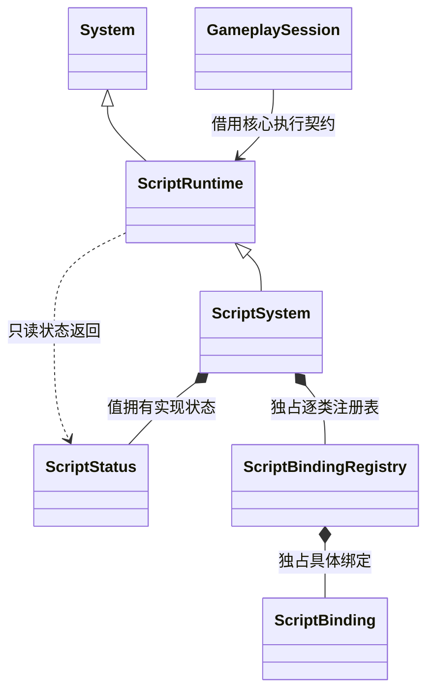

核心边界见 [ScriptRuntime](../runtime/class-diagrams/script-runtime.md)，插件实现与模板登记见 [ScriptSystem](../plugins/runtime/class-diagrams/script-system.md)、[ScriptBindingRegistry](../plugins/runtime/class-diagrams/script-bindings.md)。ScriptRuntimeFactory 是宿主创建函数的别名，不是新增管理器；未提供工厂时核心不创建脚本子系统。

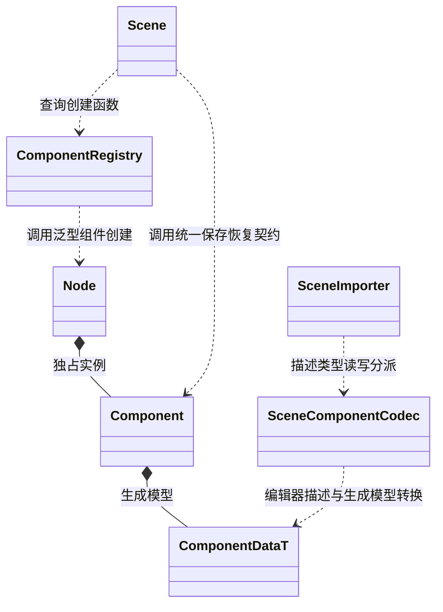

运行时创建与恢复见 [ComponentRegistry](../runtime/class-diagrams/component-registry.md)，编辑器 TOML 转换见 [SceneComponentCodec](../editor/class-diagrams/scene-component-codecs.md)。二者共享 FlatBuffers 生成模型，组件行为不依赖编辑器描述格式。

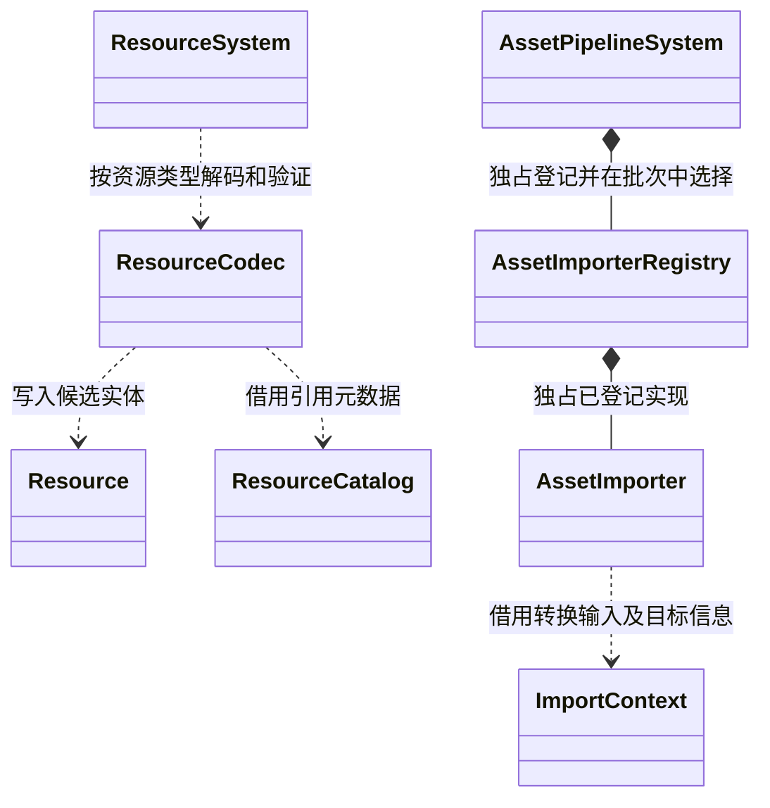

单项资源的类型校验见 [ResourceCodec](../runtime/class-diagrams/resource-codecs.md)，离线依赖、类型指纹和转换见 [AssetImporter](../editor/class-diagrams/asset-importers.md)。资源解码器不加载依赖；导入器不拥有 Taskflow 执行器或 SQLite 发布事务。

建模导入扩展的完整关系见 [ModelingMeshImporter](../plugins/editor/class-diagrams/modeling-mesh-importer.md)：插件继承编辑器 MeshImporter，宿主创建并通过 set_importer 转交管线持有。管线只拥有 AssetImporter 接口，不依赖建模插件目标；销毁管线时释放登记实现。

## 第三方资源拥有关系

```mermaid
classDiagram
    direction TB
    class WindowSystem
    class RenderSystem
    class SDL_Window {
        <<external>>
    }
    class SDL_MetalView {
        <<external>>
    }
    class ANativeWindow {
        <<external>>
    }
    WindowSystem "1" *-- "0..1" SDL_Window : 配对创建和销毁
    WindowSystem --> SDL_Window : 返回借用
    RenderSystem "1" *-- "0..1" SDL_MetalView : Apple 平台拥有视图
    RenderSystem "1" o-- "0..1" ANativeWindow : Android 持有原生引用
    RenderSystem --> WindowSystem : 借用窗口系统
    SDL_Window --> ANativeWindow : 平台属性提供借用
```

```mermaid
classDiagram
    direction TB
    class WorldSystem
    class ecs_world_t {
        <<external>>
    }
    WorldSystem "1" *-- "0..1" ecs_world_t : 配对创建和销毁
```

```mermaid
classDiagram
    direction TB
    class NavigationSystem
    class rcHeightfield {
        <<external>>
    }
    class dtNavMesh {
        <<external>>
    }
    NavigationSystem "1" *-- "0..1" rcHeightfield : 配对分配和释放
    NavigationSystem "1" *-- "0..1" dtNavMesh : 配对分配和释放
```

```mermaid
classDiagram
    direction TB
    class EditorSystem
    class ImGuiContext {
        <<external>>
    }
    EditorSystem "1" *-- "0..1" ImGuiContext : 配对创建和销毁
```

RenderSystem 借用 SDL 窗口和原生句柄，拥有 bgfx 初始化状态及 Apple Metal view；Android 通过 acquire/release 持有原生窗口引用，在 bgfx 完全关闭后释放，不独占 Android 窗口对象。

WorldSystem、NavigationSystem、EditorSystem 分别拥有图中的第三方实例并调用配对销毁接口。VirtualFileSystem 每次读取或计算摘要时拥有一个局部 SDL_IOStream，读取结束必须关闭；App 与 LogSystem 分别拥有平台路径值和日志文件。初始化期间的局部依赖检查对象不构成持久拥有关系。

## 实际编译与链接依赖

| 引擎类或宿主工具      | 使用依赖                                                                                                                                      | 当前用途                                               |
| --------------------- | --------------------------------------------------------------------------------------------------------------------------------------------- | ------------------------------------------------------ |
| PathUtils             | 标准库文件系统与字符串                                                                                                                        | UTF-8 路径编码转换                                     |
| App                   | SDL3、PathUtils、标准库文件系统                                                                                                               | 桌面与 Android 平台目录及逻辑 APK 根                   |
| LogSystem             | System、App、标准库线程与文件接口                                                                                                             | 进程日志、写盘、刷新和轮换                             |
| WindowSystem          | SDL3                                                                                                                                          | 窗口、事件及平台生命周期                               |
| VirtualFileSystem     | SDL3、PathUtils                                                                                                                               | 挂载、文件范围读取与流式摘要，统一处理 APK 内置路径    |
| ResourceCatalog       | FlatBuffers、GuidMap                                                                                                                          | 纯元数据目录、身份索引与依赖校验                       |
| Resource              | FlatBuffers、标准库共享指针                                                                                                                   | 单项实体、目录代际与生成数据                             |
| ResourceSystem        | VirtualFileSystem、ResourceCatalog、Resource、FlatBuffers、Basis Universal                                                                    | 目录原子换代、单项加载、接口借用及转码表初始化       |
| ResourceGraphSystem | ResourceLoader、ResourceSystem、标准库共享与弱指针 | 同代际依赖加载、共享缓存及反向释放 |
| WorldSystem           | flecs、FlatBuffers、Scene                                                                                                                     | ECS 世界、场景与节点身份生命周期                       |
| RenderSystem          | bgfx、bx、SDL3、WorldSystem                                                                                                                   | 图形设备、场景组件读取、PBR 方块与帧提交               |
| PhysicsSystem         | Jolt                                                                                                                                          | 版本一致性入口                                         |
| NavigationSystem      | Recast、Detour                                                                                                                                | 高度场与导航网格资源                                   |
| AnimationSystem       | ozz-animation                                                                                                                                 | 空骨骼构造和析构                                       |
| UiSystem              | RmlUi                                                                                                                                         | 运行库版本入口                                         |
| ScriptRuntime | System、ResourceCatalog、ResourceMount、ScriptStatus | 核心声明的五方法执行契约，无语言实现或 V8 链接 |
| ScriptSystem 插件 | V8、SDL3、nlohmann/json、App、LogSystem、ResourceSystem、PathUtils、WorldSystem                                                               | JS 模块预检与执行、原生绑定、玩法生命周期及状态        |
| GameplaySession       | ScriptRuntime、ResourceSystem、VirtualFileSystem、WorldSystem、RenderSystem、App、nlohmann/json                                                | 宿主会话、候选版本预检、资源释放和目录提交、热重载调度 |
| ProjectSystem         | toml++、LogSystem、PathUtils                                                                                                                  | 项目目录检查及日志                                     |
| EditorEnvironment     | ProjectSystem、App、GameplaySession、ResourceSystem、LogSystem、PathUtils                                                                     | 编辑器路径映射、活动缓存租约与目录提交                 |
| EditorSystem          | Dear ImGui、EditorEnvironment、GameplaySession、EditorCommands、SceneCommands、App、ResourceSystem、LogSystem、PathUtils、SDL3、nlohmann/json | 编辑器上下文、主线程命令、项目启停与状态回执           |
| EditorCommands        | 标准函数及独占指针、nlohmann/json                                                                                                             | 命令登记、批量执行及撤销/重做历史                      |
| SceneCommands         | WorldSystem、Scene、Node、Transform、Light、Material、EditorEdit                                                                              | 场景业务校验与字段修改记录                             |
| EditorCommandChannel  | EditorCommands、ResourceSystem、PathUtils、SDL3、nlohmann/json                                                                                | 编辑器会话请求、持久回执和重复请求防护                 |
| AssetPipelineSystem   | USD、Taskflow、SQLite、efsw、meshoptimizer、SDL3、PathUtils                                                                                   | Taskflow 并行导入、SQLite 增量索引、资源转换及 TS 编译 |
| AssetBuildSystem      | AssetPipelineSystem、ResourceCatalog、ResourceSystem、toml++                                                                                  | 项目清单、运行依赖闭包、增量散文件或合并包及运行目录   |
| AssetSyncSystem       | nlohmann/json、SDL3、ResourceSystem、VirtualFileSystem、PathUtils                                                                             | 完整版本校验与原子发布                                 |
| McpSystem             | System、nlohmann/json、标准函数对象                                                                                                           | stdio 协议、工具注册、参数检查与调用                   |
| ProjectMcpTools       | McpSystem、nlohmann/json、SDL3、ResourceSystem、AssetPipelineSystem、AssetBuildSystem、AssetSyncSystem、PathUtils                             | 项目工具注册、清单构建、资源同步、运行控制及状态       |
| EditorMcpTools        | McpSystem、ProjectLock、ResourceSystem、PathUtils、SDL3、nlohmann/json                                                                        | 编辑器工具注册、跨进程命令提交与回执查询               |
| TS 构建工具           | Node.js、项目固定版本 TypeScript                                                                                                              | settings 中配置，assets 中源码，cache 中生成物         |
| 资源构建工具          | shaderc、texturec、geometryc                                                                                                                  | 宿主工具，不进入运行时生命周期                         |

Engine 与运行时系统不拥有 ProjectSystem、EditorSystem、AssetPipelineSystem、AssetBuildSystem、AssetSyncSystem 或 McpSystem，也不反向依赖离线编译器或具体项目。工具可以复用运行时的静态资源读取能力，运行时仍只消费部署内容。

脚本模块内部的绑定接口、独占注册表、逐类实现及每个 Run 的上下文关系见[绑定类图](../plugins/runtime/class-diagrams/script-bindings.md)。ScriptSystem 通过注册表装配，不直接维护所有类的绑定实现。

## 资源身份与导入依赖

```mermaid
classDiagram
    direction TB
    class GuidMap
    class ResourceCatalog
    class ResourceSystem
    class AssetPipelineSystem
    class TaskSystem
    class AssetImporter
    class SceneAssetImporter
    class SceneImporter
    class ScriptSystem
    class System
    System <|-- TaskSystem
    AssetPipelineSystem *-- TaskSystem : 独占导入子系统
    AssetPipelineSystem ..> GuidMap : 源文件逻辑路径与身份校验
    AssetPipelineSystem ..> AssetImporter : 调度已登记类型
    AssetImporter <|-- SceneAssetImporter
    SceneAssetImporter ..> SceneImporter : TOML 转场景数据
    AssetPipelineSystem ..> ResourceSystem : 同步读取及产物校验
    ResourceCatalog *-- GuidMap : 值拥有双向索引
    ResourceSystem *-- ResourceCatalog : 元数据目录
    ScriptSystem ..> ResourceCatalog : 候选预检输入
```

GuidMap 属于纯标准库核心模块；Taskflow、SQLite、toml++ 仅用于编辑器导入，不进入设备运行时。完整数据结构与公开方法见对应独立图。源资源 meta、SQL 中的身份和运行期目录使用同一完整 GUID，生成路径固定为 `cache/gen/<GUID>`。

## 资源调用关系

方法只在[资源独立类图](index.md#资源系统)维护；本节说明跨层调用方向。

```mermaid
classDiagram
    direction TB
    class EditorHost["编辑器宿主"] {
        <<host>>
    }
    class RuntimeHost["运行宿主"] {
        <<host>>
    }
    class AssetPipelineSystem
    class AssetBuildSystem
    class ResourceSystem
    EditorHost *-- AssetPipelineSystem : 全量扫描与增量导入
    EditorHost *-- AssetBuildSystem : 可选发布打包
    AssetBuildSystem --> AssetPipelineSystem : 借用导入能力
    EditorHost ..> ResourceSystem : 直接更新完整目录
    RuntimeHost ..> ResourceSystem : 真机启动提交精简目录一次
```

运行宿主节点表示平台入口与现有 RuntimeHost 的装配流程，不为运行时添加项目扫描或编辑器配置。ResourceSystem 可由 Engine 拥有，或由外部可执行宿主初始化后借给 RuntimeHost；编辑器无需调用 AssetBuildSystem 即可运行项目。核心没有反向箭头指向编辑器。

```mermaid
classDiagram
    direction TB
    class ProjectMcpTools
    class AssetBuildSystem
    class AssetSyncSystem
    class AssetCatalogDataT
    ProjectMcpTools --> AssetBuildSystem : 调用清单构建
    ProjectMcpTools --> AssetSyncSystem : 调用显式部署
    AssetBuildSystem ..> AssetCatalogDataT : 生成统一运行清单
    AssetSyncSystem ..> AssetCatalogDataT : 按完整清单准备输出
```

MCP 的构建、部署、项目启停仍是不同操作。同步成功仅说明候选资源已准备，应用由编辑器或运行宿主协调；核心不轮询发布文件。正常真机运行不自行扩展资源集合。

```mermaid
classDiagram
    direction TB
    class ResourceSystem
    class ResourceCatalog
    class GuidMap
    class VirtualFileSystem
    class Resource
    ResourceSystem *-- ResourceCatalog : 独占元数据目录
    ResourceCatalog *-- GuidMap : 独占身份索引
    ResourceSystem *-- VirtualFileSystem : 独占存储映射
    class ResourceLoader
    class ResourceGraphSystem
    class ResourceBundle["Bundle（插件私有）"]
    ResourceLoader <|-- ResourceSystem
    ResourceLoader <|-- ResourceGraphSystem
    ResourceSystem --> ResourceLoader : 借用宿主指定实现
    ResourceSystem ..> Resource : 单项读取解析
    ResourceGraphSystem --> ResourceSystem : 借用底层和代际
    ResourceGraphSystem --> Resource : weak别名缓存不保活
    ResourceBundle o-- Resource : 当前资源与直接依赖
    ResourceGraphSystem ..> ResourceBundle : 创建共享所有权组
```

Scene、Material、MeshRenderer 与脚本运行持有实际使用对象的共享引用，关系见[领域使用者](../runtime/class-diagrams/resource-system.md#领域使用者)。资源清单借用仅在下次更新前有效，已加载对象独立保存元数据及代际。合法更新原子切换目录；新请求使用新代际，旧 ResourcePtr 和旧依赖闭包保留至引用释放。插件输出 ResourcePtr 以别名构造保活 Bundle，最后引用释放时先销毁本项再反向释放依赖。RenderSystem 继续独立管理 GPU 生命周期。

## 贴图与渲染基础

```mermaid
classDiagram
    class AssetPipelineSystem
    class AssetImporter
    class TextureImporter
    class ResourceSystem
    class Resource
    class TextureDataT
    class Material
    class MeshRenderer
    class MeshUtils
    class RenderSystem
    AssetPipelineSystem ..> AssetImporter : Taskflow任务通过统一接口调用
    AssetImporter <|-- TextureImporter
    TextureImporter ..> TextureDataT : BasisU缓存
    Resource *-- TextureDataT : 贴图载荷独占
    ResourceSystem ..> MeshUtils : 几何验证
    MeshRenderer ..> MeshUtils : 动态几何验证
    MeshRenderer *-- Material : 独占多个材质槽
    Material o-- Resource : 当前具名纹理共享引用
    RenderSystem o-- Resource : GPU纹理生命周期保活
    RenderSystem ..> MeshUtils : 切线生成
```

同一 Resource 身份只创建一份 GPU 纹理，释放最后一个场景使用者后销毁；网格提交通过节点身份和修订号发现变化。无资源读取、GPU句柄或导入策略进入 Engine 类。编辑器 TextureEdit 的撤销历史保存资源元数据值，不持有资源强引用。

## 建模三层引用关系

| 调用方/所有者 | 被调用/被拥有对象 | 关系与有效期 |
| --- | --- | --- |
| editor_app 宿主 | ModelingCommands | 独占；先于命令注册创建，晚于命令与撤销历史释放销毁 |
| ModelingCommands | WorldSystem | 借用；仅编辑器主线程访问，场景切换使旧模型身份失效 |
| ModelingCommands | EditableMeshDataT | 独占模型及操作前后快照；不借用临时序列化内存 |
| ModelingCommands | EditorCommands / EditorEdit | 注册模块命令；编辑记录交命令历史独占 |
| ModelingCommands | MeshPrimitives / MeshTopology / MeshGeometry / EditableMesh | 调用纯数据计算，无反向依赖 |
| EditableMesh | EditableMeshDataT / MeshDataT | 输入生成模型，输出独立渲染网格；没有场景/编辑器状态 |
| MeshGeometry | Manifold | 实体运算，检查返回状态；不对外暴露第三方类型 |
| EditableMesh | Earcut | 多边形三角化；输入验证及编译由建模核心负责 |
| ModelingCommands | MeshRenderer | 通过节点查询借用；只提交完整有效的新网格 |
| ModelingMcpTools | EditorMcpTools | 借用固定项目及会话通道，转发请求与完成回执 |
| ModelingMcpTools | McpSystem | 登记工具描述、参数模型和借用回调，适配器存活到服务关闭 |
| editor_app / asset_build_app / mcp_app 宿主 | ModelingMeshImporter | 按已启用目标创建插件导入器，通过 set_importer 转交资源管线 |
| AssetPipelineSystem | AssetImporterRegistry / AssetImporter | 独占登记与导入器接口；不引用具体建模插件，GUID/meta 与缓存发布仍归管线 |
| ModelingMeshImporter | MeshImporter / EditableMesh | 继承编辑器普通网格导入器；权威建模源由插件几何层编译为运行时 MeshData |

建模计算核心、场景业务和 MCP 适配均位于 `plugins/editor/modeling/`，插件内部按计算与调用边界分别编译。MCP 适配只调用工具通道，不直接引用几何接口；工具宿主提供资源构建时仍会通过导入管线链接几何编译能力。几何目标不依赖编辑器状态或 MCP，运行时场景、组件和渲染器不引用任何建模编辑器类型。


## 场景持久化与渲染编辑

| 调用方/所有者 | 被调用/被拥有对象 | 关系与有效期 |
| --- | --- | --- |
| editor_app 宿主 | ScenePersistence / RenderCommands | 独占装配；先注册命令，先释放命令及历史再销毁业务对象 |
| ScenePersistence | WorldSystem | 借用活动场景；读取 NodeInfo、组件生成数据及活动相机，构造独立 SceneDataT 快照 |
| ScenePersistence | MeshSourceWriter | 按值持有宿主注入的函数；函数借用 ModelingCommands，后者的生命期覆盖持久化对象 |
| ScenePersistence | SceneImporter / asset_pipeline 身份 helper | 场景 TOML 发布和相邻 meta 校验；失败回滚源文件，不更新运行目录 |
| ScenePersistence | Material / ResourceSystem | 读取当前全部材质槽、可公开参数和贴图，解析 Shader/Texture GUID；不向核心加入保存策略 |
| ModelingCommands | Node / MeshRenderer | export_mesh 保存已管理的多边形源；普通渲染网格可转换为编辑源，场景重载按项目路径恢复源数据 |
| RenderCommands | RenderSystem | 借用渲染设置与截图接口；编辑器负责撤销、截图根目录、越界检查及输出目录创建 |
| RenderMcpTools | EditorMcpTools | 借用固定目标通道，只提交渲染命令并返回原回执，不直接操作 GPU 或 PNG |
| RenderMcpTools | McpSystem | 注册 get_render_settings、set_render_settings、capture_frame、get_frame_capture |
| RenderSystem | Material / ShaderDataT | 通过 Material::shader_data 借用材质持有的定义，不依赖插件缓存查询 |
| RenderSystem | RenderSettings / RendererCallbacks | 拥有当前配置及 bgfx 回调；GPU 资源、阴影和实际帧 PNG 输出属于渲染系统 |

```mermaid
classDiagram
    class ScenePersistence
    class ModelingCommands
    class EditorHost
    class MeshSourceWriter
    class WorldSystem
    class SceneImporter
    class EditorCommands
    class EditorMcpTools
    class RenderCommands
    class RenderMcpTools
    class RenderSystem
    ScenePersistence --> WorldSystem : 借用场景
    EditorHost ..> ModelingCommands : 创建建模业务并绑定方法
    EditorHost ..> ScenePersistence : 创建并注入网格回调
    ScenePersistence *-- MeshSourceWriter : 持有函数契约
    ScenePersistence ..> SceneImporter : 发布场景快照
    ScenePersistence ..> EditorCommands : 注册保存命令
    EditorMcpTools ..> EditorCommands : 文件命令通道
    RenderMcpTools --> EditorMcpTools : 借用固定目标通道
    RenderCommands ..> EditorCommands : 注册设置与截图命令
    RenderCommands --> RenderSystem : 借用运行时渲染能力
```

方法契约分别维护在[场景持久化](../editor/class-diagrams/scene-persistence.md)、[渲染编辑命令](../editor/class-diagrams/render-commands.md)和[渲染 MCP](../plugins/editor/class-diagrams/render-mcp-tools.md)。场景保存是编辑器文件业务，RendererCallbacks 属于运行时渲染，MCP 只提供可发现的调用入口；三者不进入 Engine 框架类。

`EditorHost` 表示编辑器入口程序，`MeshSourceWriter` 是 `std::function` 类型别名。宿主提供的闭包借用 ModelingCommands，宿主先释放编辑器命令和持久化回调，再销毁建模对象；ScenePersistence 本身不依赖任何插件类型。

截图命令被接受与文件完成分开：编辑器命令回执完成后仍须查询渲染截图状态，只有 complete 表示 PNG 已写入。阴影只支持首个启用方向光的单张 PCF 阴影图，不包含级联、点光/聚光阴影或 IBL。建模的部分几何输入仍有限制，不能根据可经 MCP 全程操作便声称 ProBuilder/UModeler 已完整等价。
