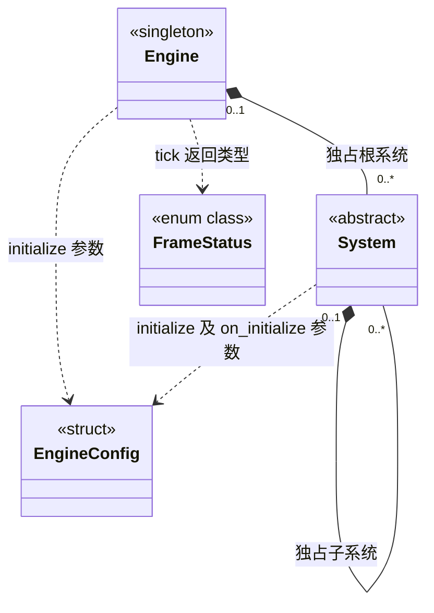
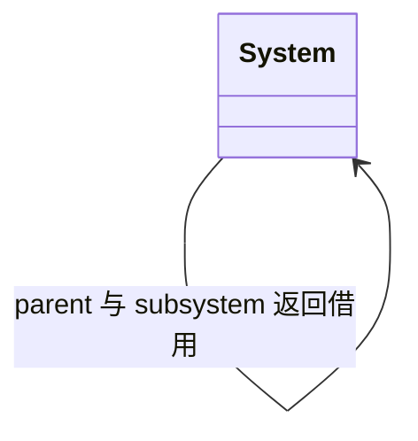
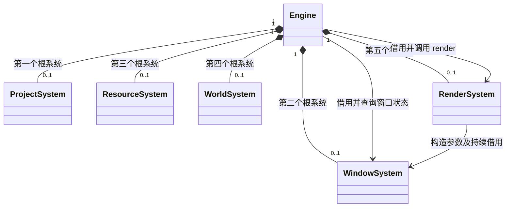
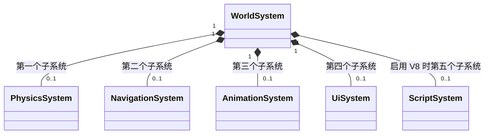
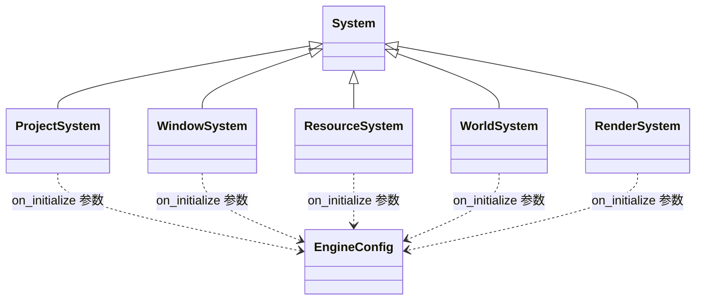
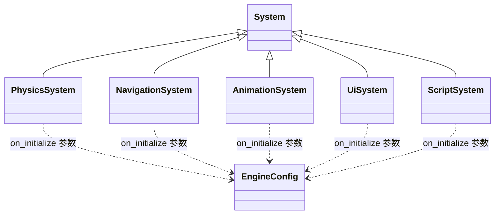
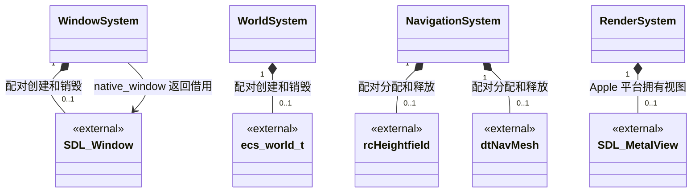
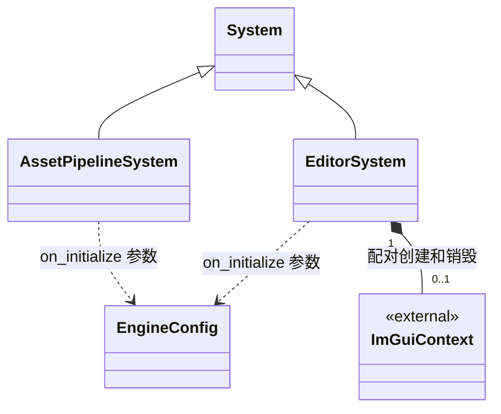

# 完整引用关系

[类图索引](index.md)

状态：与本轮最小实现同步。为避免单幅图缩得难以阅读，按拥有层级和依赖范围拆分；同名节点连接同一个类。方法和字段只在各自独立图维护。

## 引擎与生命周期

每个系统只能有一个拥有者：引擎、一个父系统，或独立宿主。`add_subsystem()` 成功接管传入对象；`subsystem()` 和 `parent()` 返回借用。公开生命周期只调度根系统，子系统由父系统递归调度。

借用关系单独绘制，避免 Mermaid 把同一类型的两条自引用边合并覆盖：

## 运行时根系统

根系统按图中顺序初始化、反序关闭；每帧窗口事件优先，随后更新其他根系统，最后提交渲染。`RenderSystem` 不拥有窗口系统，窗口必须存活到渲染系统销毁之后。

## 世界拥有的子系统

`Engine` 负责创建和装配这些对象；所有权通过 `System::add_subsystem()` 转入 `WorldSystem`，不再由 `Engine` 的根系统容器拥有。

## 继承与配置参数

## 第三方资源的所有权与借用

`RenderSystem` 通过窗口系统借用 SDL 窗口及原生句柄，拥有 bgfx 初始化状态和 Apple 平台的 Metal view。其他模块初始化时创建的局部检查对象在函数结束后释放，不构成持久成员拥有关系。

## 运行时库依赖

| 引擎类 | 使用依赖 | 关系说明 |
| --- | --- | --- |
| `ProjectSystem` | toml++ | 配置表结构验证；同时用标准库检查项目根目录及 settings、cache、assets |
| `WindowSystem` | SDL3 | 初始化、窗口、事件、销毁 |
| `ResourceSystem` | FlatBuffers、Basis Universal | 解析入口与转码表初始化 |
| `WorldSystem` | flecs | 创建、推进和销毁 ECS 世界 |
| `RenderSystem` | bgfx、SDL3 | 图形设备、平台窗口查询及帧提交 |
| `PhysicsSystem` | Jolt | 版本一致性入口 |
| `NavigationSystem` | Recast、Detour | 高度场与导航网格资源 |
| `AnimationSystem` | ozz-animation | 空骨骼构造和析构 |
| `UiSystem` | RmlUi | 运行库版本入口 |
| `ScriptSystem` | V8 | 可选构建，运行库版本入口 |

以上均为使用依赖；库不是被引擎销毁的对象。每条依赖在对应[独立类图](index.md)中绘制。

## 独立宿主模块

| 宿主类或工具 | 使用依赖 | 所有权及边界 |
| --- | --- | --- |
| `EditorSystem` | Dear ImGui | 宿主拥有根系统，系统拥有上下文 |
| `AssetPipelineSystem` | USD、Taskflow、SQLite、efsw、meshoptimizer | 宿主拥有根系统，当前库检查对象均为局部资源 |
| 资源构建工具 | shaderc、texturec、geometryc | 宿主可执行程序，不在运行时生命周期中 |

`Engine` 和各运行时系统不拥有、不引用这两个宿主系统。共享资源数据依赖可以由宿主工具再次使用，不引入运行时到离线导入器的反向依赖。
