# 完整引用关系

[类图索引](index.md)

状态：与当前桌面和 Android 玩法脚本、日志、资源同步和 MCP 实现同步。下图只维护拥有、借用、调用及参数类型关系；方法和字段在各自独立类图维护。同名节点指向同一个类型，宿主节点表示入口程序，不是新增 C++ 架构类。

## 构建边界

代码和独立类图按职责使用相同分层：

| 范围 | 头文件与实现位置 | 文档位置 |
| --- | --- | --- |
| 运行时 | `include/engine/runtime/`、`src/engine/runtime/` | `docs/runtime/` |
| 编辑器 | `include/engine/editor/`、`src/engine/editor/` | `docs/editor/` |
| 插件 | `include/engine/plugins/`、`src/engine/plugins/` | `docs/plugins/` |

各范围独立类图位于其 `class-diagrams/` 子目录。平台入口与平台专用实现仍放在 `platforms/<platform>/`；TS 声明集中在 [include/engine.d.ts](../../include/engine.d.ts)。自有头文件从 `runtime/`、`editor/` 或 `plugins/` 开始引用。编辑器和 MCP 可以使用运行时公共能力，运行时不反向依赖这些工具模块。

| 配置 | ScriptSystem 的实际职责 | 宿主与平台边界 |
| --- | --- | --- |
| `ENGINE_ENABLE_V8=OFF` | 不装配脚本子系统 | 引擎仍可独立启动窗口 |
| V8 开启，`ENGINE_ENABLE_SCRIPT_RUNTIME=OFF` | 编译 `script_system_probe.cpp`，仅调用 V8 版本入口验证链接 | 可选的依赖验证配置，不执行项目玩法 |
| V8 与脚本运行均开启 | 编译实际 V8 运行实现，创建 isolate、加载 JS、绑定 API、运行及重载 Game | 桌面和 Android 共用脚本系统；Android 读取 APK 与持久版本 |
| 桌面脚本运行与资源管线均开启 | 可构建独立 `mcp_app` | 工具进程通过本机目录或指定 adb 设备和包交换文件 |

Android 普通启动使用完整 ScriptSystem 运行项目玩法；V8 JNI 冒烟测试仍为显式触发的独立验证路径，切换测试前须停止旧进程。具体 Activity、Surface 与测试边界见[Android 宿主](../runtime/class-diagrams/android-host.md)。

## 引擎与系统所有权

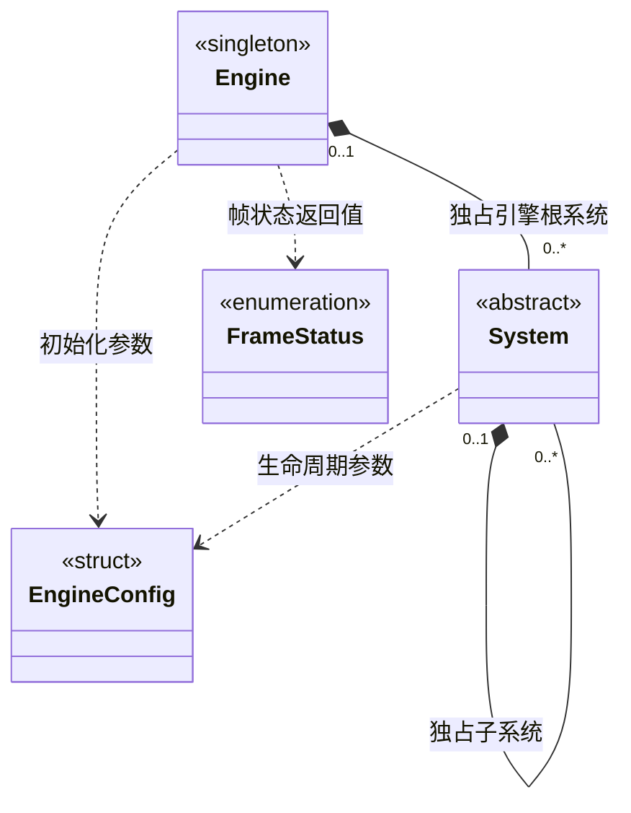

一个 System 对象只由引擎、父系统或独立宿主管理。`add_subsystem()` 成功后转移独占所有权；`parent()` 和 `subsystem()` 只返回借用。公开生命周期只接受根系统调度，子系统由父系统递归管理。

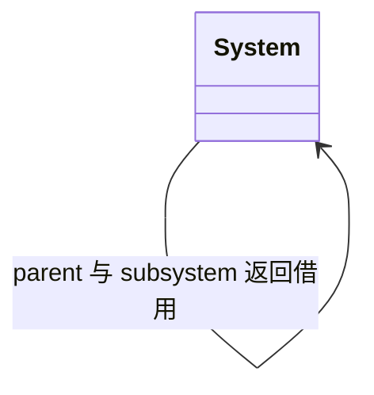

App 是静态平台门面，不继承 System。LogSystem 是进程单例及独立根系统，由宿主借用和调度，不进入 Engine 的独占系统数组。Gameplay、Game、Debug 属于脚本接口，不继承 C++ System。

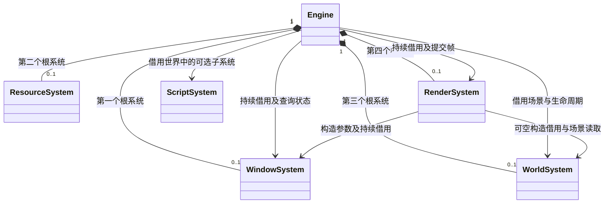

根系统初始化顺序为 Window → Resource → World → Render，关闭时反序处理。Engine 对窗口、渲染和可选脚本系统持有非拥有指针；ScriptSystem 仍属于 WorldSystem。RenderSystem 借用窗口，窗口必须存活到渲染系统退出之后。

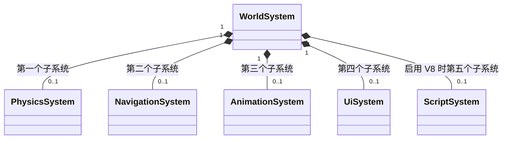

Engine 创建并装配各子系统，所有权经 System 转入 WorldSystem。父系统的更新先于子系统；当前世界推进之后才执行脚本更新。启用 V8 时即装配 ScriptSystem，具体是探针还是完整运行实现由上表区分。

每帧先处理窗口事件，再更新其余根系统，最后提交渲染。窗口暂停时不继续执行资源、世界和脚本更新；编辑器在 Engine::tick 前处理项目启停，因此暂停不阻断停止请求。外部工具仍可发布文件，脚本版本切换等待恢复后的运行线程安全点。

## 场景对象、组件及渲染引用

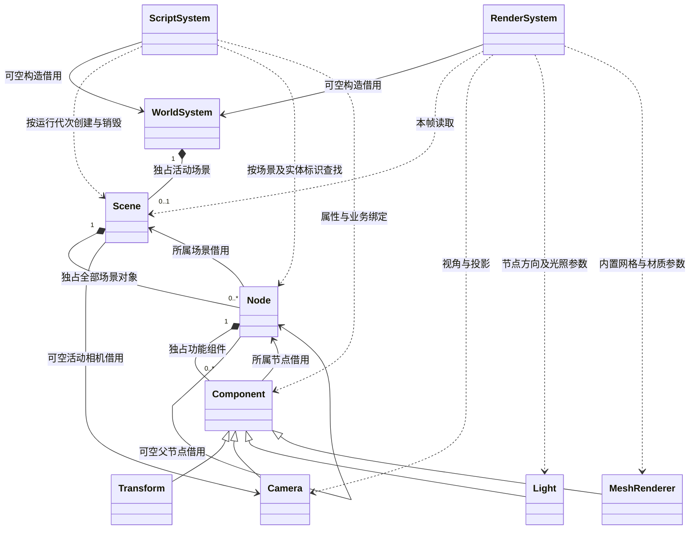

场景中的全部对象必须使用节点和组件表达。Scene 是容器，Gameplay 是场景外项目入口；Material 与 Shader 是组件数据/渲染资源，不另形成场景对象。Node 的身份来自 flecs 完整实体标识，只管理生成的 NodeInfo 与通用组件列表。局部变换由 Transform 组件持有，世界矩阵按父链上的 Transform 计算；Node 不枚举具体组件类型。场景、节点与组件以 FlatBuffers schema 为统一跨语言数据模型，组件行为直接操作生成对象；完整序列化模型只在构建内存快照时组装。材质通过类型定义和命名参数设置。ScriptSystem 的 JS 句柄保存运行/场景代次与实体标识，每次调用重新验证，停止或重载后不能访问已销毁对象。

ResourceSystem 深拷贝注册 FlatBuffers 生成的 ShaderDataT / MaterialDataT，完整路径以 builtin/ 或 project/ 区分内置与项目。Material 引用 MeshRenderer 的生成数据，按 Shader 定义匹配命名参数。RenderSystem 从资源系统借用定义，拥有本次场景使用的顶点/索引缓冲、Shader、Program、Uniform；组件仅提供描述。切换场景、停止运行或图形设备重建时配对释放，图形设备本身可在编辑器待机期间保留。项目停止在场景和 GPU 资源释放后清理 project 定义，builtin 定义随资源系统关闭。参数、返回值和配置数据关系分别在[场景](../runtime/class-diagrams/scene.md)、[节点](../runtime/class-diagrams/node.md)、[组件](../runtime/class-diagrams/component.md)与[渲染](../runtime/class-diagrams/render-system.md)中维护。

## App 与日志

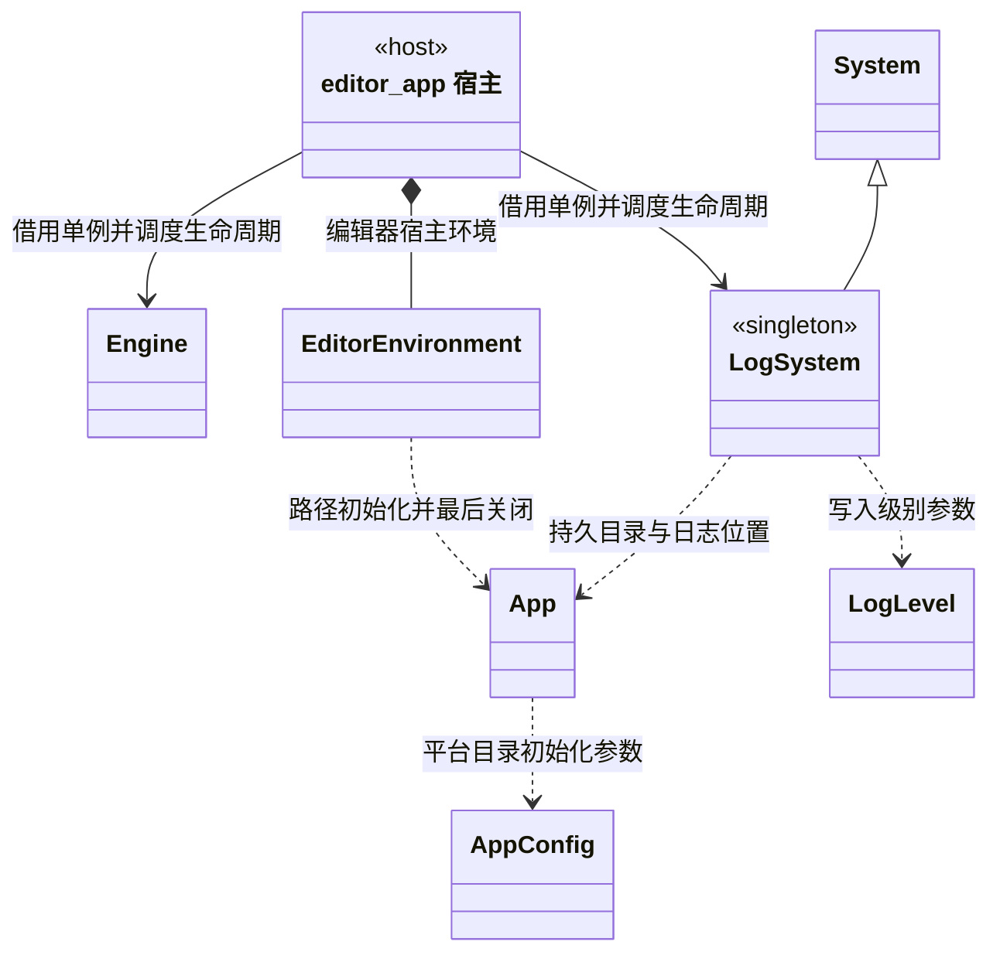

App 和 LogSystem 的生命周期由宿主负责，Engine 不反向拥有它们，也不因此获得项目依赖。AppConfig 只提供应用名及平台目录覆盖值，EngineConfig 继续只表示引擎运行配置。

App 的三个路径访问器返回内部 `std::filesystem::path` 的只读借用；LogSystem 同样借用 App 的持久目录，并拥有日志文件。日志默认写入持久目录的 `logs/engine.log`，同时输出标准错误。宿主必须先停止所有日志使用者，再刷新、关闭 LogSystem，最后关闭 App。

目录语义、失败状态和日志轮换分别见 [App](../runtime/class-diagrams/app.md) 与[日志系统](../runtime/class-diagrams/log-system.md)。内置资源根由资源系统解释；Android APK 使用逻辑路径，普通磁盘 canonical 只用于可写版本和桌面文件。

## 编辑器宿主拥有的独立系统

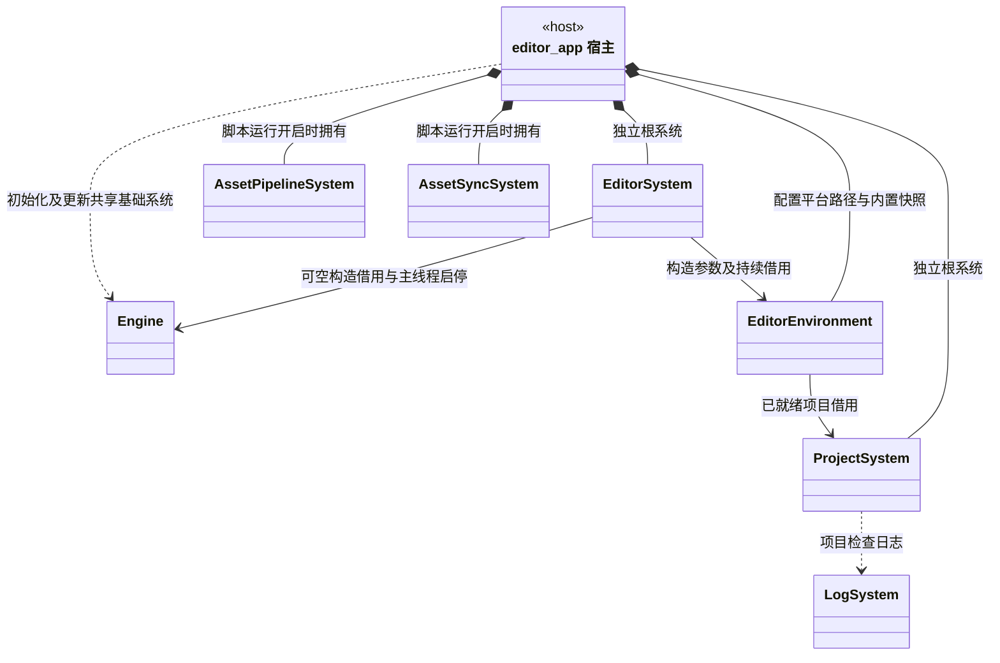

ProjectSystem、EditorSystem、AssetPipelineSystem、AssetSyncSystem 均为宿主拥有的独立根系统。EditorSystem 借用已初始化的 EditorEnvironment，环境借用 ProjectSystem；项目和环境必须保持就绪直到编辑器退出。ProjectSystem 没有路径 getter；运行时读取 App 路径，环境的私有项目身份仅用于会话回执。

当前 AssetSyncSystem 属于编辑器或工具宿主，未挂入 ResourceSystem 子系统树。它使用 ResourceSystem 的静态读取入口，不拥有 ResourceSystem 实例，也不调用 ScriptSystem。独立类图见[项目](../editor/class-diagrams/project-system.md)、[编辑器](../editor/class-diagrams/editor-system.md)、[资源管线](../editor/class-diagrams/asset-pipeline-system.md)、[资源同步](../editor/class-diagrams/asset-sync-system.md)。

启用完整脚本运行时，`editor_app` 启动顺序为：

1. 解析项目与运行目录，初始化 ProjectSystem，检查项目根目录及 `settings/`、`cache/`、`assets/`。失败时尚未打开引擎窗口。
2. 初始化 EditorEnvironment，由环境配置 App 路径，然后初始化 LogSystem。
3. 初始化 AssetPipelineSystem 及其 TaskSystem 子系统，按项目导入线程设置转换资源，生成 `cache/gen/<完整 GUID>` 与资源目录；SQLite 索引留在 cache。
4. 由 EditorEnvironment 从生成内容建立本会话只读内置快照，初始化 AssetSyncSystem 并发布完整初始版本。
5. 初始化 Engine 全部根系统及子系统，再初始化 EditorSystem。
6. 编辑器发布新会话状态，保持空白等待 MCP；收到本会话 start_project 后，调用 Engine 玩法入口，经 ScriptSystem 创建 Game 与场景，再准备 GPU 资源。

关闭顺序为：先结束 Game 回调，再关闭 EditorSystem、Engine、AssetSyncSystem、AssetPipelineSystem；刷新并关闭 LogSystem，由 EditorEnvironment 清理内置快照并关闭 App，最后关闭 ProjectSystem。中途失败按已成功初始化部分清理。

Engine 内部也在销毁 RenderSystem 之前调用停止玩法，因此 Game 的退出回调仍能使用存活的引擎系统。完整脚本运行关闭时，编辑器跳过编译、同步和玩法启动，保留项目检查、引擎及编辑器窗口流程。

桌面 `engine_app` 只初始化 App、LogSystem、Engine，并反序关闭；不要求项目、不创建 ProjectSystem，也不自动启动 Game。Android 同名宿主在引擎就绪后显式启动打包项目 Gameplay，退出顺序相同；项目选择发生在打包阶段。

## 脚本运行、资源读取与项目入口

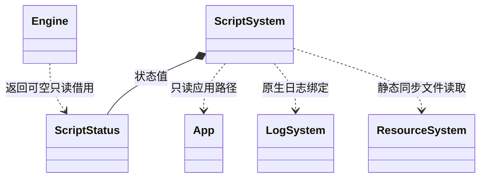

ScriptSystem 由 WorldSystem 独占；Engine 只通过借用转发玩法启动、停止、热重载开关及状态查询。ScriptStatus 是 ScriptSystem 的值成员，返回借用仅在所属系统存活期间有效，不能跨线程保留使用。

ResourceSystem 的静态读取方法不要求 System、App 或 Engine 已初始化，供脚本、资源同步和 MCP 共用。它通过 SDL3 同步读取普通文件，成功输出由调用者拥有，失败清空；不为调用者创建隐藏的 ResourceSystem 实例。路径、文本和二进制缓冲区的参数依赖见[资源系统](../runtime/class-diagrams/resource-system.md)。

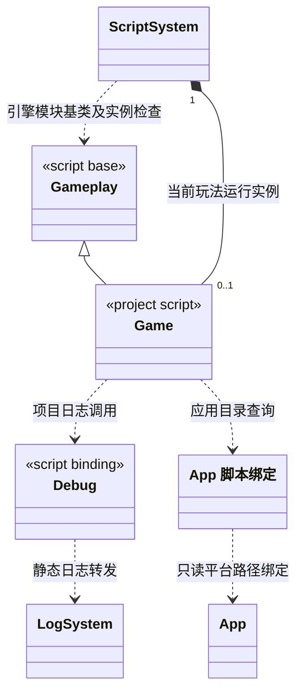

Game 是项目默认导出的 Gameplay 派生类型，是引擎与项目业务之间的胶水。ScriptSystem 持有当前运行的一个 Game 实例；项目可承载业务、组织业务对象，并为后续场景流转保留入口职责。

本轮实现 Node、Component、Scene 的动态创建与脚本绑定，场景落盘加载留到下一阶段。图中的 App 脚本绑定是 C++ App 的只读暴露，不是第二个平台所有者；Debug 直接转发原生日志，不新增 C++ Debug 或 Logger 所有者。

V8 平台按进程管理，完整退出前须先销毁全部 isolate。每个实际 ScriptSystem 拥有一个 isolate；单次玩法运行拥有独立 Context、模块缓存和 Game。热重载重建这些玩法对象，不重新初始化整个 V8 平台。具体方法及 SDK 声明见[脚本系统](../runtime/class-diagrams/script-system.md)和[玩法入口](../runtime/class-diagrams/gameplay.md)。

## MCP 宿主与跨进程文件关系

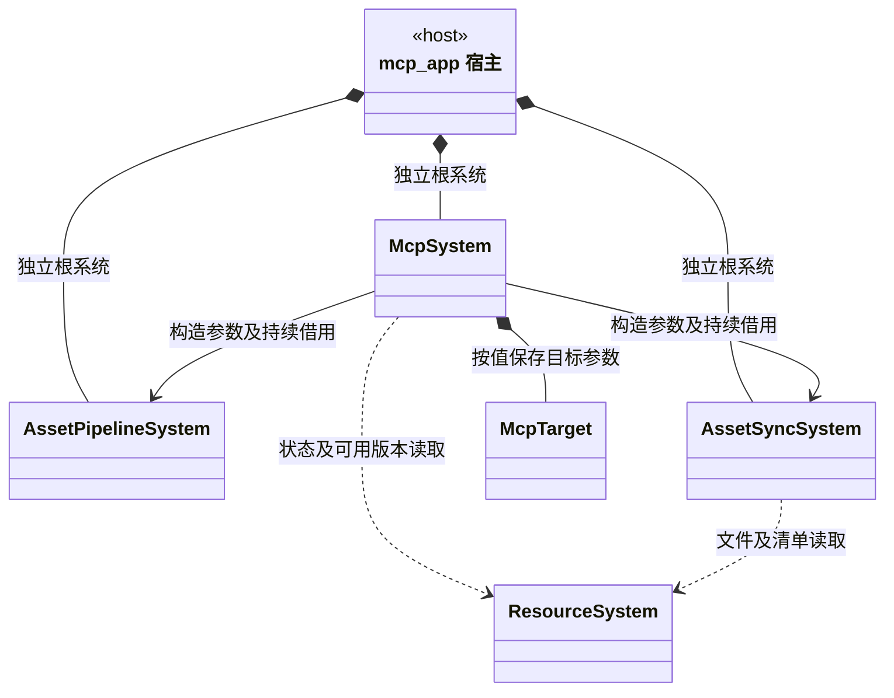

`mcp_app` 接收明确的项目根目录与 McpTarget（本机运行目录，或 adb 序列号和 Android 包名），依次初始化 AssetPipelineSystem、AssetSyncSystem、McpSystem；退出时反序关闭。McpSystem 构造参数中的两个系统是必需借用，必须先就绪并持续存活。

MCP 宿主不创建 Engine、WorldSystem 或 ScriptSystem，也不通过编辑器对象直接执行玩法。它使用项目路径编译资源，使用指定运行目录同步和控制；标准输出只写 JSON-RPC，构建诊断输出到标准错误。当前 MCP 入口不初始化 App 或 LogSystem。

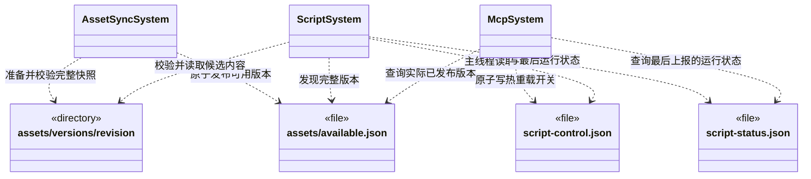

上述文件均位于目标应用的持久数据目录之下，不属于可被系统清理的 App 缓存目录。两个进程无需共享 C++ 对象：

- AssetSyncSystem 准备并校验不可变完整版本，再原子替换 `available.json`。发布成功只表示文件可用，不表示脚本已经激活。
- ScriptSystem 检查完整清单和文件，运行会话固定自己的模块内容；关闭热重载仍可接收新文件及报告可用版本。
- 查找模块时，清单 files 命中使用版本内容，deleted 命中拒绝加载，其余路径回退内置内容。编辑器为本会话建立独立内置快照，后续 TS 构建不改写它。
- 热重载开启后，在运行线程安全点预检候选模块。语法或静态链接失败保留旧 Game；预检通过后停止旧 Game 并执行新入口，执行失败停止此次玩法，不承诺撤销已产生的业务副作用。
- MCP 通过控制文件请求开关，由引擎读取后生效。状态查询独立读取实际发布版本；运行状态来自引擎最后上报，不作为进程实时在线证明。
- 当前同步使用完整版本快照；相同版本复用已有目录，变化时准备完整批次。Android 通过 adb 与 run-as 发布到 Debug 包，Release 不开放该通路；不提供独立网络服务或差量传输。

资源同步与 MCP 具体契约见[资源同步系统](../editor/class-diagrams/asset-sync-system.md)及 [MCP 系统](../plugins/class-diagrams/mcp-system.md)。

## 项目启停控制文件

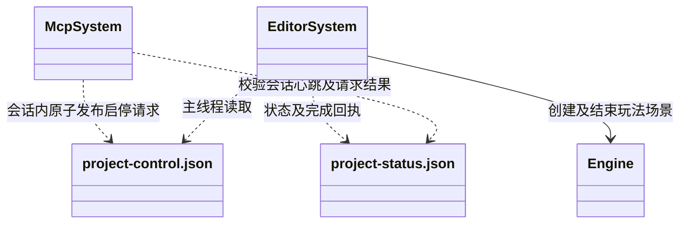

以上文件同样位于 App 持久数据目录。项目控制与脚本热重载控制分开：启动/停止只由编辑器会话消费；同步脚本或打开热重载不会让已停止项目自行启动。启停锁串行化 MCP 发布，旧会话请求不重放，超时返回未确认请求编号。Android 本轮继续使用已有脚本同步协议，新启停仅用于桌面编辑器。

## 公共路径工具

公共 [PathUtils](../runtime/class-diagrams/path-utils.md) 位于 `runtime/utils/`，提供 UTF-8 字符串与文件系统路径之间的静态转换，不继承 System、不持有实例，也不参与生命周期调度。其方法只在独立类图定义。

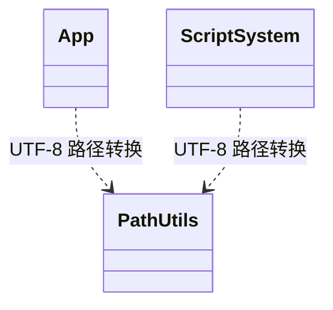

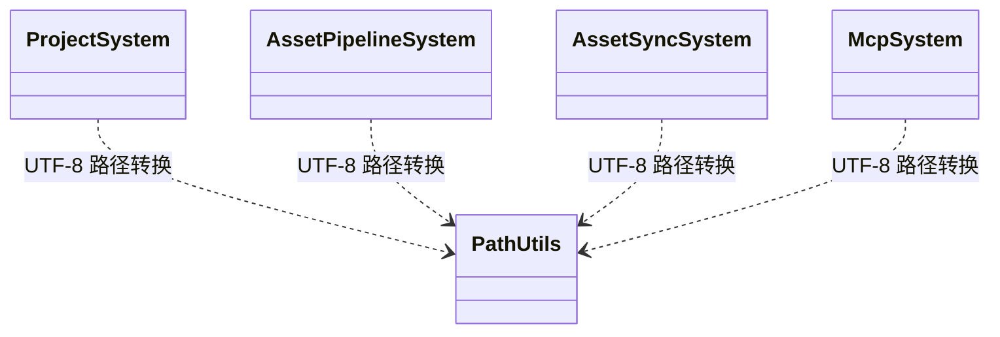

桌面 App 实现、脚本系统、项目系统、资源管线、资源同步、MCP 及编辑器/MCP 宿主使用上述公共转换。转换保留路径内容，不负责路径存在性、规范化或目录越界检查；这些判断继续由使用者完成。

ResourceSystem 的 SDL 文件读取保留原生 `path.u8string()` 编码，避免统一正斜杠转换改变 Windows 扩展长度路径语义，因此它与 LogSystem 均没有 PathUtils 调用依赖。

## System 继承与参数依赖

下列继承与配置关系均已实现，各类公开方法在其独立图中维护：

| 类别 | 直接继承 System 的类型 | 配置与其他参数依赖 |
| --- | --- | --- |
| 引擎根系统 | WindowSystem、ResourceSystem、WorldSystem、RenderSystem | EngineConfig 生命周期参数；RenderSystem 构造借用 WindowSystem 和可空 WorldSystem |
| 世界子系统 | PhysicsSystem、NavigationSystem、AnimationSystem、UiSystem、ScriptSystem | EngineConfig 生命周期参数；实际脚本接口还使用入口字符串及 ScriptStatus |
| 独立单例根系统 | LogSystem | EngineConfig、LogLevel、日志文本；返回日志路径借用 |
| 编辑器根系统 | ProjectSystem、EditorSystem | EngineConfig；项目根目录字符串；EditorSystem 构造借用 EditorEnvironment 和可空 Engine |
| 工具根系统 | AssetPipelineSystem、AssetSyncSystem、McpSystem | EngineConfig；项目、资源及运行目录 Path；McpSystem 构造借用管线和同步系统，并按值接收 McpTarget |

App 不参与 System 继承，初始化参数为 AppConfig。McpTarget 是普通配置结构，按值保存运行目录、adb 路径、设备序列号与包名，完整字段及 Path/String 关系在 [MCP 独立图](../plugins/class-diagrams/mcp-system.md)维护。ResourceSystem 的同步读取参数使用 Path 与调用者的文本或二进制输出缓冲区；AssetSyncSystem 返回的版本、错误字符串也是所属对象的只读借用。

## 第三方资源拥有关系

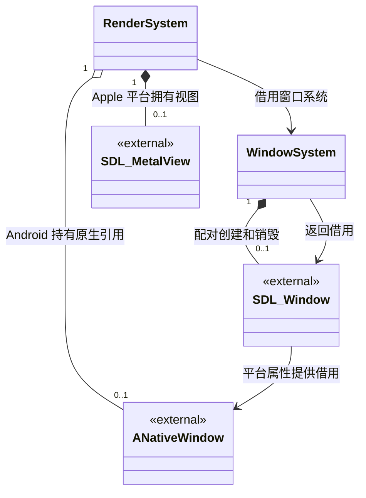

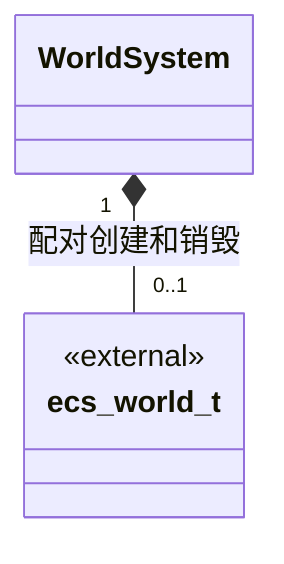

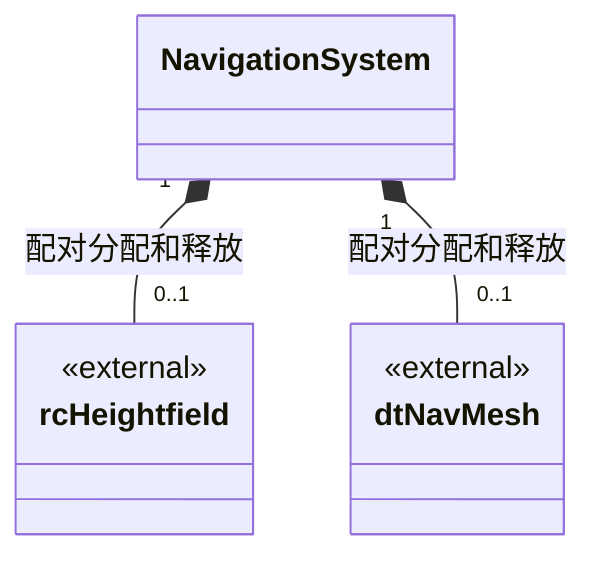

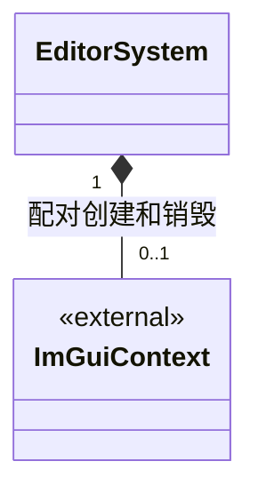

RenderSystem 借用 SDL 窗口和原生句柄，拥有 bgfx 初始化状态及 Apple Metal view；Android 通过 acquire/release 持有原生窗口引用，在 bgfx 完全关闭后释放，不独占 Android 窗口对象。

WorldSystem、NavigationSystem、EditorSystem 分别拥有图中的第三方实例并调用配对销毁接口。ResourceSystem 每次读取拥有一个局部 SDL_IOStream，读取结束必须关闭；App 与 LogSystem 分别拥有平台路径值和日志文件。初始化期间的局部依赖检查对象不构成持久拥有关系。

## 实际编译与链接依赖

| 引擎类或宿主工具 | 使用依赖 | 当前用途 |
| --- | --- | --- |
| PathUtils | 标准库文件系统与字符串 | UTF-8 路径编码转换 |
| App | SDL3、PathUtils、标准库文件系统 | 桌面与 Android 平台目录及逻辑 APK 根 |
| LogSystem | System、App、标准库线程与文件接口 | 进程日志、写盘、刷新和轮换 |
| WindowSystem | SDL3 | 窗口、事件及平台生命周期 |
| ResourceSystem | SDL3、FlatBuffers、Basis Universal | 同步文件读取、解析入口及转码表初始化 |
| WorldSystem | flecs、FlatBuffers、Scene | ECS 世界、场景与节点身份生命周期 |
| RenderSystem | bgfx、bx、SDL3、WorldSystem | 图形设备、场景组件读取、PBR 方块与帧提交 |
| PhysicsSystem | Jolt | 版本一致性入口 |
| NavigationSystem | Recast、Detour | 高度场与导航网格资源 |
| AnimationSystem | ozz-animation | 空骨骼构造和析构 |
| UiSystem | RmlUi | 运行库版本入口 |
| ScriptSystem 探针实现 | V8 | V8 版本入口的实际链接验证 |
| ScriptSystem 完整实现 | V8、SDL3、nlohmann/json、App、LogSystem、ResourceSystem、PathUtils、WorldSystem | JS 模块、原生绑定、玩法生命周期、状态与热重载 |
| ProjectSystem | toml++、LogSystem、PathUtils | 项目目录检查及日志 |
| EditorEnvironment | ProjectSystem、App、LogSystem、PathUtils | 编辑器路径映射、私有会话身份与内置快照 |
| EditorSystem | Dear ImGui、EditorEnvironment、Engine、App、ResourceSystem、LogSystem、PathUtils、SDL3、nlohmann/json | 编辑器上下文、项目启停与状态回执 |
| AssetPipelineSystem | USD、Taskflow、SQLite、efsw、meshoptimizer、SDL3、PathUtils | 保留依赖验证，启动本地 TS 编译进程 |
| AssetSyncSystem | nlohmann/json、SDL3、ResourceSystem、PathUtils | 完整版本校验与原子发布 |
| McpSystem | nlohmann/json、SDL3、ResourceSystem、AssetPipelineSystem、AssetSyncSystem、PathUtils | stdio 协议、编译同步、控制与状态 |
| TS 构建工具 | Node.js、项目固定版本 TypeScript | settings 中配置，assets 中源码，cache 中生成物 |
| 资源构建工具 | shaderc、texturec、geometryc | 宿主工具，不进入运行时生命周期 |

Engine 与运行时系统不拥有 ProjectSystem、EditorSystem、AssetPipelineSystem、AssetSyncSystem 或 McpSystem，也不反向依赖离线编译器或具体项目。工具可以复用运行时的静态资源读取能力，运行时仍只消费部署内容。

脚本模块内部的绑定接口、独占注册表、逐类实现及每个 Run 的上下文关系见[绑定类图](../runtime/class-diagrams/script-bindings.md)。ScriptSystem 通过注册表装配，不直接维护所有类的绑定实现。

## 资源身份与导入依赖

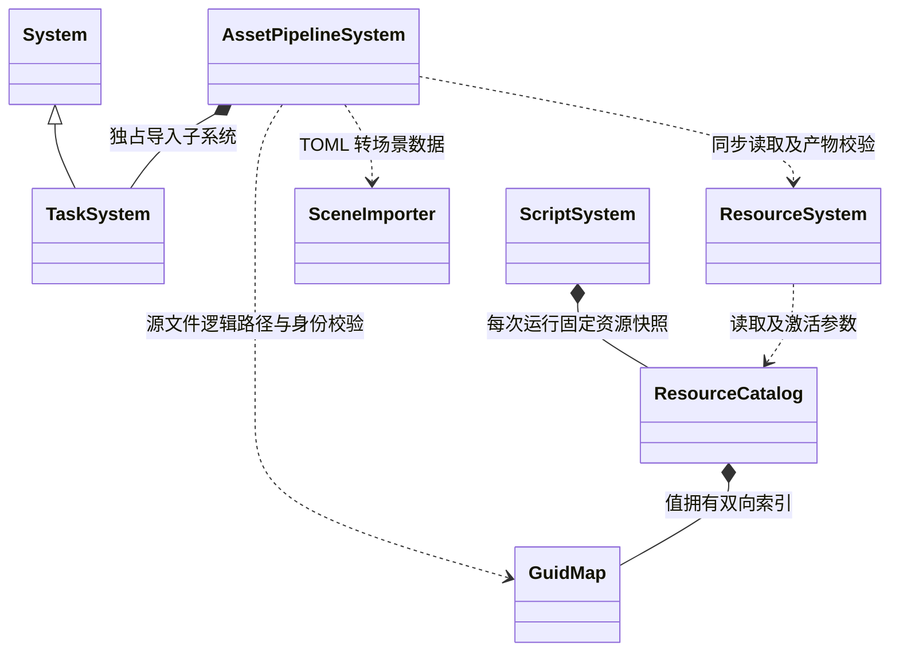

GuidMap 属于纯标准库核心模块；Taskflow、SQLite、toml++ 仅用于编辑器导入，不进入设备运行时。完整数据结构与公开方法见对应独立图。源资源 meta、SQL 中的身份和运行期目录使用同一完整 GUID，生成路径固定为 `cache/gen/<GUID>`。
