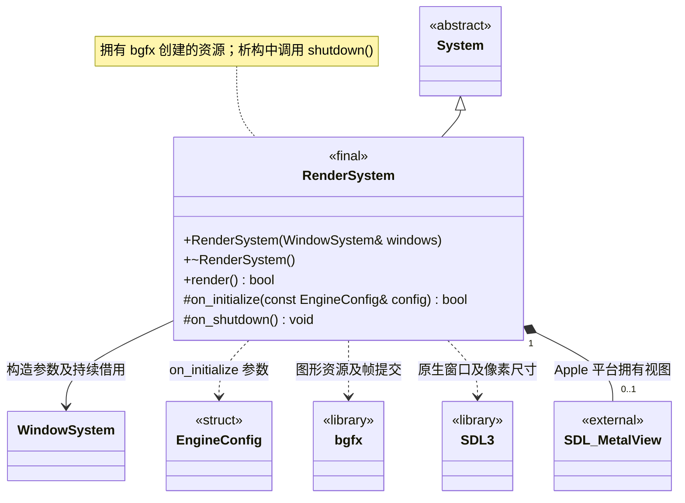

# 渲染系统

[类图索引](index.md) · [引擎与系统](engine-system.md) · [完整引用关系](references.md)

状态：本轮最小窗口与渲染实现。本图只定义 `RenderSystem` 的方法，其他节点为跨图引用或第三方库。

- 构造时仅借用窗口系统，窗口系统必须比渲染系统存活更久；初始化时检查窗口已就绪。
- 初始化、继承的更新、`render()` 和关闭均由应用主线程调用；窗口指针及原生句柄借用不跨线程传递。
- 继承 `System` 的公共生命周期入口及默认 `on_tick()`；它管理的子系统随统一入口更新。
- `render()` 在本帧系统及子系统更新完成后检查窗口尺寸和表面状态，完成图形资源适配及一帧提交。成功返回 `true`，无法完成返回 `false`。
- 引擎在提交前检查窗口退出和暂停状态。恢复和表面重建由渲染系统与[窗口系统](window-system.md)协作处理。
- 拥有 bgfx 创建的资源，使用对应 API 释放；不拥有窗口系统，也不拥有第三方库本身。初始化、清理和复制移动限制遵守[系统约定](engine-system.md)。

- 当前使用 SDL3 提供原生窗口句柄，macOS / iOS 选择 Metal、Windows 选择 Direct3D12、Android / Linux 选择 Vulkan；拒绝 Noop 和回退到其他图形后端。最小画面为清屏和调试文字，窗口像素尺寸变化时重置交换链。
- Android Surface 处理代码已留在平台实现中；APK、暂停恢复和设备端渲染仍需单独验证，不能据桌面运行结果宣称通过。

C++ 限定符：构造为 `explicit` 且 `noexcept`，析构和 `on_shutdown()` 为 `noexcept`；析构及受保护钩子标注 `override`，状态返回值标注 `[[nodiscard]]`。
