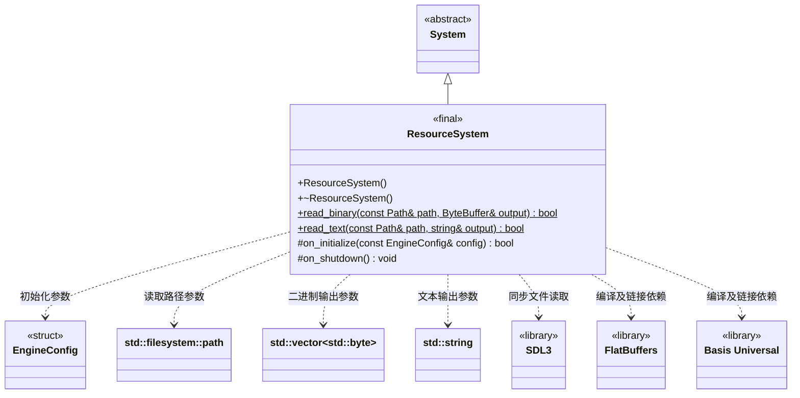

# 资源系统

[类图索引](index.md) · [引擎与系统](engine-system.md) · [完整引用关系](references.md)

状态：本轮增加同步文件读取；本图只定义 ResourceSystem，其他系统保持跨图引用。

- 由 Engine 拥有的根系统，先于世界和渲染初始化；保留 Basis Universal 转码表初始化和 FlatBuffers 解析入口的实际编译、链接验证。
- 两个静态读取方法不依赖系统、App 或引擎初始化，可由脚本、工具和 MCP 直接调用。不新增通用文件包装类，不在静态读取中隐式创建 System 实例。
- 路径参数是 `std::filesystem::path`；传给 SDL 前转换为 UTF-8。图中 `ByteBuffer` 仅简写 `std::vector<std::byte>`，不是新增类型或包装。
- `read_binary()` 使用 SDL3 的路径检查与 `SDL_IOFromFile/GetIOSize/ReadIO/CloseIO` 同步读取普通文件；`read_text()` 复用相同读取路径，保留完整字节，不截断 NUL、不改换行、不删除 BOM，也不自动转码。
- 空文件成功并输出空内容。缺失、目录、设备等非普通文件、非法路径、过大文件、短读、读取期间长度变化或关闭失败均返回 `false`，输出保持为空；成功后输出由调用者拥有。
- 单次文件上限为 64 MiB，在分配内容缓冲区前检查；大资源的流式读取按后续实际需求增加。该限制不是对整套项目资源的限制。
- 本轮只实现桌面磁盘文件读取，不声明 Android APK 内置资源已接通。未来包资源定位仍由资源系统解释，业务不直接依赖普通文件路径。
- 不重写 `on_tick()`，沿用基类默认空更新。静态读取与系统资源生命周期互不耦合。

返回状态的方法标注 `[[nodiscard]]`；构造、析构与关闭钩子保持 `noexcept`，覆盖方法标注 `override`。每个成功打开的 SDL 文件流均显式关闭，失败不遗留半成品输出。
