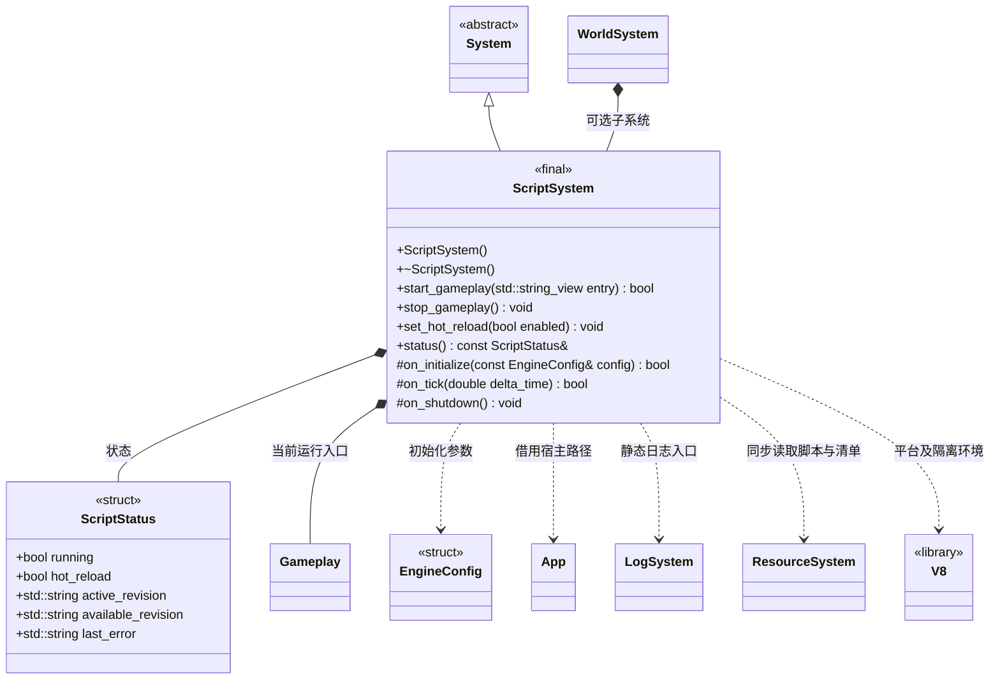

# 脚本系统

[类图索引](index.md) · [引擎与系统](engine-system.md) · [玩法入口](gameplay.md)

状态：本轮实现桌面编辑器脚本运行。仅定义 `ScriptSystem` 与其状态；其他类的方法在各自类图维护。

- `WorldSystem` 独占可选子系统。系统初始化只准备 V8 环境，所有系统就绪后宿主显式调用 `start_gameplay()`；空引擎无需项目或入口。
- 入口默认参数为空，采用清单 entry；没有清单时使用 `scripts/game.js`。非空参数固定显式入口，重载继续使用该路径。入口必须默认导出继承 `Gameplay` 的类。所有生命周期和脚本调用在引擎运行线程进行。
- V8 平台每进程只初始化一次、退出时释放；每个脚本系统独占 isolate，单次玩法运行持有独立 Context、模块缓存及一个入口实例。停止重载释放该次运行；系统重启可以重建 isolate。
- `ScriptStatus` 默认布尔值为 false、字符串为空；`status()` 返回借用，不能跨系统销毁或跨线程使用。内置运行的 `active_revision` 为 `builtin`。
- 每帧先读取控制和完整发布版本，在安全点切换，再调用 `Update()`。JavaScript 异常写日志及 `last_error`，不使 Engine 失败。`OnInitialize` 非布尔值或 false 均使此次启动失败。
- 预检候选 Context 编译、静态链接失败时，旧入口与快照继续运行；预检成功后先停止旧入口，再执行新模块及入口。执行失败明确报告并停止玩法，不承诺撤销已产生的副作用。
- 关闭热重载只禁止切换，仍报告可用版本，固定当前入口和模块快照；重新开启在下一帧处理最新完整版本。停止后不会自动重启。
- `persistent_data_path/assets/available.json` 清单包含 `revision`、`entry`、`files[{path,size,hash}]`、`deleted[]`。版本位于 `assets/versions/<revision>/`，哈希为小写 16 位 FNV-1a 64。全部文件的大小、哈希、路径验证通过后才接受版本。
- 入口和所有 import 统一按路径解析：清单 files 命中读取对应 cache；deleted 命中拒绝；其他路径回退 builtin。宿主保证 builtin 在会话内不变；不复制内置内容覆盖同步文件。绝对路径、越界路径和符号链接越界均拒绝。
- 本阶段支持静态 ES 模块和虚拟 `engine` 模块，不提供 Node.js API、动态导入或顶层 await。
- 源码、清单和控制文件统一通过 ResourceSystem 的 SDL3 同步读取入口访问；文件系统仅负责非异常路径校验和状态写入。
- 桌面工具原子写 `persistent_data_path/script-control.json` 的 `hotReload`；脚本系统原子写 `script-status.json` 的 `running`、`hotReload`、`activeRevision`、`availableRevision`、`lastError`，不启动网络服务。
- `stop_gameplay()` 和清理支持重复调用。已进入初始化的入口会收到一次 `OnShutdown()`，包括部分启动失败。
- 桌面真实运行由 `ENGINE_ENABLE_SCRIPT_RUNTIME` 控制；关闭时保留 V8 版本链接探针，启动玩法返回 false，不接入 App、日志或 JSON，不增加 Android 脚本功能。

C++ 限定符：构造、析构、`stop_gameplay()`、`status()` 和 `on_shutdown()` 为 `noexcept`；`status()` 为 const。返回状态或借用的方法标注 `[[nodiscard]]`，钩子和析构标注 override。V8 异常捕获只处理 JavaScript 异常，不使用 C++ 异常。
