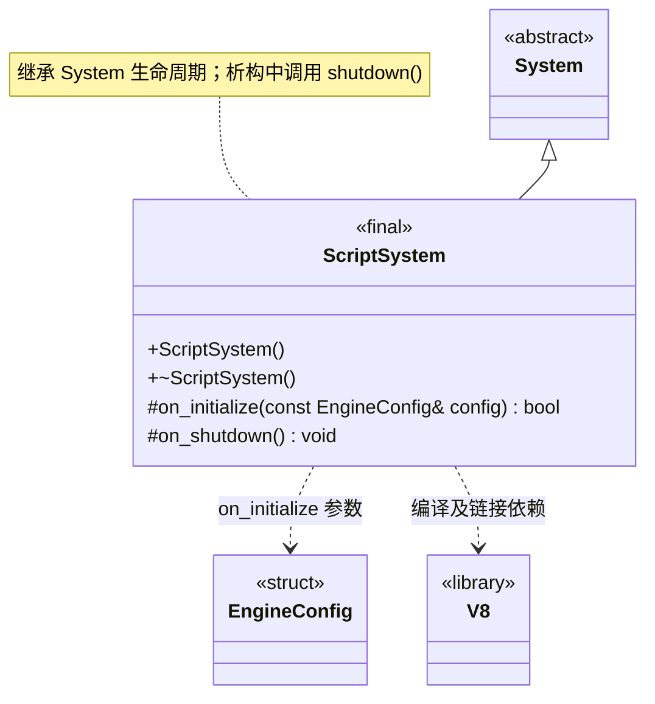

# 脚本系统

[类图索引](index.md) · [引擎与系统](engine-system.md) · [完整引用关系](references.md)

状态：本轮最小实现。仅定义 `ScriptSystem` 的方法；其他节点为跨图引用或第三方类型。

- 启用 V8 构建时由 `WorldSystem` 独占；未启用时不装配该子系统。
- 当前调用 V8 版本入口验证真实链接；尚未初始化平台、创建 isolate 或执行游戏脚本。
- 公开业务接口当前只有构造与析构；继承 `System` 的公共生命周期方法，不提前增加业务方法。初始化失败和清理遵守[系统约定](engine-system.md)。
- 不重写 `on_tick()`，沿用基类默认成功的空更新；当前无逐帧业务任务。

C++ 限定符：构造、析构及 `on_shutdown()` 为 `noexcept`；析构和受保护钩子标注 `override`，返回状态的钩子标注 `[[nodiscard]]`。
