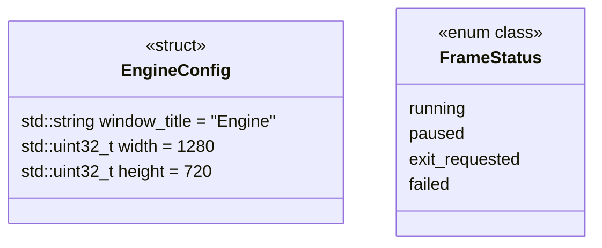

# 配置与状态

[类图索引](index.md) · [完整引用关系](references.md)

状态：本轮最小实现使用的公共数据类型。本图维护公共配置结构体和帧状态枚举，不增加行为类。

- 默认配置可直接初始化引擎，不要求项目。编辑器项目路径由宿主传给 `ProjectSystem` 构造函数，不属于运行时配置。
- 窗口标题不得为空，窗口尺寸不得为零或超出平台整数范围；实际像素尺寸还需通过渲染系统检查。
- 系统按需复制配置，不保存指向调用者配置的悬空引用。
- `FrameStatus` 由 `Engine::tick()` 返回；具体语义见[引擎接口约定](engine-system.md)。
