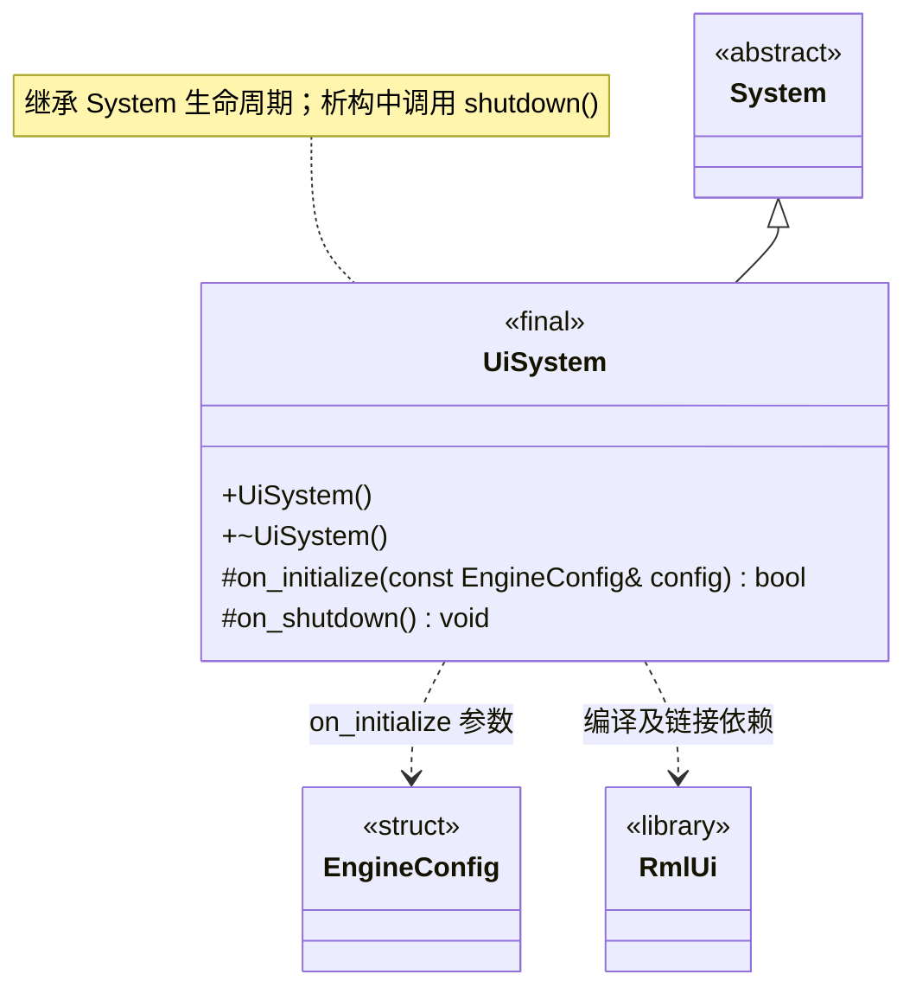

# 界面系统

[类图索引](index.md) · [引擎与系统](engine-system.md) · [完整引用关系](references.md)

状态：本轮最小实现。仅定义 `UiSystem` 的方法；其他节点为跨图引用或第三方类型。

- 由 `WorldSystem` 独占，通过父系统统一管理生命周期。
- 当前读取 RmlUi 版本，验证真实运行库符号；尚未安装渲染适配器、初始化 UI 上下文或绘制界面。
- 公开业务接口当前只有构造与析构；继承 `System` 的公共生命周期方法，不提前增加业务方法。初始化失败和清理遵守[系统约定](engine-system.md)。
- 不重写 `on_tick()`，沿用基类默认成功的空更新；当前无逐帧业务任务。

C++ 限定符：构造、析构及 `on_shutdown()` 为 `noexcept`；析构和受保护钩子标注 `override`，返回状态的钩子标注 `[[nodiscard]]`。
