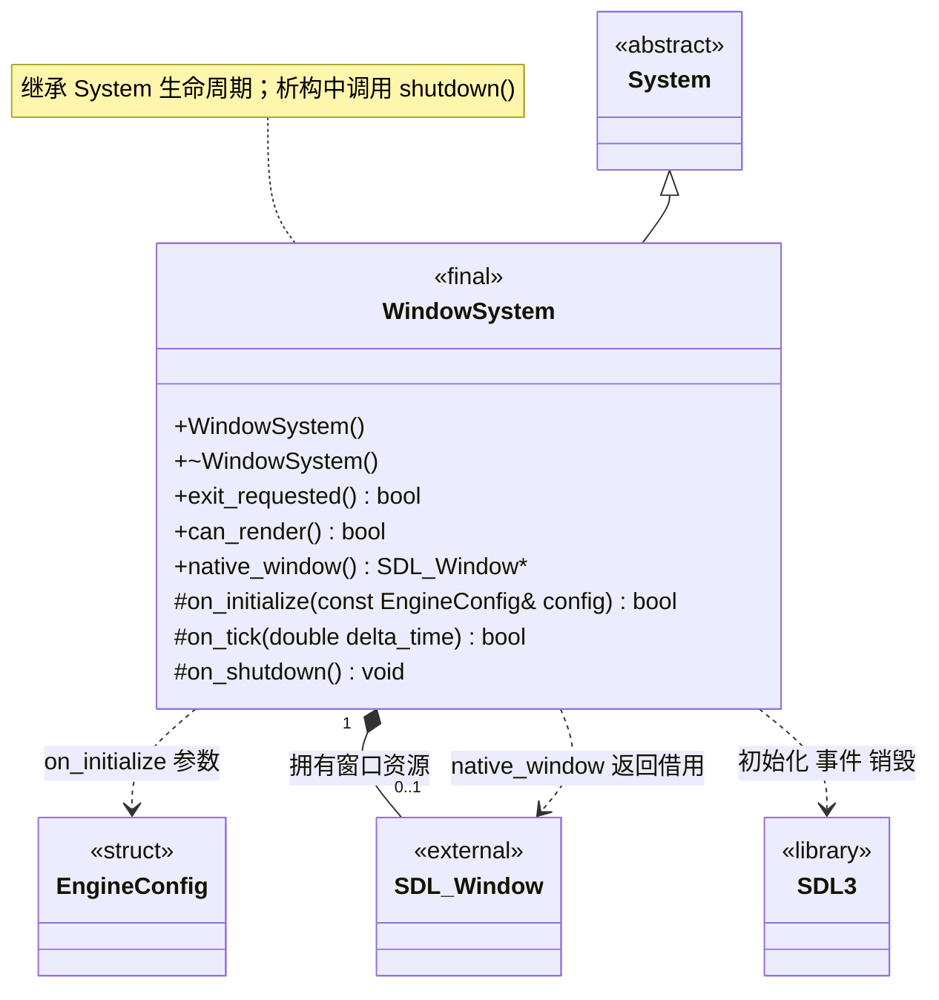

# 窗口系统

[类图索引](index.md) · [引擎与系统](engine-system.md) · [完整引用关系](references.md)

状态：本轮最小窗口与渲染实现。本图只定义 `WindowSystem` 的方法，其他节点为跨图引用或第三方类型。

- 负责 SDL3、主窗口和事件处理，`on_tick()` 更新退出与可绘制状态。
- `can_render()` 在未初始化、暂停或窗口表面不可用时返回 `false`。
- `native_window()` 返回借用指针，未创建时为 `nullptr`；借用仅在应用主线程及窗口生命周期内有效，调用者不能销毁窗口，也不能跨窗口重建长期缓存该指针。
- 初始化、事件更新和关闭均由应用主线程调用；后台事件标志使用原子变量不代表公共接口具备线程安全性。
- Android 原生 Surface 是否可用不等同于 SDL 窗口指针是否非空；恢复后继续使用同一引擎，表面重建与渲染系统协作处理。
- 从[配置](types.md)读取所需窗口参数，不保存指向调用者配置的悬空引用。复制、移动限制和初始化失败清理遵守[系统约定](engine-system.md)。

- 平台窗口选项配合已确定的图形后端：macOS / iOS 为 Metal，Windows 为 Direct3D12，Android / Linux 为 Vulkan。平台差异集中在窗口和渲染实现。

C++ 限定符：构造、析构、状态及窗口访问器为 `noexcept`；访问器为 `const`。受保护钩子和析构标注 `override`，`on_shutdown()` 为 `noexcept`，状态返回值标注 `[[nodiscard]]`。
