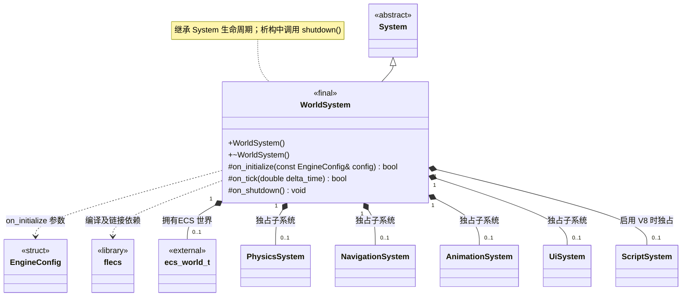

# 世界系统

[类图索引](index.md) · [引擎与系统](engine-system.md) · [完整引用关系](references.md)

状态：本轮最小实现。仅定义 `WorldSystem` 的方法；其他节点为跨图引用或第三方类型。

- 由 `Engine` 拥有的根系统；持有一个 flecs 世界，初始化与销毁调用成对。
- `on_tick()` 推进 ECS 世界；之后由 `System` 按加入顺序更新子系统。当前尚未注册玩法组件或创建场景实体。
- `Engine` 装配物理、导航、动画、界面及可选脚本子系统，通过 `add_subsystem()` 将所有权移交世界系统。关闭子系统后再销毁 ECS 世界。
- 公开业务接口当前只有构造与析构；继承 `System` 的公共生命周期方法，不提前增加业务方法。初始化失败和清理遵守[系统约定](engine-system.md)。

C++ 限定符：构造、析构及 `on_shutdown()` 为 `noexcept`；析构和受保护钩子标注 `override`，返回状态的钩子标注 `[[nodiscard]]`。
