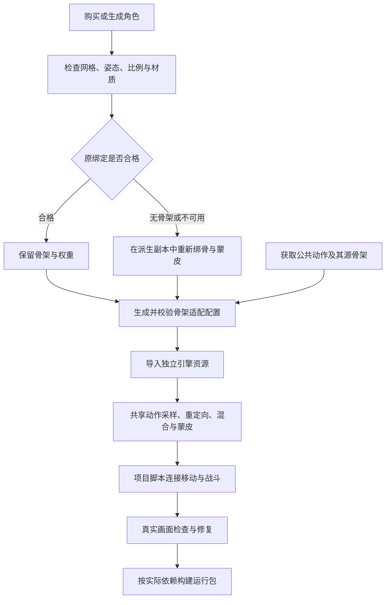

# 角色与动画制作流程（规划）

[类图评审入口](../class-diagrams/index.md) · [资源管线](asset-pipeline.md) · [动画模块](../runtime/animation.md) · [FBX 导入契约](../plugins/editor/class-diagrams/fbx-importer.md)

## 目标与当前状态

核心流程是：购买或生成角色模型，由 AI 调用现成工具完成检查、绑定与动作适配，最终在引擎中复用公共动作库。AI 承担执行、编排和验证；工具内部可以使用确定性算法，不要求采用神经网络。界面不是选型依据，不为此自研完整 DCC 或动画制作界面。

本规划于 2026-11-01 按主干 `c0544d7` 的源码核对。当前已有 FBX 模型、骨架和动作导入、完整关节路径匹配、ozz 双动作过渡、场景级编译缓存和 GPU compute 蒙皮。跨骨架的语义映射、参考姿态补偿及运行时重定向尚未实现；现有匹配不等于通用重定向。Root Motion 驱动、接触 IK 和通用动画状态图也未实现。

当前加工交付优先走 FBX；尚无 glTF/GLB 导入插件，服务仅返回 GLB 时须先在离线工具转换。FBX 已支持 `scale_factor`、`rotation_offset`、法线选择和 `material_remaps`，但后者只是引用已有引擎材质，并未自动转换源材质与贴图；材质和纹理需分别导入，再显式建立映射。每顶点仅保留最高四项骨骼影响并归一化，转换后须检查变形。外观保留须经离线材质整理、标准资源导入和实景检查，不能仅凭服务预览判断完成。

本文记录制作流程、职责及验收方向，不新增已确认的类、公开方法、资源类型或文件后缀。后续新增骨架适配数据及运行时契约时，先更新所属类图和跨图关系供评审，再实现 Schema、代码和测试。

## 两条资产线

角色与动作分别制作和维护。角色包含自己的网格、材质、骨架及蒙皮权重；公共动作保存源骨架、参考姿态和运动轨道。角色适配配置把两者联系起来，不要求所有角色具有相同的关节位置和骨长。

## 完整制作步骤

| 步骤 | 输入与处理 | 产出与通过条件 |
| --- | --- | --- |
| 1. 定义制作规格 | 明确普通双足人形、所需动作、手指精度、服装附件、尺寸朝向和目标平台；先选控制器移动或动作位移策略 | 可检查的角色规格；首版限定普通人形，由控制器处理移动和碰撞，动作原地播放 |
| 2. 取得并归档来源 | 保留模型、贴图、原骨架、原权重与原动画；确认允许加工、服务上传及游戏使用 | 可重做的原始资产与本地来源记录，不覆盖原件 |
| 3. 整理模型 | 检查中立姿态、坐标、网格拓扑、法线、UV、材质、肢体分离与多部件关系；必要时修网格或重新生成 | 可绑定模型，整理或必要重绑不应意外改变缩放、部件关系与外观 |
| 4. 保留或重建绑定 | 好绑定保留；无骨架、损坏或不适合目标规格的绑定在派生副本中重建，拟合关节并生成权重 | 肩胯、肘膝、手腕及手指弯曲可用；骨名不同本身不是重绑理由 |
| 5. 处理衣物与附件 | 身体、衣袖和裤腿随骨架变形；盔甲、眼球、牙齿、武器等按具体资产选择刚性绑定或挂点 | 软部件不明显穿插，硬部件不被错误拉伸，已有特殊绑定价值不丢失 |
| 6. 准备公共动作库 | 独立整理待机、走跑、转身、跳跃、下蹲、攻击等动作，保留源骨架和参考姿态；记录循环范围、移动方式及需要的事件 | 每条动作可追溯、可预览；动作可来自不同源骨架，不要求随每个角色重新购买或制作 |
| 7. 生成角色适配配置 | 显式对应骨骼语义和骨链，校验参考姿态、骨轴、比例、root/hips 与附加骨骼策略 | 与骨架版本绑定的配置及诊断；缺少必要链或映射含糊时不发布合格结果 |
| 8. 导入引擎 | 将加工结果交给现有资源管线，建立 Model、Mesh、Skeleton、Animation、Material 和 Texture 的独立身份与真实依赖 | 有效 catalog 与 GUID 缓存；增量和失败回滚遵守现有资源契约 |
| 9. 接入玩法 | 项目脚本按速度、地面状态、攻击和受击选择动作，通过组件请求播放与过渡 | 同一角色从待机到移动、攻击和恢复的实际行为正确，核心不识别项目业务状态 |
| 10. 验收与发布 | 在引擎播放代表动作，检查变形、脚滑、触地、握物、服装、阴影与停止释放；不合格返回对应加工步骤 | 真实运行证据、可重复批处理及仅含实际依赖的运行包 |

网格轮廓正确并不代表适合动画：手臂与躯干粘连、手指连成块、关节附近缺少可弯曲拓扑，都需要在绑定前处理。面部 shape keys、特殊骨骼、纠正形变和双四元数蒙皮不能因源文件中存在就视为引擎已支持；当前 FBX 导入对不支持的变形明确失败，资产准备须转换、另行规划支持或拒绝该输入，不能静默删除后报成功。

## 骨骼不匹配的处理

统一的是骨骼语义、必要骨链、坐标与动作约定，不强制所有资产使用完全相同的空间骨架。普通人物可标准化重绑以降低复杂度；已有高质量绑定应先评估保留，以免丢失精修权重、手指、twist、面部和附件关系。

| 差异 | 处理原则 |
| --- | --- |
| 名称或命名空间不同 | 离线建立明确对应，不仅靠字符串相似度判定成功 |
| A/T 参考姿态、骨轴或朝向不同 | 保存参考姿态及坐标修正；保留原绑定时不直接改写 bind pose 或逆绑定矩阵 |
| 身高、臂腿比例不同 | 关节位置贴合角色，区分旋转传递和位移比例；体型适配不等于脚锁或握物接触已正确 |
| 脊柱分段、helper 或 twist 不同 | 按实际骨链定义分配或保留策略；额外骨停在静止姿态不等于正确分摊扭转 |
| 缺少必要关节、无效权重或错误拓扑 | 只有明确规则且验收通过的离线修复才能发布；否则重绑、返修或拒绝，不承诺通用自动修复 |
| root 与 hips 含义不同 | 分清整体位移与骨盆起伏；配置说明由控制器移动还是由动作提供位移，不能重复应用 |

适配配置必须随源/目标骨架层级、参考/绑定姿态、骨轴及导入坐标设置变化而失效重算。每种角色骨架建立自己的语义描述，不同来源动作也保留源描述；多源动作库不能把一套源到目标的对应表无条件套到所有源骨架。动作须明确所需骨链，不能以某个角色曾经通过映射为由放行所有动作。

## 离线加工与运行时边界

| 所属范围 | 职责 |
| --- | --- |
| AI 与离线制作工具 | 模型检查、网格整理、绑定创建、权重计算、动作整理、参数选择和画面诊断；可以调用 Blender 脚本、本地算法或外部服务 |
| 编辑器基础及可选插件 | 复用任务、导入、GUID、增量和发布能力；服务接入、具体格式与制作算法归各自编辑器插件或项目离线脚本，不进入核心 |
| 运行时动画与渲染 | 加载已校验资源及显式适配配置，完成共享动作采样、重定向、局部姿态混合和 GPU 蒙皮；后续按需求接入接触修正 |
| 项目脚本与玩法插件 | 决定状态、优先级、动作切换、移动策略及攻击命中等业务行为 |

正式运行包不依赖 Blender、Python、云 API、机器学习权重、FBX 解析器或编辑器设置。MCP 只登记和转发已有命令，不复制模型加工或动画算法，也不为每家服务另建一层运行时系统。

**运行时复用与重定向是目标能力，不能仅以逐角色离线烘焙代替。** 服务把 walk 烘焙给角色 A，得到的是 A 专用片段；再给 B 烘焙一份可用作对照或缓存，但不能据此声称 A、B 已在运行时共享源动作。目标流程是共享源动作及源骨架，按显式配置得到目标局部姿态，在同一目标骨架上混合，经过必要修正后生成骨骼矩阵并复用现有 GPU 蒙皮。

运行时执行已确认的对应关系，不按角色名称、购买来源或模型文件猜测骨骼语义。新增能力继续复用现有 Animator、AnimationSystem 与资源模型；具体配置的 Schema、身份和依赖及必要接口留待类图评审，不提前建立通用 Manager、DCC 控制 rig 或项目状态机。

## 可复用工具与服务候选

以下为 2026-11-01 的调研候选，不代表已经集成、购买、跑通或锁定供应商。选型按自动调用能力、真实模型效果、输出格式、许可、成本和可重试性决定，不按界面完整度决定。价格、额度和输入输出条款会变，执行前查当前官方文档；维护文档不承诺固定单价。

| 候选 | 可减少的工作 | 接入边界与待验证项 |
| --- | --- | --- |
| [Blender Python](https://developer.blender.org/docs/handbook/building_blender/python_module/) | 模型整理、骨架操作、权重处理、格式转换及预览渲染；可无界面执行 | 优先作为离线加工底座，仍需项目脚本和质量检查，不随游戏部署 |
| [Tripo Rigging API](https://developers.tripo3d.com/en/models/rig) / [Meshy Rigging API](https://docs.meshy.ai/en/api/rigging) | 外部模型的骨架拟合与蒙皮，可异步提交和获取结果 | 按量绑骨候选；验证标准骨架约定、材质保留、手指和服装；预设动作接口不等于任意外部动作的运行时重定向 |
| [Mixamo](https://helpx.adobe.com/creative-cloud/faq/mixamo-faq.html) / [AccuRIG](https://www.reallusion.com/auto-rig/accurig/) | 免费或低成本角色制作与动作效果对照 | 本轮未确认可依赖的官方无人值守绑骨 API，不作为全自动流程的必要依赖；动作许可与工具许可分别核对 |
| [Mesh2Motion](https://github.com/Mesh2Motion/mesh2motion-app) | 骨架模板、启发式蒙皮及动作资源 | 已有流程仍需定位模板关节，未提供完整无头绑骨接口；不能当成现成的自动关节预测服务 |
| [Make-It-Animatable](https://github.com/jasongzy/Make-It-Animatable) / [SkinTokens](https://github.com/VAST-AI-Research/SkinTokens) | 自动预测关节与权重的本地推理备选 | 非必要依赖；验证骨架约定、代码/权重及第三方许可、设备后端、质量与耗时，再决定是否封装 |
| [Wicked Engine 重定向](https://wickedengine.net/category/devblog/2022/09/23/animation-retargeting/index.html) / [Godot RetargetModifier3D](https://docs.godotengine.org/en/stable/classes/class_retargetmodifier3d.html) | 已有 C++ 人形映射和姿态修正实现可供评估 | 依赖各自引擎数据与生命周期，不是直接链接的小库；采用前固定版本、保留许可并适配本引擎数据，不整体引入另一引擎 |
| [ozz-animation](https://github.com/guillaumeblanc/ozz-animation) | 保留已接入的采样、混合、模型矩阵计算和场景编译缓存 | 不把这些基础能力视为已具备通用重定向，也不重写已经工作的 GPU 蒙皮 |

动作库独立选择可合法使用的内容，例如 [Quaternius Universal Animation Library](https://quaternius.com/packs/universalanimationlibrary.html)。免费制作工具、动作在游戏中使用、原始素材再分发是不同授权；不能把受限动作随引擎模板或公共仓库发布。付费/私有模型、动作、下载产物、购买清单、密钥和本机路径不进入引擎 Git；仅提交许可明确、允许再分发的最小验证样例。

M1 Max / 64 GB 可作为资产准备和引擎验证设备，但本规划没有在该设备跑过上述推理工具。统一内存不能等同于满足 NVIDIA/CUDA 要求，不能保证现有 CUDA 依赖可直接转为 Metal/MPS。先验证真实模型的运行、峰值内存与耗时；不兼容时使用外部服务或独立 GPU 工作机，避免将推理后端移植变成引擎接入的前置条件。

## 分阶段验收

| 阶段 | 验收证据 |
| --- | --- |
| 资产准备最小闭环 | 一个普通人形经 AI 调用工具得到可用绑定，保留网格、UV 与材质；肩胯、肘膝、手腕、手指和衣物通过代表动作检查，FBX 能进入现有管线 |
| 运行时真实复用 | 同一组源动作驱动至少两个角色，样例共同覆盖骨名、身高/肢体比例及 A/T 参考姿态差异；不能只改名通过验收，也不能用源位移轨道错误覆盖目标骨长；运行时执行明确适配，不以每角色烘焙片段冒充共享；混合前统一目标姿态空间 |
| 失败与增量 | 缺骨、低可信映射、坏权重或不支持变形有明确错误；失败不覆盖旧缓存；重复执行不改原件、不无故换 GUID；记录源哈希、工具/服务版本、参数和请求结果避免重复收费 |
| 实景与生命周期 | 检查移动、攻击、脚滑、触地、握物、服装、主画面/AO/阴影一致性，验证换动作、换场景、停止和重载释放；记录真实平台证据 |
| 平台交付 | C++ 实现按根 Presets 运行受影响 Debug/Release 构建与 CTest，再做目标平台实际播放；本地推理性能与运行时性能分别记录，不能互相代替 |

首版先验证普通人形、原地动作与控制器移动；接触 IK、Root Motion 和特殊骨链按实际需求分阶段交付，不把通用全身重定向或任意购买/生成模型的自动成品质量当成已达成目标。这里新增的是规划文档，未运行绑骨服务、修改源资源或执行新的引擎构建。
