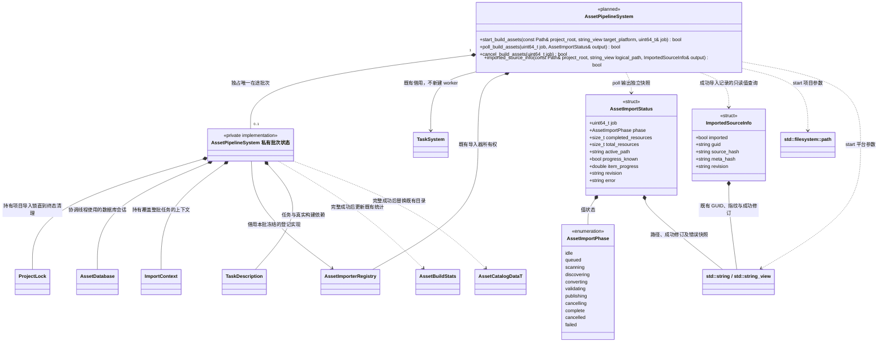
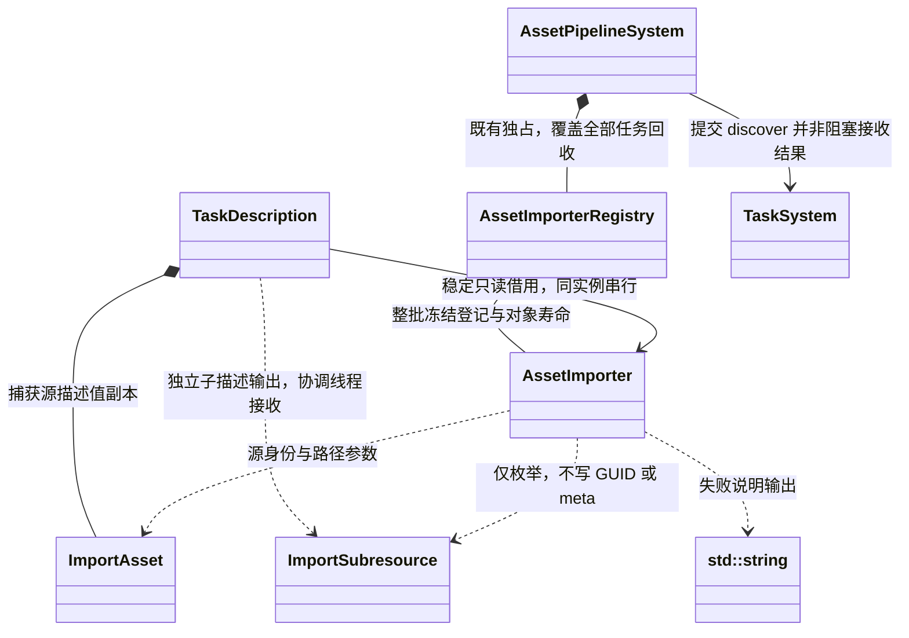
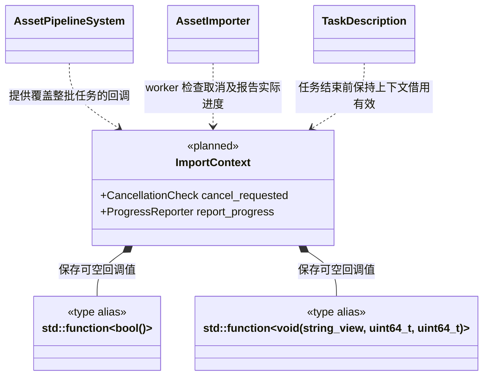
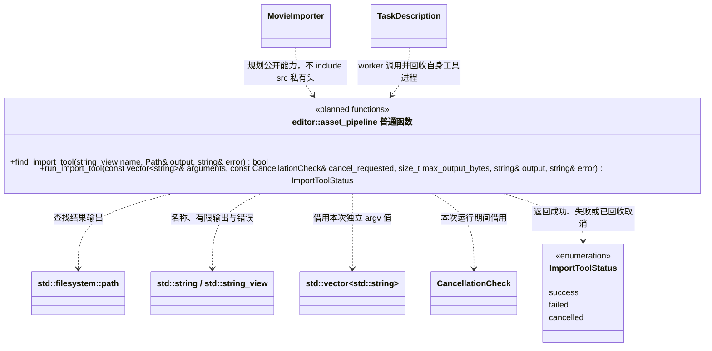

# 资源导入异步批次（规划／待实现）

本页只定义现有 `AssetPipelineSystem` 的规划增量，不表示当前已有异步导入。当前公开入口仍是同步 `build_assets()`，实现最终调用 `tasks_.run(tasks)` 等待；`ImportContext` 已增加可选取消检查，但当前同步调用没有提供作业取消入口；新 `run_import_tool()` 可限量读取输出、合作取消并回收进程，旧 `run_process()` 仍阻塞等候离线工具结束。

[现行资源管线](asset-pipeline-system.md) · [现行导入接口](asset-importers.md) · [影片导入](../../plugins/editor/class-diagrams/movie-importer.md) · [影片与导入 MCP](../../plugins/editor/class-diagrams/movie-mcp-tools.md)

目标是使影片等长转换可在编辑器继续处理命令、窗口与预览时执行；复用 ThreadSystem/TaskSystem、原项目锁、SQLite 与整批原子发布，不另建线程池、作业系统或 MovieJobManager。

## 规划公开增量

只列新增方法，原构造、登记、同步导入和查询契约仍由现行类图维护。类型属于 `engine::editor`；`Path/String` 是标准库图示简写，`uint64_t` 是批次身份，不新增通用 Job 句柄类。

`BatchState` 仅表示现有管线内部需要延长到异步结束的状态；不作为公开类、System 或注册点，也不供其他模块执行任意作业。旧 `build_assets()` 保留同步语义，规划中复用同一套私有批次步骤；异步路径不在主线程调用等待整批结束的 `tasks_.run()`。

- 本页四个新增方法标注 `[[nodiscard]]`，仅由初始化该管线的协调线程调用。`start_build_assets()` 失败时 `job=0`，不接管输入路径或调用方对象；受理后返回本管线实例内单调且不复用的非零身份。项目路径和平台字符串复制进入批次。
- `AssetImportStatus` 默认 `job=0/phase=idle`、计数与进度为零、`progress_known=false`、字符串为空，表示没有有效批次；失败查询恢复此安全初始状态。
- 同一管线只接收一个在途批次。新批次检查初始化、域就绪、项目权限和锁占用；占用时明确拒绝，不覆盖进行中的错误或状态。资源导入器登记及并发额度在批次内冻结。
- `poll_build_assets()` 只进行有界协调工作和非阻塞完成检查，返回独立值快照；不把内部指针、worker 可写状态或临时文件借用交给调用方。查询成功返回 `true`，作业失败由 `phase=failed/error` 表达；未知、已失效或其他批次的身份返回 `false`，输出保持安全初始状态。
- 宿主受理任务后保存身份，每帧在原 Task 完成派发后调用 poll。MCP 查询可以读取同一状态，不创建第二条执行链。最近一个终态快照至少保留至下一批受理或关闭；不为此建立无限历史表。
- `revision` 只在完整发布成功的 `complete` 中有值。现有 `last_build()/catalog()` 在失败或取消时仍表示最近成功批次，不能用暂存进度更新它们。

`ImportedSourceInfo` 属于 `engine::editor`，是独立返回值，不是新增数据库模型：默认 `imported=false`、其余字符串为空。`imported_source_info()` 只读取指定项目与逻辑路径已有的最近成功导入记录，返回主 GUID、当时源/meta 摘要和成功修订；不扫描媒体、不计算当前视频哈希、不创建 meta/GUID，也不暴露 SQLite 连接。尚无成功记录是正常结果，返回 `true` 与默认值；非法路径、未就绪或记录读取损坏返回 `false` 并清空整个输出。值快照不借用管线内部存储，后续导入不改变调用方已取得的内容。

## 子资源发现的异步执行

当前 `discover()` 早于 `inspect_batch()`；影片必须先知道源音轨是否存在，不能依赖尚未执行的批预检。规划直接将既有 `discover()` 作为任务执行，保留原签名；不新增前置虚方法、探测结果接口或第二套准备阶段。当前类图中的协调线程调用仍描述现有实现，本节是执行位置的规划变更。

- 次序为：收集源路径，按既有规则建立主 GUID 与默认 meta；冻结本批源/meta 输入身份与指纹；协调线程将 `ImportAsset` 值副本交给任务调用 `discover()`；非阻塞接收成功输出并确认源/meta 未变化；协调线程分配或复用稳定子 GUID；最后执行原 `inspect_batch -> scan_dependencies -> prepare_batch/convert -> 校验/发布`。昂贵输入哈希与源探测由任务执行，不塞进 poll 的协调步骤。
- `discover()` 仍为 `[[nodiscard]] const`，只输出子资源描述，不写 GUID、meta、数据库或缓存。任务捕获独立输出/错误存储；失败或取消的输出不被协调线程接受。现有 FBX/USD 等解析也由相同调度搬离协调线程，无需改变各导入器的公开方法或另写准备实现。
- 管线独占登记表并在全部任务回收前冻结登记、保留导入器；任务可以稳定借用该导入器，不需要复制多态对象。同一导入器实例的 discover 串行执行，且不与其 inspect_batch、prepare_batch 或 convert 交叉，避免给已有实现增加线程安全假设。不同导入器可按预算并行。场景、GPU、播放器等不在该稳定借用范围内。
- 源路径与主 GUID 的值副本不等于文件不可变化；前后源/meta 摘要检查必须走任务，变化时拒绝本次子描述及产物并重新导入，不把旧音轨枚举用于新文件。源文件参数编辑和本批发现仍遵守同一项目锁与输入校验边界。
- 现有 discover 签名没有批次取消回调。取消在调用前后检查；已进入解析或探测的调用须先返回、回收其拥有的子进程，批次才可进入 cancelled。MovieImporter 的外部探测须有内部执行时限，可将只捕获截止时间的检查回调传给下文工具函数；超时回收后返回发现失败，不冒充用户取消。不能宣称任意旧导入器可即时中断。关闭也先回收这些调用再清理登记、输出和暂存；不通过线程终止或提前销毁 importer 强行取消。

## ImportContext 的合作控制增量

以下是规划新增的可空回调字段，既有身份、路径、平台和资源列表不变。类型属于 `engine::editor::asset_pipeline`，不是运行时配置，也不序列化到项目或 catalog。

- `CancellationCheck = std::function<bool()>`，空回调表示本次没有外部取消请求；非空回调允许 worker 检查，必须线程安全且不访问场景、GPU、JSON 命令服务或管线生命周期。
- 两个回调借用批次内的取消和进度单元，不反向共享拥有 BatchState；管线在全部 worker 结束前保留这些单元，避免闭包与批次形成拥有环。
- `ProgressReporter = std::function<void(std::string_view path, std::uint64_t completed, std::uint64_t total)>`。`path` 只在回调期间借用，回调仅更新批次的线程安全进度单元；协调线程再组装 `AssetImportStatus`。`total=0` 表示细项总量未知，不伪造百分比。
- `completed_resources/total_resources` 统计转换项；`item_progress` 只在 `progress_known=true` 时表示当前项的可验证进度，范围为 `[0,1]`。扫描、校验与发布仍单独显示 phase，不能把视频编码完成的 100% 当作整批发布完成。
- 旧调用方和既有导入器可在回调为空时继续按原契约工作。长转换应在输入块、编码帧及输出阶段合作检查；取消标志本身不能强行中断一个任意 C++ 函数。

## 线程、取消与终态

1. 协调线程拥有批次、GUID/meta 操作、SQL 事务及发布状态。扫描、准备和校验按有界步骤组织；无须等待的纯读取可以提交既有任务域，结果仍在协调线程接受。
2. 任务由协调线程通过既有 `submit_batch/submit` 提交，worker 只处理稳定输入快照、转换与本批独立暂存产物。原 `TaskDescription.dependencies` 继续表达真实构建依赖。完成委托仍只由所属线程派发。
3. 不能把整个 `build_assets()` 包装成同一个 TaskSystem 的 worker 作业：该方法会再次控制、提交并等待该域，违反当前 owner 约束并可能造成同池等待。也不能给影片单独开一套后台线程池。
4. 离线工具通过下文规划的公开共享函数取得路径、运行并合作取消；现有 `src/editor` 私有 `run_process()` 不能作为插件已可调用的公开接口。具有 ImportContext 的转换将批次取消回调传入函数；保持原签名的 discover 不接收批次取消，MovieImporter 用内部时限回调限制探测，已运行调用必须回收后才能进入终态。不终止共享进程或其他批次工具。
5. `cancel_build_assets(job)` 对同一进行中请求幂等，记录后进入 `cancelling`，不立即声称任务已释放。收到 worker/子进程结束并清理本批暂存后才进入 `cancelled`。无可取消批次或已越过原子提交点时返回 `false`，调用方通过 poll 查询最终结果。
6. 提交前收到取消，不发布新的 `gen/catalog`；若原子提交已经开始，则完成既有恢复协议，最终只能报告完整成功或明确失败，不能声称“已取消”却暴露新版本。源文件及合法 meta 参数编辑独立于运行产物发布，不因取消而丢失。
7. `complete/cancelled/failed` 均为终态。重复 poll 返回同一快照，不重复发布目录、递增修订、触发完成通知或重新执行转换。迟到的旧任务只完成其所属批次清理，不能更新新批次。
8. 关闭先停止接收新批次、请求取消，再等待已接收任务与本批子进程退出并执行清理；任务上下文、导入器、数据库和锁不得提前销毁。关闭阶段允许等待，但借用 TaskSystem/ThreadSystem 必须仍就绪，最后才关闭它们。

## 编辑器共享的最小离线工具函数

以下函数已公开于 `include/engine/editor/asset_pipeline/import_tool.hpp`，实现留在编辑器层，命名空间为 `engine::editor::asset_pipeline`。它们是普通函数，不新增 Process 类、工具注册框架或工作线程；仅在选定方案确实使用外部工具时调用。直接链接库的方案使用同一取消检查完成可取消调用，不为两种候选提前创建后端框架。

- 两函数返回均标注 `[[nodiscard]]`。`find_import_tool()` 只查编辑器宿主部署或明确配置的工具，成功返回路径；失败清空路径和错误的旧值并给出本次说明。不把本机路径写入资源或运行包，也不把 PATH 中任意同名程序当作固定版本保证。
- `run_import_tool()` 的 argv、取消回调与输出参数借用覆盖本次调用；它在 worker 内同步完成，不再提交或等待同一任务域。实现以独立 argv 创建进程，不拼接 shell 命令；私有平台/SDL 细节不进入公开头。
- stdout/stderr 持续排空，合计只保留不超过正值 `max_output_bytes` 的诊断；超限须停止并回收本次进程后返回 `failed`，不能无限读入内存或因管道写满死锁。`output` 失败时只包含有界诊断，`error` 为明确原因，不包含半个解析结果。
- 运行前及运行中检查取消；`cancelled` 只在没有启动子进程或子进程已停止并回收后返回，输出仍有界。取消与非零退出、启动失败、读取失败区分；只回收本次函数拥有的进程。
- 现有 `asset_io.hpp` 的 `run_process()` 和 `editor_tools.hpp` 的工具定位函数位于 `src/`，仅是可供后续内部重整的实现参考，不是本规划声称插件已经拥有的公开契约。FFmpeg 仍只是候选，公开函数不承诺已部署具体编解码器。

## 编辑器与 MCP 接入

通用 `import_assets(targetPlatform?)` 受理后返回 `{job, status}`；`get_asset_import(job)` 返回阶段、计数、当前项、错误及成功修订；`cancel_asset_import(job)` 返回已接受取消请求或当前终态，不能把“请求取消”写成“取消完成”。JSON 中批次身份采用十进制 uint64 字符串，并由既有编辑器会话隔离跨进程重启的旧请求。

命令走现有 `EditorCommands` 和持久去重回执通道；任务身份与命令请求身份不同，重复提交同一命令回执不得新建第二批。通用导入结果仍交给 `EditorEnvironment::apply_resources()` 显式提交，既有构建与同步操作继续调用原资源管线；不从导入作业隐式启动或停止项目。
