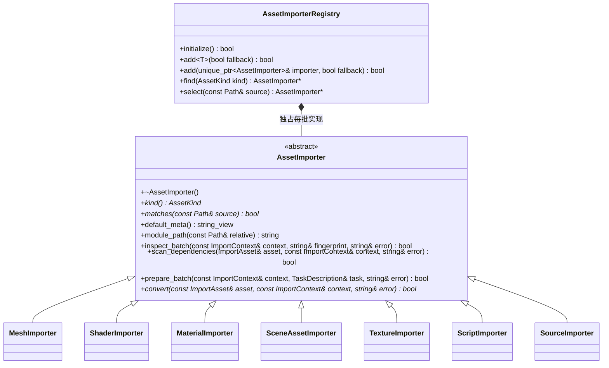

# 逐类型资源导入

资源管线按显式登记选择实现。每种资源的识别、meta 默认值、依赖、类型指纹与转换保存在自己的文件；锁、GUID、SQLite、Taskflow 编排及原子发布留在 AssetPipelineSystem。

- 析构与 kind/default_meta 为 noexcept；matches/module_path/scan_dependencies/prepare_batch/convert 为 const。inspect_batch 允许保存本批预检结果，随后转换只读。重要返回值均为 nodiscard。
- add 默认 fallback=false，成功才转移所有权；重复类型、空指针及第二个 fallback 失败。select 拒绝多个类型同时匹配，没有具体匹配时使用独立登记的普通源实现；不通过路径固定分支分派。
- ImportAsset 保存源身份及两类依赖，ImportContext 借用 GUID 映射、类型表、批次源清单，持有项目、assets、暂存输出及目标平台值；不是新的持久化模型。
- inspect_batch 收集类型工具/Schema指纹。scan_dependencies 只建立元数据；转换输出原始载荷，由管线统一封装资源实体。失败不发布暂存文件，旧缓存与目录保留。
- prepare_batch 可提供一个前置 TaskDescription，空 execute 表示没有公共任务；调用方将该类型全部失效资源任务依赖它。没有异步导入框架或新的任务执行器。
- ScriptImporter 读取 TypeScript 编译器输入快照、解析运行模块依赖，每个失效批次仅安排一次项目编译；单脚本转换只从该批次 JS 输出复制载荷。配置和工具发布前再次核对。
- TextureImporter 直接实现接口，在协调线程初始化 BasisU 后并行编码。SceneAssetImporter 调用已有 SceneImporter 的 TOML 读写能力；场景格式不再复制一份。
- 增量键格式升级到 engine-asset-importers-6；已有缓存首次重建一次，GUID、缓存路径、实体/目录格式和原子发布协议不变。各类型只携带自身Schema/工具指纹，依赖变化仍通过构建图传播。
