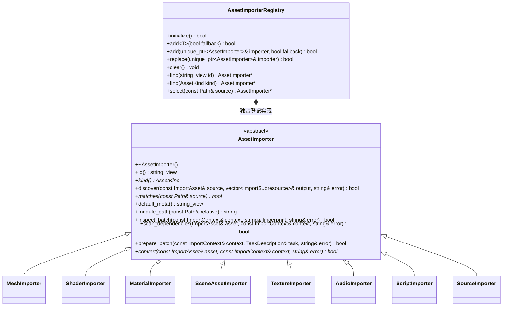

# 逐类型资源导入

资源管线按显式登记选择实现。每种资源的识别、meta 默认值、依赖、类型指纹与转换保存在自己的文件；锁、GUID、SQLite、Taskflow 编排及原子发布留在 AssetPipelineSystem。

- 析构与 kind/default_meta 为 noexcept；matches/module_path/scan_dependencies/prepare_batch/convert 为 const。inspect_batch 允许保存本批预检结果，随后转换只读。重要返回值均为 nodiscard。
- add 默认 fallback=false，成功才转移所有权；重复 id、空指针及第二个 fallback 失败。select 拒绝多个类型同时匹配，没有具体匹配时使用独立登记的普通源实现；不通过路径固定分支分派。
- 所有导入接口属于 `engine::editor::asset_pipeline`；管线在初始化时登记默认实现，并在关闭时清空。`replace` 只替换已有合法 id，失败保留调用方与登记表的所有权，替换 fallback 同步更新指针。宿主通过 `AssetPipelineSystem::add_importer / set_importer` 注入插件实现；构建期间拒绝更换，编辑器库不引用任何插件。
- `MeshImporter` 公开为普通 Mesh 导入实现，允许插件继承；未注入建模导入器时，含 `[modeling]` 的源明确返回失败，不能退回过期的渲染数组。建模源转换见[建模资源导入](../../plugins/editor/class-diagrams/modeling-mesh-importer.md)。
- ImportAsset 保存源身份及两类依赖，ImportContext 借用 GUID 映射、类型表、批次源清单，持有项目、assets、暂存输出及目标平台值；不是新的持久化模型。
- inspect_batch 收集类型工具/Schema指纹。scan_dependencies 只建立元数据；转换输出原始载荷，由管线统一封装资源实体。失败不发布暂存文件，旧缓存与目录保留。
- prepare_batch 可提供一个前置 TaskDescription，空 execute 表示没有公共任务；调用方将该类型全部失效资源任务依赖它。没有异步导入框架或新的任务执行器。
- ScriptImporter 读取 TypeScript 编译器输入快照、解析运行模块依赖，每个失效批次仅安排一次项目编译；单脚本转换只从该批次 JS 输出复制载荷。配置和工具发布前再次核对。
- TextureImporter 直接实现接口，在协调线程初始化 BasisU 后并行编码。SceneAssetImporter 调用已有 SceneImporter 的 TOML 读写能力；场景格式不再复制一份。
- 增量键格式升级到 engine-asset-importers-7；已有缓存首次重建一次，GUID、缓存路径、实体/目录格式和原子发布协议不变。各类型只携带自身Schema/工具指纹，依赖变化仍通过构建图传播。

- 导入器以 `id()` 标识源格式，资源 `kind()` 标识产物类型；多个源格式可以输出同一种资源。默认 id 为类型名，FBX/USD 等可选插件使用自己的 id。按 kind 查询仅在唯一匹配时成功。
- `discover` 在协调线程枚举源的子资源，只返回稳定 key 和产物 kind。管线维护源 meta 的 `[[subresources]] key/kind/guid`，保存已消失子资源身份以便重新出现时复用，拒绝所有 GUID 冲突。
- `ImportAsset` 保存 importer_id、subresource_key、parent_guid。每个子资源都有独立目录条目和 `cache/gen/GUID`；逻辑路径为源路径加子资源 key。转换批次及工具指纹按 importer id 调度，实体头按输出 kind 编码。
- 新 id 通过 `AssetPipelineSystem::add_importer` 装配；已有 id 才能 `set_importer`。两者仅在已初始化且空闲时接受修改。编辑器基础库只包含扩展接口，格式解析及第三方库位于各自编辑器插件。
