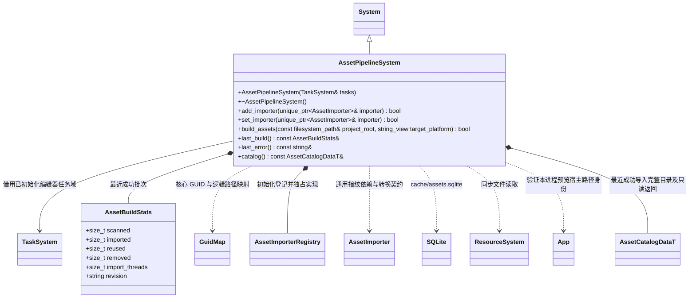
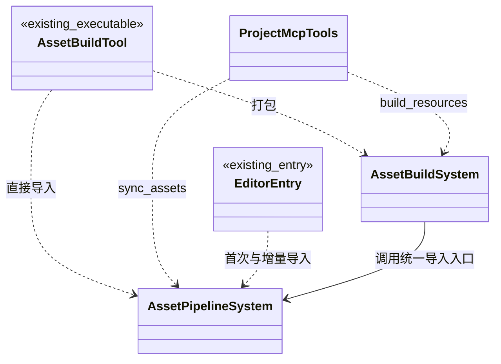
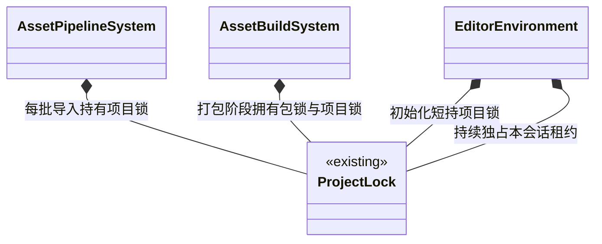

# 资源管线系统

[类图索引](../../class-diagrams/index.md) · [完整引用关系](../../class-diagrams/references.md)

`catalog()` 提供完整可用资源目录，编辑器直接取得元数据，无需打包或把清单落盘后再读回。运行时契约见[资源加载](../../runtime/resource-loading.md)。

规划入口：[资源导入异步批次（待实现）](asset-import-jobs.md)为现有系统增加 start/poll/cancel、成功源记录只读查询、前置发现准备和合作进度能力，不另建影片作业系统。当前 `build_assets()` 与 `tasks_.run()` 仍同步等待；[影片导入规划](../../plugins/editor/class-diagrams/movie-importer.md)继续复用本页身份、缓存、依赖与整批发布。以下方法定义不包含尚未实现的增量。

每次全扫描 `assets/`，为新资源创建同名 `.meta`，GUID 必须为唯一完整小写 GUID（新建使用 UUIDv4）。既有资源丢失 meta、重复 GUID、非法路径、符号链接、缺失引用或循环依赖都返回失败。移动时一起移动 meta；缓存数据库可删除重建，meta 保留资源身份。

`catalog()` 仅在成功导入后提供完整可用目录，返回借用在下次成功导入或关闭前有效；首次成功前为空，导入失败保留上一份成功目录。编辑器数据库登记全部源资源和导入状态，构建输入与必要运行依赖分别记录，精简与分包由独立的 [AssetBuildSystem](../../plugins/editor/class-diagrams/asset-build-system.md) 完成。

源 `.scene/.mesh/.shader/.material` 使用 TOML 内容；TS 源仍为 `.ts`。每个生成文件严格位于 `cache/gen/<完整GUID>`，无扩展名、类型前缀或版本子目录。`cache/catalog.bin` 为生成的 FlatBuffers 目录，SQLite 不进入运行时。GUID 映射由运行时核心共用。

PNG/JPG/JPEG 通过 [TextureImporter](texture-importer.md) 生成 BasisU 缓存，全部转换参数来自相邻 `.meta` 的 `[texture]`。材质 `[[textures]]` 以 `name` 匹配 Shader sampler，以 `texture` 保存贴图 GUID；导入时解析唯一逻辑路径并登记依赖。Shader 的 `[[samplers]]` 保存 `name/uniform/stage/default_texture/exposed`；槽位为 0..15、各自唯一，默认纹理必须是内置路径，进入 Shader 的运行依赖。Shader 源文件仅作为构建依赖，默认纹理和材质显式引用随统一目录打包、同步及加载。

Mesh 保持原六项位置/法线顶点表达，新增可选 `texcoords`（二项）、`tangents`（四项）、`colors`（四项）数组；出现时必须与顶点数相等。切线方向非零、第四项为 -1 或 1；颜色通道在 0..1。`[[submeshes]]` 的 `first_index/index_count/material_slot` 按顺序完整覆盖三角形索引，材质槽为 0..15；不填时整个 Mesh 使用槽 0。场景组件以 `additional_materials` GUID 数组给槽 1 起绑定材质，所有材质参与依赖计算。

SQLite v2 保存源指纹、转换器/Schema/配置/工具/目标版本、构建依赖、运行依赖和产物指纹。两类依赖分别使用 `dependencies` 与 `runtime_dependencies` 表。首次全量；之后重新扫描但只转换失效产物及构建依赖变化的资源。命中缓存仍校验实体头与完整产物指纹。TS 按项目编译，JS 沿用对应 TS GUID；实际生成的模块 import / export 和字面量动态 import 成为运行依赖，类型导入和声明文件只作为构建输入。

项目 OS 文件锁覆盖 meta、扫描、转换、发布。oneTBB 工作线程写独立临时产物，协调线程单独写 SQL。批次以同级暂存和备份交换 gen/catalog；SQL 提交 revision 作为恢复依据。转换失败不替换上一批产物；中断恢复在持锁后、下次扫描前完成。脚本与其他资源共用唯一的 `build_assets()` 批次发布入口。

孤立的 `.meta` 不作为资源导入；删除源文件后保留的 meta 可以随源文件恢复。任务目标平台可显式指定 `macos/ios/windows/android/linux`，空值使用宿主；后端、工具与 Schema 指纹参与增量键。

Shader 源码的 include 保守依赖全部项目普通源文件（不按 .sc/.sh 扩展名筛选），保证 .inc/.h 等变化不会漏编译。TS 使用编译器解析的实际输入快照，包含声明文件、标准库与继承 tsconfig；转换前后都校验指纹，配置中途变化不发布。

Shader 源码依赖不进入运行依赖；普通源资源仍有实体及完整目录条目，供编辑器访问和打包显式保留。转换结束后统一使用核心 `encode_resource()` 封装 `ERS1` 实体。目录版本为 2，存储定位使用 `content` 挂载及 `gen/<GUID>` 路径；`catalog()` 返回最近成功目录的只读借用，不含资源字节，失败保留上一份目录，关闭后清空。

资源管线在项目锁内探测 `cache/editor-hosts/` 的会话 OS 租约。有活租约时，必须读取到身份匹配的 idle/closed 状态；本进程编辑器主线程也可在 preview 状态增量导入，但必须同时确认 running=false、App 已初始化、登记的持久目录与本进程一致、App 内置资源目录对应本项目 cache。外部工具不能借其他编辑器的 preview 状态覆盖缓存。启动中、运行中、停止中或状态读取失败均拒绝覆盖，要求先停止项目，不自动停启。心跳过期不能授予写权限；进程退出自动解锁，残留登记不阻塞导入。编辑器调用方负责在导入成功后将 `catalog()` 及挂载直接提交给核心。独立打包职责见[资源构建系统](../../plugins/editor/class-diagrams/asset-build-system.md)。

逐类型接口与批准备见[资源导入器](asset-importers.md)。管线不按具体资源类型分派，类型识别、meta默认值、模块路径、工具指纹、依赖和转换由所选导入器实现。

`AssetPipelineSystem` 与统计属于 `engine::editor`。初始化成功后，宿主可通过 `add_importer` 添加新 id，或通过 `set_importer` 替换某个已登记 id 的实现，成功才转移独占所有权；空指针、重复或未登记/非法 id、未初始化或构建期间调用均返回失败。构建与替换由同一协调线程发起，内部互斥拒绝并行调用；并发拒绝不改写正在构建的错误信息。关闭清空登记，重新初始化恢复默认导入器，宿主需要再次注入。编辑器接口不识别插件身份，插件只向下依赖该接口。

多输出源在 `discover` 阶段枚举子资源，由管线为每个稳定 key 维护 GUID、逻辑路径和产物记录。源格式以 importer id 调度，输出资源 kind 仅控制运行时实体类型；各子资源独立增量、依赖及目录发布。已消失的子资源身份仍保留在源 meta 并参与冲突检查，重新出现时复用。格式解析见统一[资源导入插件](../../plugins/editor/class-diagrams/asset-import.md)内的[FBX](../../plugins/editor/class-diagrams/fbx-importer.md)与[USD](../../plugins/editor/class-diagrams/usd-import.md)实现；基础管线不链接具体插件。

导入并发配置读取 `settings/editor-import.toml` 的 `[common].import_threads`，文件和字段必需，项目显式配置为 `8`，仅接受 `1–64` 的整数；非法配置返回失败。

## 目标切换互斥

继续只保留一份 `cache/gen/<GUID>`。安全检查属于共享导入链路，所有调用入口遵守同一规则，不依赖命令行工具或 MCP 自行加锁。

### 锁与会话所有权

复用现有 `cache/.asset-build.lock` 和 ProjectLock；不增加另一把目标锁，不增加公开锁参数、可绕过检查的导入重载或锁管理类。

ProjectLock 的 acquire／try_acquire 保持现有非阻塞契约。每条拥有关系表示所属阶段自己的锁对象；ProjectLock 不变成可重入锁，也不在同一调用栈重复取得同一路径。

| 阶段 | 锁与检查 |
| --- | --- |
| EditorEnvironment.initialize | 短持项目锁；在首次导入和预览前登记 OS 会话租约及初始原生 idle 状态，记录同一 session／项目／运行目录和编辑器所需 targetPlatform，再释放项目锁 |
| AssetPipelineSystem.build_assets | 自身取得项目锁，在修改 meta／缓存前校验 requested target、所有活租约及既有原生状态；持锁覆盖扫描、转换、发布 |
| AssetBuildSystem.build 的导入阶段 | 直接调用 build_assets，由管线独自持锁；外层不提前持有项目锁 |
| AssetBuildSystem.build 的打包阶段 | 导入返回后，依次取得现有输出包锁、项目锁；重新读取并校验完整导入目录／目标／revision 及实体，再持锁构造、校验和发布完整输出 |
| 编辑器刷新、启动与预览 | 保留当前项目锁保护目录读取、快照捕获和状态转换；不再在嵌套调用中重复获取同一路径 |

固定多锁顺序为“输出包锁 → 项目锁”；导入和编辑器登记只持项目锁，不反向申请包锁。工具和 MCP 只调用业务方法，不拥有外围目标锁。锁忙返回明确错误，既有 bool／last_error 契约保持不变。

### 目标与租约规则

- 活租约记录的是编辑器自身需要的原生 targetPlatform，而不是当时 cache 的平台。任一活租约与请求目标不同即拒绝导入，包括 idle 或 preview 编辑器；不能因为磁盘已是 web 就跳过检查。
- 同目标导入继续遵守现有原生状态约束：running／starting／stopping 拒绝，外部进程不能借其他宿主的 preview 状态写缓存；本进程预览仍核对项目、session、App 路径及 running=false。
- EditorEnvironment 在 initialize 中原子发布会话租约和无玩法／无预览的初始 idle 状态，早于首次 build_assets。后续 EditorSystem 使用同一 session 更新状态，apply_resources 复用租约并校验目录目标，不能等首次提交资源时才登记。任何初始化失败均撤销自己的候选登记；不依赖 MCP 或心跳推断存活。
- 登记成功后管线才能开始同目标初始导入，因此不需要为了“自身初始化”绕过活租约检查。原生目录和状态校验仍由共享编辑器实现负责，运行时核心不识别宿主身份。
- 关闭必须先停止导入／预览／玩法的资源访问，再删除自己的登记、释放 OS 租约。撤销租约只减少占用，无需再套目标锁或与在途导入相互等待；并发读到不完整退出记录时允许本次导入保守失败。异常退出后 OS 解锁，遗留登记不会获得活租约资格。
- 当前版本的登记新增 targetPlatform 后，相关原生状态写入、工具和用例一并升级；活租约缺字段或身份不匹配时明确失败，不猜测目标或兼容旧记录。

### 导入与打包之间

导入缓存发布和运行包发布仍是两个独立阶段，不扩大为跨系统事务。两阶段之间释放项目锁：若另一个合法调用改变了缓存，打包重新持锁后发现完整目录、目标或 revision 不匹配，明确失败并保留旧包，不自动重试、不拼接两个版本的文件。

如果 Web 导入先完成，随后原生编辑器开始初始化，它必须在自己的同目标导入完成后才能使用资源；打包可能成功读取原 Web 快照，也可能因锁忙或快照变化而失败。两种结果均不允许把 Web Shader 交给原生预览。编辑器先登记则 Web 导入直接拒绝；这条次序由同一项目锁决定。

本节同样覆盖直接 build_assets、直接 AssetBuildSystem、CLI、build_resources 和 sync_assets。Web 导出器只消费已完成且再次校验的运行包，最终产物的 staging／发布契约见 [Web 导出](web-export.md#包输出)。

### 契约验证

沿用资源管线／构建／编辑器环境用例，验证所有入口在活原生租约下拒绝 web、初始登记与目标切换竞争、直接调用不能绕过检查、嵌套构建无重复加锁、阶段间快照变化保留旧包，以及同目标合法导入仍可用。用同步栅栏制造竞争，不靠定时睡眠猜测。
