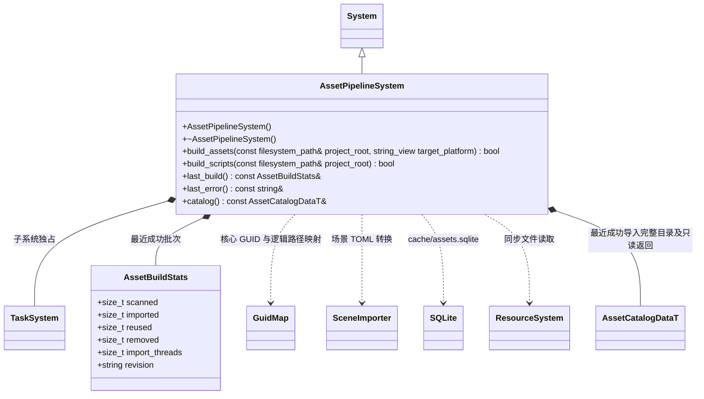

# 资源管线系统

[类图索引](../../class-diagrams/index.md) · [完整引用关系](../../class-diagrams/references.md)

`catalog()` 提供完整可用资源目录，编辑器直接取得元数据，无需打包或把清单落盘后再读回。运行时契约见[资源加载](../../runtime/resource-loading.md)。

每次全扫描 `assets/`，为新资源创建同名 `.meta`，GUID 必须为唯一完整小写 GUID（新建使用 UUIDv4）。既有资源丢失 meta、重复 GUID、非法路径、符号链接、缺失引用或循环依赖都返回失败。移动时一起移动 meta；缓存数据库可删除重建，meta 保留资源身份。

`catalog()` 仅在成功导入后提供完整可用目录，返回借用在下次成功导入或关闭前有效；首次成功前为空，导入失败保留上一份成功目录。编辑器数据库登记全部源资源和导入状态，构建输入与必要运行依赖分别记录，精简与分包由独立的 [AssetBuildSystem](asset-build-system.md) 完成。

源 `.scene/.mesh/.shader/.material` 使用 TOML 内容；TS 源仍为 `.ts`。每个生成文件严格位于 `cache/gen/<完整GUID>`，无扩展名、类型前缀或版本子目录。`cache/catalog.bin` 为生成的 FlatBuffers 目录，SQLite 不进入运行时。GUID 映射由运行时核心共用。

SQLite v2 保存源指纹、转换器/Schema/配置/工具/目标版本、构建依赖、运行依赖和产物指纹。两类依赖分别使用 `dependencies` 与 `runtime_dependencies` 表。首次全量；之后重新扫描但只转换失效产物及构建依赖变化的资源。命中缓存仍校验实体头与完整产物指纹。TS 按项目编译，JS 沿用对应 TS GUID；实际生成的模块 import / export 和字面量动态 import 成为运行依赖，类型导入和声明文件只作为构建输入。

项目 OS 文件锁覆盖 meta、扫描、转换、发布。Taskflow 工作线程写独立临时产物，协调线程单独写 SQL。批次以同级暂存和备份交换 gen/catalog；SQL 提交 revision 作为恢复依据。转换失败不替换上一批产物；中断恢复在持锁后、下次扫描前完成。`build_scripts()` 调用完整的 `build_assets()`，不建立独立脚本发布流程。

孤立的 `.meta` 不作为资源导入；删除源文件后保留的 meta 可以随源文件恢复。任务目标平台可显式指定 `macos/ios/windows/android/linux`，空值使用宿主；后端、工具与 Schema 指纹参与增量键。

Shader 源码的 include 保守依赖全部项目普通源文件（不按 .sc/.sh 扩展名筛选），保证 .inc/.h 等变化不会漏编译。TS 使用编译器解析的实际输入快照，包含声明文件、标准库与继承 tsconfig；转换前后都校验指纹，配置中途变化不发布。

Shader 源码依赖不进入运行依赖；普通源资源仍有实体及完整目录条目，供编辑器访问和打包显式保留。转换结束后统一使用核心 `encode_resource()` 封装 `ERS1` 实体。目录版本为 2，存储定位使用 `content` 挂载及 `gen/<GUID>` 路径；`catalog()` 返回最近成功目录的只读借用，不含资源字节，失败保留上一份目录，关闭后清空。

资源管线在项目锁内探测 `cache/editor-hosts/` 的会话 OS 租约。有活租约时，必须读取到身份匹配的 idle/closed 状态；启动中、运行中、停止中或状态读取失败均拒绝覆盖，要求先停止项目，不自动停启。心跳过期不能授予写权限；进程退出自动解锁，残留登记不阻塞导入。编辑器调用方负责在导入成功后将 `catalog()` 及挂载直接提交给核心。独立打包职责见[资源构建系统](asset-build-system.md)。
