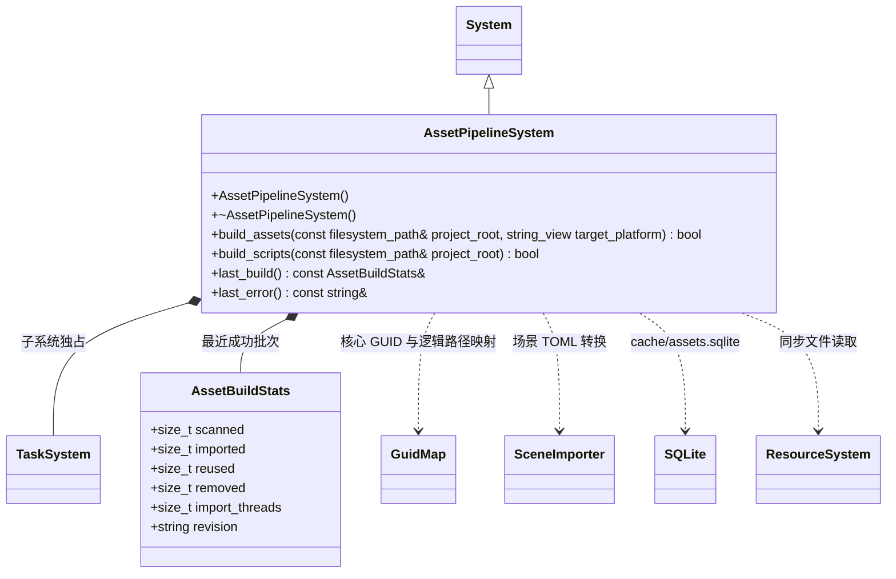

# 资源管线系统

[类图索引](../../class-diagrams/index.md) · [完整引用关系](../../class-diagrams/references.md)

每次全扫描 `assets/`，为新资源创建同名 `.meta`，GUID 必须为唯一完整小写 GUID（新建使用 UUIDv4）。既有资源丢失 meta、重复 GUID、非法路径、符号链接、缺失引用或循环依赖都返回失败。移动时一起移动 meta；缓存数据库可删除重建，meta 保留资源身份。

源 `.scene/.mesh/.shader/.material` 使用 TOML 内容；TS 源仍为 `.ts`。每个生成文件严格位于 `cache/gen/<完整GUID>`，无扩展名、类型前缀或版本子目录。`cache/catalog.bin` 为生成的 FlatBuffers 目录，SQLite 不进入运行时。GUID 映射由运行时核心共用。

SQLite 保存源指纹、转换器/Schema/配置/工具/目标版本、依赖、产物指纹。首次全量；之后重新扫描但只转换失效产物及依赖变化的资源。命中缓存仍校验产物指纹。TS 按项目一次编译，JS 沿用对应 TS GUID；声明文件只作为输入。

项目 OS 文件锁覆盖 meta、扫描、转换、发布。Taskflow 工作线程写独立临时产物，协调线程单独写 SQL。批次以同级暂存和备份交换 gen/catalog；SQL 提交 revision 作为恢复依据。转换失败不替换上一批产物；中断恢复在持锁后、下次扫描前完成。`build_scripts()` 调用完整的 `build_assets()`，不建立独立脚本发布流程。

孤立的 `.meta` 不作为资源导入；删除源文件后保留的 meta 可以随源文件恢复。任务目标平台可显式指定 `macos/ios/windows/android/linux`，空值使用宿主；后端、工具与 Schema 指纹参与增量键。

Shader 源码的 include 保守依赖全部项目普通源文件（不按 .sc/.sh 扩展名筛选），保证 .inc/.h 等变化不会漏编译。TS 使用编译器解析的实际输入快照，包含声明文件、标准库与继承 tsconfig；转换前后都校验指纹，配置中途变化不发布。
