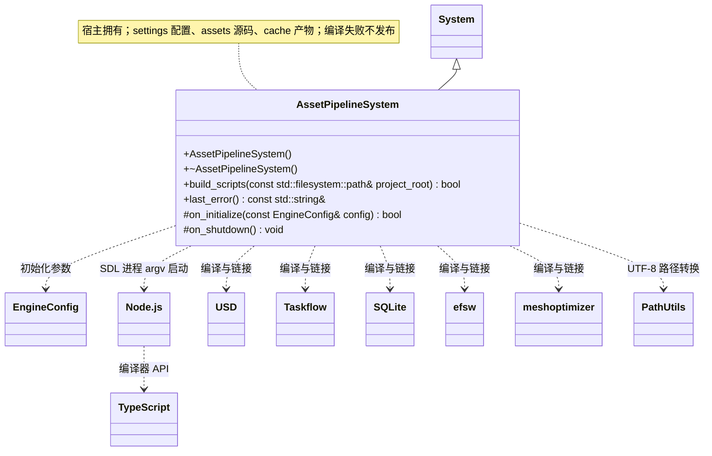

# 资源管线系统

[类图索引](../../class-diagrams/index.md) · [完整引用关系](../../class-diagrams/references.md)

本轮桌面编辑器实现；独立根系统由工具宿主初始化并反序关闭。跨图引用不重复定义公开方法。

通过 SDL3 进程 API 传递独立 argv，调用固定构建脚本；Node 和构建脚本由构建配置指定。TS 配置放 settings，源码 assets，编译成功后替换 cache/assets。失败返回 false，并保留上次有效产物；调用方不能在 false 后同步旧产物。保留 USD、Taskflow、SQLite、efsw、meshoptimizer 的实际编译链接探针。`last_error()` 返回借用错误描述。

返回状态及只读访问方法标注 `[[nodiscard]]`；析构和清理为 `noexcept`，钩子标注 `override`。`last_error()` 为 const noexcept，只读字符串借用在下一次业务操作前有效。

公共路径编码复用 [PathUtils](../../runtime/class-diagrams/path-utils.md)；路径规范化和安全检查仍由本类负责。
