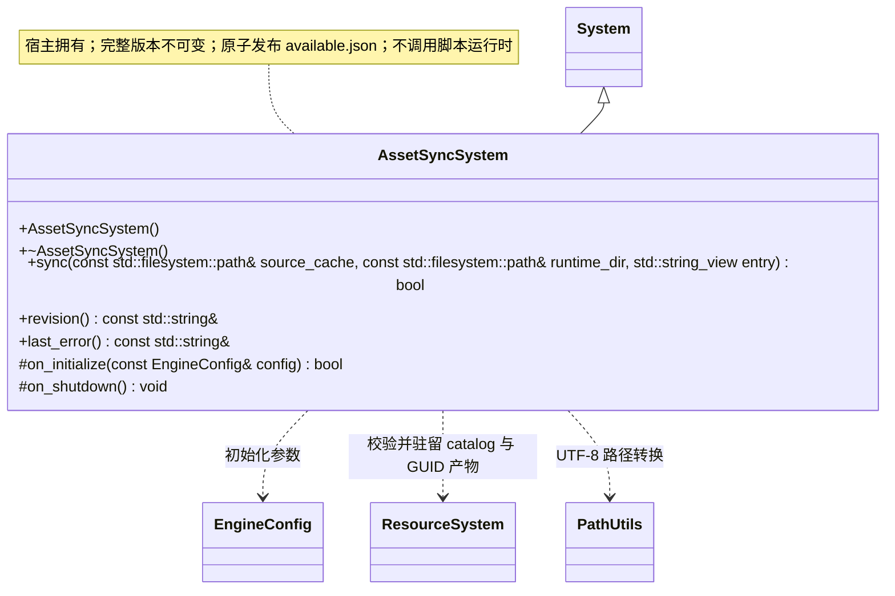

# 资源同步系统

[类图索引](../../class-diagrams/index.md) · [完整引用关系](../../class-diagrams/references.md)

本轮桌面编辑器实现；独立根系统由工具宿主初始化并反序关闭。跨图引用不重复定义公开方法。

`sync()` 返回是否完整发布，`revision()` 只表示可用版本，不表示脚本已经运行。相对路径拒绝越界及符号链接，版本目录不可变。`available.json` 包含 revision、entry、files（path、size、FNV-1a 64 位 hash）和累计 deleted；删除项阻止包内回退复活。失败保持旧清单，暂存不参与加载。

返回状态及只读访问方法标注 `[[nodiscard]]`；析构和清理为 `noexcept`，钩子标注 `override`。`last_error()` 与 `revision()` 为 const noexcept，只读字符串借用在下一次业务操作前有效。

公共路径编码复用 [PathUtils](../../runtime/class-diagrams/path-utils.md)；路径规范化和安全检查仍由本类负责。

本轮 GUID 契约：正式输入是项目 `cache/`，只发布 `catalog.bin` 与 `gen/<完整GUID>`，不复制数据库、临时文件或旧路径树。项目缓存不创建版本子目录；设备持久运行目录继续使用不可变 `assets/versions/<revision>/` 快照，每份快照保留 `catalog.bin` 和 `gen/`。同步校验目录全部记录与产物后才原子发布可用版本；接收端不依赖 SQLite。

正式 catalog 分支同步全部引用产物，不要求存在玩法脚本；entry 只记录后续启动提示。是否可以启动由脚本系统检查，同步系统不代替运行时激活资源或执行 Gameplay。
