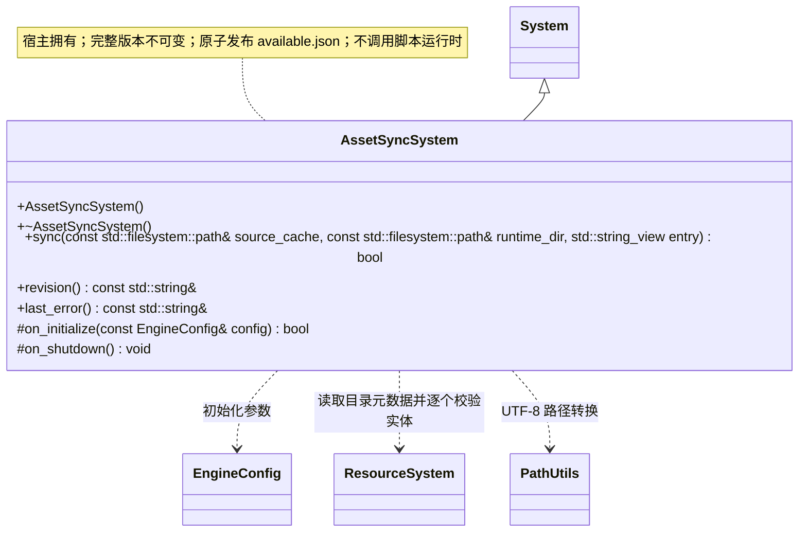

# 资源同步系统

同步输入必须包含有效的统一运行清单及其引用的独立文件或包；无清单的散脚本目录返回失败。由编辑器/宿主明确提交目录；发布监测由运行宿主负责。输入契约见[资源构建](../resource-build.md)和[同步加载设计](../../runtime/resource-loading.md)。

[类图索引](../../class-diagrams/index.md) · [完整引用关系](../../class-diagrams/references.md)

桌面编辑器与同步工具使用的独立根系统，由宿主初始化并反序关闭。跨图引用不重复定义公开方法。

`sync()` 返回是否完整发布，`revision()` 只表示可用版本，不表示脚本已经运行。相对路径拒绝越界及符号链接，版本目录不可变。`available.json` 包含 revision、entry、files（path、size、FNV-1a 64 位 hash）和累计 deleted；删除项阻止包内回退复活。失败保持旧清单，暂存不参与加载。

返回状态及只读访问方法标注 `[[nodiscard]]`；析构和清理为 `noexcept`，钩子标注 `override`。`last_error()` 与 `revision()` 为 const noexcept，只读字符串借用在下一次业务操作前有效。

公共路径编码复用 [PathUtils](../../runtime/class-diagrams/path-utils.md)；路径规范化和安全检查仍由本类负责。

资源输入可以是项目 `cache/` 或指定清单构建的独立运行目录，只发布 `catalog.bin` 与它引用的散文件或包。项目缓存不创建版本子目录；设备持久运行目录使用不可变 `assets/versions/<revision>/` 快照，每份快照保持清单中的相对存储路径。同步校验目录全部记录与产物后才原子发布可用版本；接收端不依赖 SQLite。

基于 catalog 同步全部引用产物，不要求存在玩法脚本；entry 只记录玩法启动提示。是否可以启动由脚本系统检查，同步系统不代替运行时激活资源或执行 Gameplay。

统一运行清单接入：同步收集 `entry.location.path` 的唯一物理文件集合及 catalog.bin，挂载限定为部署根 content；多个资源位于同一合并包时只复制一次包。源与暂存中的每个实体通过公共解包校验，临时字节逐个释放，不构造全量 ResourceCatalog 字节快照。合并包以固定大小缓冲区流式校验哈希，允许包体大于单个资源实体的读取上限。资源目录可以不含玩法入口；同步只交付资源，能否启动由宿主检查。sqlite、源meta和settings不会进入版本。
