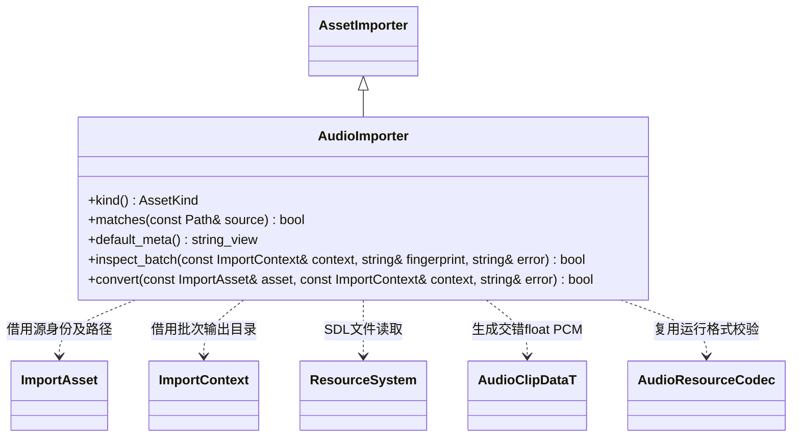

# 音频导入

音频转换属于 `engine::editor::asset_pipeline`；播放、设备和场景音源不进入导入器。

只识别 `.wav`（大小写不敏感）。当前支持未压缩 PCM 8/16/24/32 位及 IEEE float32 WAV，包括对应 WAVE_FORMAT_EXTENSIBLE 子格式。ADPCM、MP3、OGG 尚未提供导入支持，不将其当成可播放音频。源声道为 1–8，目标声道为 1 或 2，采样率为 8000–192000 Hz。

相邻 `.meta` 的 `[audio]` 保存 `sample_rate`（默认 48000）、`channels`（默认 2）、`gain`（默认 1，范围 0–4）；未知字段、错误类型或越界值使导入失败。增益应用后裁剪到 [-1,1]，NaN/Inf 样本始终失败。源资源仍以唯一 GUID 登记，不复制身份。

先检查 RIFF/WAVE 块长度、格式、声道和帧对齐，再使用 `SDL_LoadWAV_IO` 读取内存文件，并以 `SDL_ConvertAudioSamples` 转为目标交错 float PCM。源读取与解码上限为 64 MiB，PCM 上限为 64 MiB 减 128 KiB，为 FlatBuffers 和公共实体头留空间；重采样输出在分配前检查长度上界。

生成 `AudioClipDataT`，包含采样率、声道、帧数和样本，存入无后缀 `cache/gen/<完整GUID>`；本阶段是未压缩 PCM，不宣称流式播放或压缩音频支持。导入器不加载其他资源，无资源依赖。音频 Schema、SDL 解码版本、导入器版本、源与 meta 共同参与增量指纹；批次失败由管线保留上一版缓存和目录，所有 SDL 内存及文件流按配对 API 清理。
