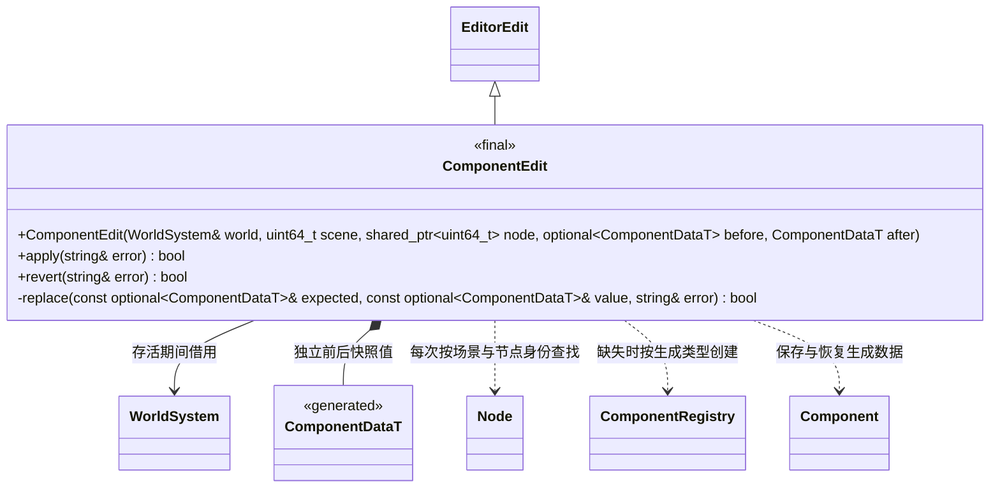

# 按类型组织的组件编辑命令

[类图索引](../../class-diagrams/index.md) · [命令与撤销](editor-commands.md) · [物理与音频 MCP](../../plugins/editor/class-diagrams/physics-audio-mcp-tools.md)

组件行为属于运行时 `engine`。参数解析、节点身份检查、添加组件、快照和撤销属于编辑器 `engine::editor::components`；Collider、RigidBody、AudioSource、AudioListener 各自一个命令实现文件。没有新增系统或 Manager。

修改已有组件前先比较完整生成快照；场景、节点、组件或数据已变化时拒绝陈旧操作。应用设置通过组件 `restore_data()`，不直接修改内部字段。原本没有组件时，首次应用创建，撤销调用 `Node::remove_component()`；恢复失败移除本次创建的组件。历史只保存数据和节点身份，不持有音频资源或组件借用，不重建已有组件。

节点身份使用与创建命令共享的 `shared_ptr<uint64_t>`，允许编辑器重做创建后更新内部身份；这不是节点所有权，外部请求仍须使用新查询的 ID。物理步进可能改变刚体快照中的速度，撤销此时返回冲突，不覆盖模拟结果。

以下是命名空间函数，不代表额外 C++ 类：

| 注册函数 | 可撤销设置与查询 | 非撤销运行操作 |
| --- | --- | --- |
| `register_collider(world, commands, aliases)` | `set_collider`、`get_collider` | 静态 mesh 形状通过资源目录解析独立 Mesh 路径 |
| `register_rigid_body(world, commands, aliases)` | `set_rigid_body`、`get_rigid_body` | `add_impulse` |
| `register_audio_source(world, commands, aliases)` | `set_audio_source`、`get_audio_source` | `play_audio`、`pause_audio`、`stop_audio`、`get_audio_state` |
| `register_audio_listener(world, commands, aliases)` | `set_audio_listener`、`get_audio_listener` | 无 |
| `register_animator(world, commands, aliases)` | `set_animator`、`get_animator` | `play_animation`、`pause_animation`、`stop_animation`、`seek_animation`、`get_animation_state` |

注册函数均返回 `bool`，借用 `WorldSystem&`、`EditorCommands&` 和编辑器内部节点映射 `NodeAliases&`；由 SceneCommands 登记。`set_*` 可添加缺失组件，`get_*` 缺失时返回失败；设置和查询均要求当前 `sceneId` / `nodeId`。音频的 `clip` 输入使用逻辑资源路径，编辑器转换为 GUID，组件加载并检查实际资源类型；空路径清空 clip。

所有 `set_*` 共用主线程批量事务与撤销历史。冲量与播放控制是瞬态请求，不进入 `execute_batch` 或撤销记录；成功表示请求被组件接受，音频实际输出须检查后续 `get_audio_state`。运行时组件和系统不依赖这些命令或 JSON。
