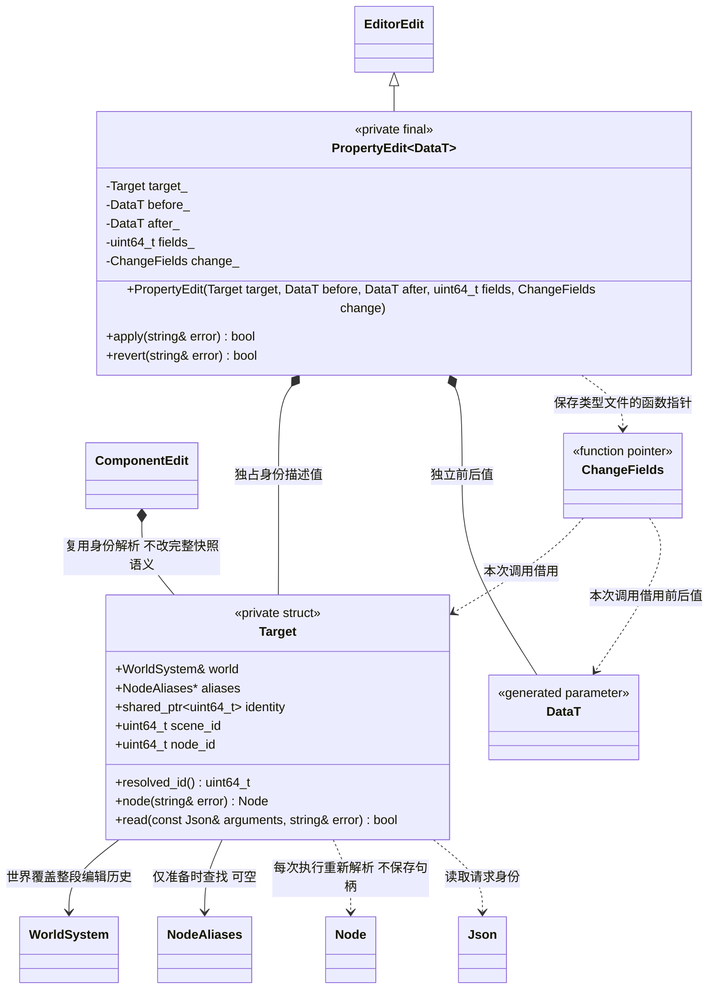
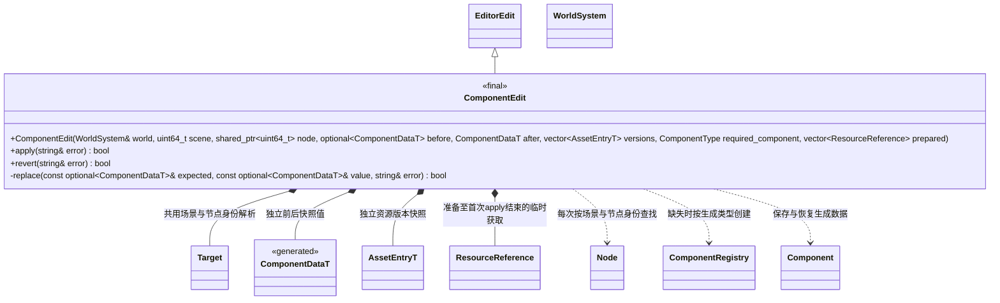

# 按类型组织的组件编辑命令

[类图索引](../../class-diagrams/index.md) · [命令与撤销](editor-commands.md) · [物理与音频 MCP](../../plugins/editor/class-diagrams/physics-audio-mcp-tools.md)

组件行为属于运行时 `engine`。参数解析、节点身份检查、添加组件、快照和撤销属于编辑器 `engine::editor::components`；Collider、RigidBody、AudioSource、AudioListener 各自一个命令实现文件。没有新增系统或 Manager。

**精简状态：字段编辑合并及共用 Target 已按确认类图实现；ComponentEdit 的完整快照契约保持。**

## 字段编辑合并目标

TransformEdit、CameraEdit、LightEdit 收敛为同一个私有 `PropertyEdit<DataT>` 模板，DataT 直接使用相应生成的 TransformDataT、CameraDataT、LightDataT。类型文件保留参数解析、字段集合及类型校验，不再各自定义相同的记录容器和 apply/revert。类不导出到公开头文件，也不建立字段反射或第二套历史。

- `ChangeFields = bool (*)(const Target&, const DataT& expected, const DataT& replacement, uint64_t fields, std::string& error)`；它是每类型文件里的普通函数，无捕获、无 RTTI、无字段名运行时分派。fields 是该类型内部的明确位集合，不新增持久字段。准备函数拒绝空字段请求和未知字段，从允许字段生成非空位集合，并直接绑定本类型的非空回调；构造仅保存安全数据。
- apply 调用 change(target, before, after, fields, error)，revert 交换前后值。每次先通过 Target 核对活动场景与共享节点身份，再获取当前组件并读取设置；缺失组件返回原类型错误，不创建组件。
- 类型函数只比较选中字段与 expected，比较规则与原实现相同；在当前设置副本上只替换选中字段，再通过组件 set_settings 一次提交。其他字段被外部修改不构成本记录的冲突，也不会被撤销覆盖；非法新值或冲突保持当前对象不变。各命令现有错误文本及返回值保持。
- Target 复用现有 NodeAliases / shared_ptr<uint64_t> 身份单元；创建命令重做可更新单元值。PropertyEdit 与 ComponentEdit 不各自维护节点映射；ComponentEdit 内部构造 Target。Target 不拥有世界、节点或组件，resolved_id/node 为 const，read 只在准备时修改描述。
- apply/revert 标注 nodiscard 与 override，禁止复制编辑记录；独占记录继续交给 EditorCommands。字段编辑仍接受同一个 Prefab 包装器，显式字段、同值写入及 false 的覆盖意图不丢失。
- MaterialEdit、TextureEdit、StateEdit、模型实例化和插件状态编辑有材质槽、资源版本、结构或运行状态语义，本轮保持各自记录，不用完整快照替代字段冲突检查。

## 完整组件快照

修改已有组件前先比较完整生成快照；场景、节点、组件或数据已变化时拒绝陈旧操作。应用设置通过组件 `restore_data()`，不直接修改内部字段。原本没有组件时，首次应用创建，撤销调用 `Node::remove_component()`；恢复失败移除本次创建的组件。历史只保存数据和节点身份，不持有音频资源或组件借用，不重建已有组件。

节点身份使用与创建命令共享的 `shared_ptr<uint64_t>`，允许编辑器重做创建后更新内部身份；这不是节点所有权，外部请求仍须使用新查询的 ID。物理步进可能改变刚体快照中的速度，撤销此时返回冲突，不覆盖模拟结果。

渲染及 UI 命令同样通过 `SceneCommands::node_identity()` 取得共享身份，不单独复制节点 ID。资源绑定在准备时显式加载并检查类型，所得 ResourceReference 随记录保留到首次 apply 成功或失败结束，避免准备后释放、提交时重新读取。长期历史只保存 AssetEntryT 版本值；应用、撤销和重做仍核对当前目录，不因临时保活跳过版本检查。`versions` 与 `prepared` 默认空、`required_component` 默认 NONE。

以下是命名空间函数，不代表额外 C++ 类：

| 注册函数 | 可撤销设置与查询 | 非撤销运行操作 |
| --- | --- | --- |
| `register_collider(world, commands, aliases)` | `set_collider`、`get_collider` | 静态 mesh 形状通过资源目录解析独立 Mesh 路径 |
| `register_rigid_body(world, commands, aliases)` | `set_rigid_body`、`get_rigid_body` | `add_impulse` |
| `register_audio_source(world, commands, aliases)` | `set_audio_source`、`get_audio_source` | `play_audio`、`pause_audio`、`stop_audio`、`get_audio_state` |
| `register_audio_listener(world, commands, aliases)` | `set_audio_listener`、`get_audio_listener` | 无 |
| `register_animator(world, commands, aliases)` | `set_animator`、`get_animator` | `play_animation`、`pause_animation`、`stop_animation`、`seek_animation`、`get_animation_state` |

注册函数均返回 `bool`，借用 `WorldSystem&`、`EditorCommands&` 和编辑器内部节点映射 `NodeAliases&`；由 SceneCommands 登记。`set_*` 可添加缺失组件，`get_*` 缺失时返回失败；设置和查询均要求当前 `sceneId` / `nodeId`。音频的 `clip` 输入使用逻辑资源路径，编辑器转换为 GUID，组件加载并检查实际资源类型；空路径清空 clip。

所有 `set_*` 共用主线程批量事务与撤销历史。冲量与播放控制是瞬态请求，不进入 `execute_batch` 或撤销记录；成功表示请求被组件接受，音频实际输出须检查后续 `get_audio_state`。运行时组件和系统不依赖这些命令或 JSON。

各类型命令重建 payload 时显式保留已有组件的局部 `enabled/visible`，只覆盖请求携带的字段；撤销快照保存两项标记。通用局部状态修改由 SceneCommands 的 `set_component_state` 负责，不重复在每个 payload 命令增加显示字段。
