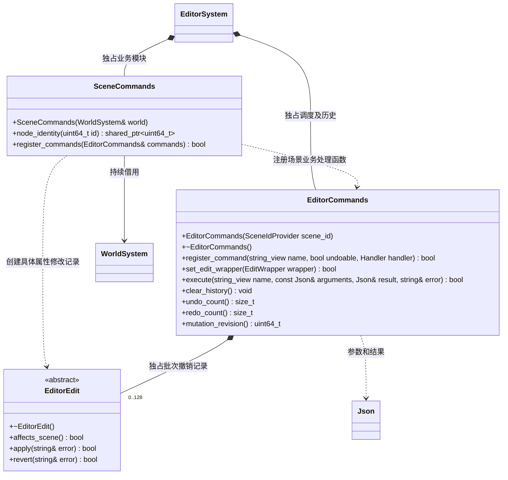
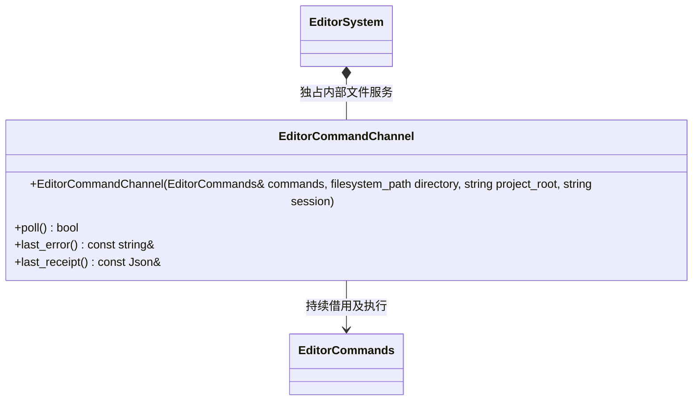
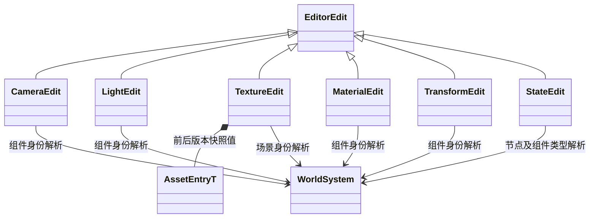

# 编辑器命令与撤销

[类图索引](../../class-diagrams/index.md) · [编辑器系统](editor-system.md)

编辑器主线程执行命令；业务模块自行注册名称和处理函数。JSON、批量事务、撤销和文件通道均留在编辑器层，运行时组件只提供既有公共读写接口。

- `SceneIdProvider = std::function<std::uint64_t()>`，无场景返回 0。每次执行先读取代次，变化时清空历史。提供者与模块借用的世界须存活到命令服务销毁。
- `Handler = std::function<bool(const Json&, Json&, std::unique_ptr<EditorEdit>&, std::string&)>`。查询返回结果及空记录；修改仅创建尚未应用的独占记录，由命令服务执行。注册不允许覆盖已有名称或内置 batch/undo/redo。
- `EditorEdit::apply/revert` 检查场景、完整节点身份和相关属性期望值；失败保持当前对象不变。属性记录只修改涉及字段；组件快照记录比较并恢复整个组件生成数据。已有对象不重建，创建命令及新组件的撤销/重做按各自契约销毁与重建对象。
- batch 最多 64 条修改，按顺序执行，任一失败反序回滚已应用部分；一批只产生一次撤销记录。禁止嵌套 batch、查询及 undo/redo。撤销反序恢复，重做正序恢复；发现陈旧值则拒绝并恢复本次已执行部分。最多保留 128 批，新的修改清空 redo。
- `EditorEdit::affects_scene()` 为 const、noexcept 虚函数，默认 true；不改场景的记录自行返回 false。批量记录只要任一子记录影响场景就返回 true。
- `mutation_revision()` 返回单调场景修改代次，仅影响场景的成功修改、批量、撤销、重做递增；查询、全局渲染设置和清空历史不改变代次。编辑器预览用它保护尚未保存的场景，不依赖撤销栈长度推测修改状态。
- SceneCommands 注册 `get_scene`、`create_node`、`set_active_camera`、`set_transform`、`set_light`、`set_material_parameter`。仅操作已有活动场景；无场景查询返回 null，修改失败。`create_node` 创建 Transform 和可选 Camera/Light；同场景名称唯一，返回名称后可查询节点身份。撤销删除自身创建的无后代节点，重做可分配新的运行时 ID；其他修改仍检查身份与期望状态。不新增建模、渲染或资源导入职责。
- `get_scene(offset?, limit?)` 按场景节点顺序分页，参数均为非负整数。offset 默认 0，省略 limit 返回该偏移后的全部节点，保持无参数查询行为；limit 为 0 或 offset 超出节点总数时返回空节点数组。结果顶层返回 `totalNodes` 和请求的 `offset`，`scene.nodes` 仅包含当前页；无活动场景时 `scene=null`、`totalNodes=0`。分页不锁定跨请求快照，调用方应核对 sceneId，并在结构变化后重新查询。
- 节点 ID 与 sceneId 使用完整十进制 uint64 字符串；数值 JSON ID、零值、溢出及旧场景身份均拒绝。材料参数支持 float/v2/v3/v4，遵守原生材质类型与值域检查。

通道位于编辑器持久目录：`editor-command.json` 输入，`editor-receipt.json` 为最新回执，`editor-receipts/<session>/<requestId>.json` 保存各请求原回执。输入上限 1 MiB。请求为 `{session,projectRoot,requestId,command,arguments}`；回执为 `{session,projectRoot,requestId,command,success,result,error,completedAtMs}`。session/requestId 仅允许不超过 128 个 ASCII 字母、数字、下划线或连字符。会话与项目必须匹配；同会话 requestId 只执行一次，先写独立回执再更新最新快照。写回失败保留已执行结果供重试。`start_project`、`stop_project` 与其他非撤销命令共用此通道；项目状态仍单独发布到 `project-status.json`，不再维护第二套启停请求文件。

内部 `EditorCommandChannel` 仅负责上述文件传输。命令执行失败属于正常回执，不使编辑器退出；传输失败保留待写回执供下一帧重试。`last_receipt()` 借用最近完整发布的原回执；回执重试成功的这一帧先返回，宿主观察该结果后下一帧再处理新请求。已执行 ID 不因回执文件被删除而重新执行。回执同样限制为 1 MiB；超大查询返回同 ID 的有界失败回执。输入及历史回执在读取前后都校验长度，历史回执校验身份及字段类型。

EditorCommands 与 SceneCommands 明确禁止复制。EditorCommands 的析构、clear_history、undo_count、redo_count 为 noexcept；后两者为 const。EditorEdit 通过 noexcept 虚析构释放；场景查询、命令执行和编辑记录 apply/revert 不承诺 noexcept。需要检查的状态返回值标注 nodiscard。

渲染编辑命令增加 `set_camera`、`set_material_texture`；材质命令接受可选 `slot`（默认 0），灯光命令接受类型、范围和聚光半角。相机和灯光编辑仅回滚被请求的字段；贴图编辑记录前后资源身份和版本；撤销重新按路径加载，资源已变更时拒绝旧操作，历史不阻止停止项目或热重载释放资源。所有命令继续走同一主线程事务与撤销栈。场景查询包含投影、灯光类型、全部材质槽及具名贴图。

这些具体编辑记录是命令模块的内部实现，仅实现基类 apply/revert，不向运行时公开。

物理与音频组件使用独立的[按类型组件命令](component-commands.md)，共用 ComponentEdit 保存前后生成快照，并由 SceneCommands 显式登记。播放控制和冲量调用普通运行时接口，作为非撤销操作执行；不放进可撤销批次。

`set_material_type(sceneId,nodeId,slot?,path)` 选择已有材质资源。内部 MaterialTypeEdit 保存前后参数与贴图快照和依赖版本；不在历史中持有资源获取，执行时重新校验并临时加载。撤销恢复原材质全部覆盖值，资源版本改变拒绝陈旧操作；普通参数修改仍只改变请求字段。

创建命令在编辑器内部共享自身节点的当前运行时 ID，后续属性历史随重做重建重新定位；外部仍须使用 get_scene 得到的新 ID，旧 ID 不接受。映射随场景代次清理，不向 Node 增加编辑器身份字段。

`SceneCommands::node_identity(id)` 返回当前场景中已存在节点的共享 ID 单元；调用前核验场景代次，不存在返回空。插件编辑记录共享同一单元，创建命令重做更新单元值后可继续定位；共享的是身份值，不是节点或场景所有权。场景改变清空当前映射，历史执行仍须核验其原场景代次。

模型实例化的事务与资源版本校验见[模型命令](model-commands.md)。

`set_node_state(sceneId,nodeId,enabled?,visible?)` 和 `set_component_state(sceneId,nodeId,componentType,enabled?,visible?)` 至少修改一个布尔字段；组件类型使用 `get_scene` 的 `componentType`（生成枚举名称）。内部 StateEdit 复用共享节点身份，只检查和修改请求的局部标记，不恢复整个组件数据、不改后代的局部设置。支持批次、撤销和重做；外部改变相同字段时拒绝陈旧历史。查询对节点和组件同时返回局部 `enabled/visible` 与继承后 `active/visibleInHierarchy`；组件额外返回 `componentType` 与 `instanceId`，后者仅标识当前实例。

Prefab 编辑登记一个 `EditWrapper = std::function<bool(std::string_view, const Json&, std::unique_ptr<EditorEdit>&, std::string&)>`；`set_edit_wrapper` 仅允许登记一次非空回调。命令先准备尚未应用的记录，再由包装器验证目标并把显式属性覆盖与原修改组成同一撤销记录。包装器只处理可撤销编辑，批次走相同入口；未知会影响 Prefab 的修改明确拒绝，不在保存时把任意运行变化推断成覆盖。回调借用 WorldSystem/SceneCommands 至命令服务释放。

## 内部命令实现归属

`SceneCommands` 保留场景/节点生命周期、活动相机选择、节点身份单元和显式命令登记。Transform、Camera、Light 与材质编辑分别位于 `commands/components/` 的类型文件；具体 Edit 继续派生同一个 EditorEdit，只有 EditorCommands 拥有事务和历史。共享 Target 及 JSON 数值校验留在已有 component_edit 内部实现，继续借用同一 NodeAliases，不另建注册表、状态镜像或命令框架。

`get_scene` 的分页和诊断快照位于 `commands/scene_query.cpp`；它不承担运行时名称/路径查询。材质快照和恢复归材质命令文件，供预制体事务复用。拆分只改变源文件归属，命令名称、参数、回执、字段级陈旧检查、批次回滚及创建后重做的节点身份均保持。
