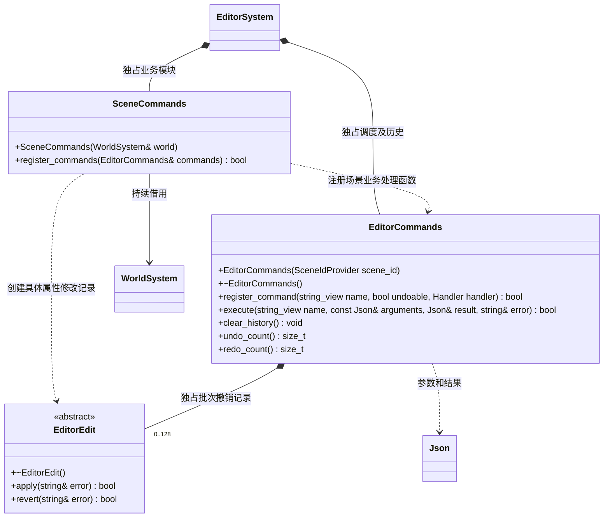
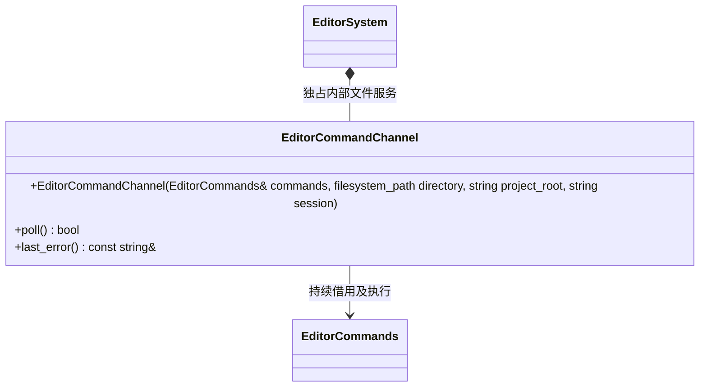
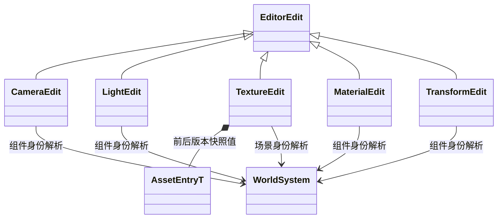

# 编辑器命令与撤销

[类图索引](../../class-diagrams/index.md) · [编辑器系统](editor-system.md)

编辑器主线程执行命令；业务模块自行注册名称和处理函数。JSON、批量事务、撤销和文件通道均留在编辑器层，运行时组件只提供既有公共读写接口。

- `SceneIdProvider = std::function<std::uint64_t()>`，无场景返回 0。每次执行先读取代次，变化时清空历史。提供者与模块借用的世界须存活到命令服务销毁。
- `Handler = std::function<bool(const Json&, Json&, std::unique_ptr<EditorEdit>&, std::string&)>`。查询返回结果及空记录；修改仅创建尚未应用的独占记录，由命令服务执行。注册不允许覆盖已有名称或内置 batch/undo/redo。
- `EditorEdit::apply/revert` 检查场景、完整节点身份和相关属性期望值；失败保持当前对象不变。仅修改涉及的字段，保留脚本对其他字段的修改。不会重建场景、节点或组件。
- batch 最多 64 条修改，按顺序执行，任一失败反序回滚已应用部分；一批只产生一次撤销记录。禁止嵌套 batch、查询及 undo/redo。撤销反序恢复，重做正序恢复；发现陈旧值则拒绝并恢复本次已执行部分。最多保留 128 批，新的修改清空 redo。
- SceneCommands 注册 `get_scene`、`set_transform`、`set_light`、`set_material_parameter`。仅操作已有活动场景；无场景查询返回 null，修改失败。不新增建模、渲染或资源导入职责。
- 节点 ID 与 sceneId 使用完整十进制 uint64 字符串；数值 JSON ID、零值、溢出及旧场景身份均拒绝。材料参数支持 float/v2/v3/v4，遵守原生材质类型与值域检查。

通道位于编辑器持久目录：`editor-command.json` 输入，`editor-receipt.json` 为最新回执，`editor-receipts/<session>/<requestId>.json` 保存各请求原回执。输入上限 1 MiB。请求为 `{session,projectRoot,requestId,command,arguments}`；回执为 `{session,projectRoot,requestId,command,success,result,error,completedAtMs}`。session/requestId 仅允许不超过 128 个 ASCII 字母、数字、下划线或连字符。会话与项目必须匹配；同会话 requestId 只执行一次，先写独立回执再更新最新快照。写回失败保留已执行结果供重试。旧 `project-control.json` 启停协议保持兼容。

内部 `EditorCommandChannel` 仅负责上述文件传输。命令执行失败属于正常回执，不使编辑器退出；传输失败保留待写回执供下一帧重试。已执行 ID 不因回执文件被删除而重新执行。回执同样限制为 1 MiB；超大查询返回同 ID 的有界失败回执。输入及历史回执在读取前后都校验长度，历史回执校验身份及字段类型。

EditorCommands 与 SceneCommands 明确禁止复制。EditorCommands 的析构、clear_history、undo_count、redo_count 为 noexcept；后两者为 const。EditorEdit 通过 noexcept 虚析构释放；场景查询、命令执行和编辑记录 apply/revert 不承诺 noexcept。需要检查的状态返回值标注 nodiscard。

渲染编辑命令增加 `set_camera`、`set_material_texture`；材质命令接受可选 `slot`（默认 0），灯光命令接受类型、范围和聚光半角。相机和灯光编辑仅回滚被请求的字段；贴图编辑记录前后资源身份和版本；撤销重新按路径加载，资源已变更时拒绝旧操作，历史不阻止停止项目或热重载释放资源。所有命令继续走同一主线程事务与撤销栈。场景查询包含投影、灯光类型、全部材质槽及具名贴图。

这些具体编辑记录是命令模块的内部实现，仅实现基类 apply/revert，不向运行时公开。
