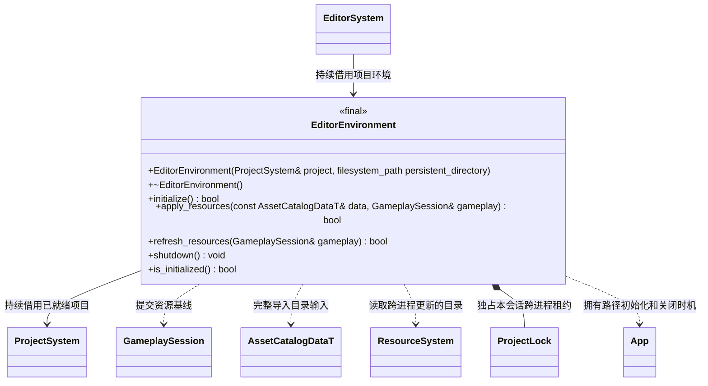

# 编辑器环境

[类图索引](../../class-diagrams/index.md) · [编辑器系统](editor-system.md) · [项目系统](project-system.md)

- 环境只负责编辑器路径映射和资源准备，不继承 System、不拥有 Engine。项目先初始化，环境在 App 使用者关闭后再关闭。
- 初始化映射项目 `cache/` 到 App 内置资源根，复用现有持久、缓存路径语义；不复制会话资源快照、不创建运行包。项目未就绪、重复初始化或 App 已被其他宿主占用时失败且不破坏既有状态。
- `apply_resources()` 将管线提供的内存目录和 cache 的 content 挂载直接交给 GameplaySession。无需序列化再读回，编辑器不打包即可运行。
- `refresh_resources()` 用于其他进程的 MCP/CLI 已更新导入结果后，在显式启动前读取已发布 catalog；修订未变化则保持原目录，变化时提交新基线。EditorSystem 使用与导入器相同的 ProjectLock 覆盖刷新和启动，防止读取与覆盖并发。
- initialize 在项目锁内先取得 `cache/editor-hosts/<session>.lock` 的 OS 独占锁，原子发布 projectRoot/runtimeDir/targetPlatform 登记和匹配 session 的初始 idle 状态，先于首次导入。失败清理本次登记、租约与 App；apply_resources 只验证目标和提交资源，失败保留既有登记。导入器在同一项目锁内探测宿主租约及状态，规则见下节。
- 关闭先删除本会话登记，再释放租约；进程异常退出时 OS 自动释放锁，遗留登记无需等待心跳超时。ProjectLock 为[编辑器公开扩展工具](extension-tools.md)中的独占文件锁，`try_acquire(path, acquired, error)` 以返回值区分 I/O 失败，以 acquired 表示取得锁或锁被占用；`acquire(path, error)` 要求取得锁才成功。
- 不提供项目根重复 getter。项目身份仅供编辑器会话回执；核心不接收项目配置或编辑器模式。
- 关闭保留项目产物和持久部署，只释放自己的 App 与会话登记。重复关闭安全，析构兜底；项目或 App 提前失效时查询返回 false。
- 类型不可复制或移动，构造为 explicit，持久目录默认空；析构、关闭及查询为 noexcept，查询为 const，状态返回标注 nodiscard。

## Web 导出所需租约调整

本会话租约和初始原生状态在 initialize 登记，先于首次导入与预览；记录编辑器自身 targetPlatform，apply_resources 只复用并验证，不再首次登记。initialize 的签名及本环境所有权不变，失败清理候选状态。

项目锁范围、所有入口的目标拒绝规则和关闭次序统一见[资源管线目标切换设计](asset-pipeline-system.md#目标切换互斥)。apply_resources 保留早期租约；资源提交失败不释放宿主的目标所有权。
