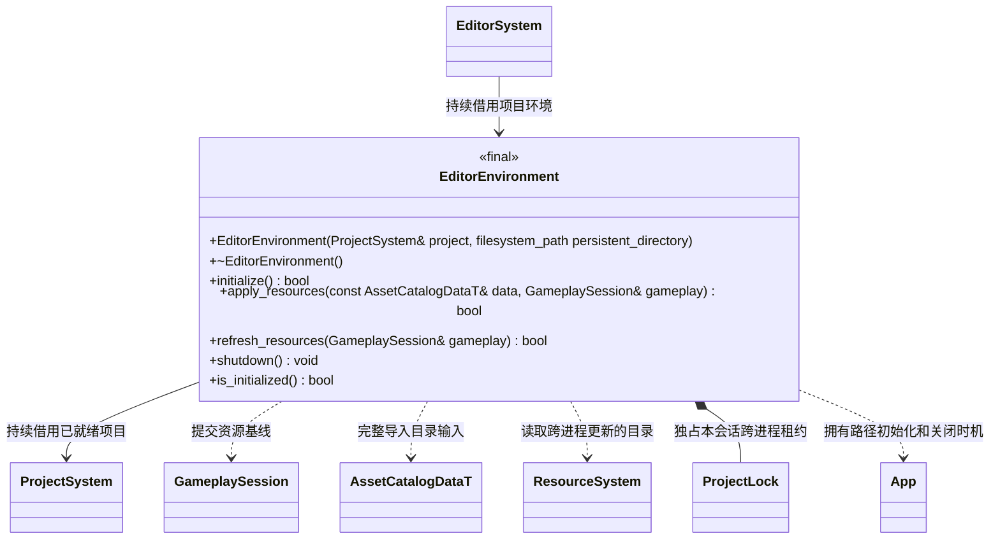

# 编辑器环境

[类图索引](../../class-diagrams/index.md) · [编辑器系统](editor-system.md) · [项目系统](project-system.md)

- 环境只负责编辑器路径映射和资源准备，不继承 System、不拥有 Engine。项目先初始化，环境在 App 使用者关闭后再关闭。
- 初始化映射项目 `cache/` 到 App 内置资源根，复用现有持久、缓存路径语义；不复制会话资源快照、不创建运行包。项目未就绪、重复初始化或 App 已被其他宿主占用时失败且不破坏既有状态。
- `apply_resources()` 将管线提供的内存目录和 cache 的 content 挂载直接交给 GameplaySession。无需序列化再读回，编辑器不打包即可运行。
- `refresh_resources()` 用于其他进程的 MCP/CLI 已更新导入结果后，在显式启动前读取已发布 catalog；修订未变化则保持原目录，变化时提交新基线。EditorSystem 使用与导入器相同的 ProjectLock 覆盖刷新和启动，防止读取与覆盖并发。
- 首次成功提交后，持有 `cache/editor-hosts/<session>.lock` 的 OS 独占锁，并原子发布同名 `.json` 的 projectRoot/runtimeDir 登记。EditorSystem 状态使用相同 session。导入器在项目锁内探测租约：仍持锁的宿主必须有身份匹配的 idle/closed 状态，否则拒绝覆盖；暂停、长帧、缺失或损坏状态均不能因心跳超时获得写权限。
- 关闭先删除本会话登记，再释放租约；进程异常退出时 OS 自动释放锁，遗留登记无需等待心跳超时。ProjectLock 为编辑器内部文件锁，`try_acquire(path, acquired, error)` 以返回值区分 I/O 失败，以 acquired 表示取得锁或锁被占用；`acquire(path, error)` 要求取得锁才成功。
- 不提供项目根重复 getter。项目身份仅供编辑器会话回执；核心不接收项目配置或编辑器模式。
- 关闭保留项目产物和持久部署，只释放自己的 App 与会话登记。重复关闭安全，析构兜底；项目或 App 提前失效时查询返回 false。
- 类型不可复制或移动，构造为 explicit，持久目录默认空；析构、关闭及查询为 noexcept，查询为 const，状态返回标注 nodiscard。
