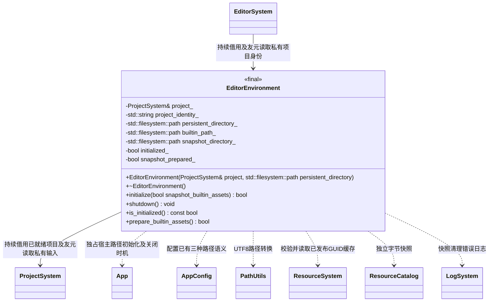

# 编辑器环境

[类图索引](../../class-diagrams/index.md) · [编辑器系统](editor-system.md) · [项目系统](project-system.md)

- 编辑器宿主环境不是逐帧系统，不继承 `System`；借用项目，不拥有运行时 `Engine`。宿主先初始化 ProjectSystem，再初始化环境，最后启动引擎与编辑器；反序关闭，环境在 App 使用者关闭后清理快照和 App。
- 构造只保存借用及可选持久目录输入；项目未就绪、环境重复初始化、其他宿主已初始化 App 或路径准备失败时返回 `false`。重复初始化不改动当前环境；`shutdown()` 可重复调用，析构兜底。复制和移动均禁用。
- 不提供项目根目录 getter。私有规范化项目身份只供编辑器发布会话回执，MCP 继续核对其目标项目；运行时统一读取 App 的内置、持久、缓存路径。项目根包含 settings/cache/assets，不能替代资源目录的含义。
- `initialize(false)` 把项目 assets 映射到 `App::builtin_assets_path()`；`initialize(true)` 为脚本运行建立独占的会话内置快照目录。资源转换后调用 `prepare_builtin_assets()`，从项目 cache/catalog.bin 与 cache/gen/完整GUID 校验并读取独立字节快照，再写入会话内置目录的 catalog.bin 与 gen/完整GUID，重复准备返回 `false`，不覆盖已准备内容。
- 初始发布和 MCP 同步仍写入 App 持久目录；脚本按相对路径优先读取可修改持久缓存，再回退内置快照。环境不参与脚本选择或热重载。
- 环境关闭只删除本次创建的快照目录，保留持久数据、项目编译缓存和其他会话目录。初始化失败时清理自己已创建的目录。
- 项目或 App 提前失效后 `is_initialized()` 返回 `false`，编辑器拒绝后续工作；宿主不可在环境存活时自行重配 App。

构造为 explicit，析构与 shutdown 为 noexcept；返回状态的方法均标注 nodiscard，清理失败仅记录日志。
