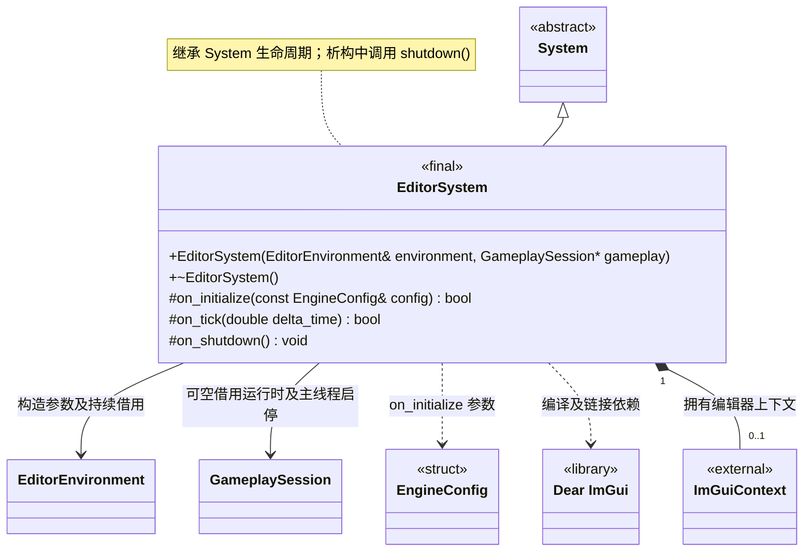

# 编辑器系统

[类图索引](../../class-diagrams/index.md) · [引擎与系统](../../runtime/class-diagrams/engine-system.md) · [完整引用关系](../../class-diagrams/references.md)

仅定义 `EditorSystem` 的方法；其他节点为跨图引用或第三方类型。

- 独立宿主模块，由编辑器宿主管理根系统生命周期；运行时 `Engine` 不拥有或依赖它。
- 构造函数借用宿主拥有的 `EditorEnvironment`；环境持续借用已就绪的 `ProjectSystem`。项目、环境和 App 必须存活且保持就绪直到编辑器关闭；失效环境拒绝启动与更新。
- `editor_app` 必须接收 `--project <path>`，依次初始化项目、编辑器环境、运行宿主和编辑器，反序关闭；`engine_app` 启动不接收项目路径。编辑器仍通过继承的 `add_subsystem()` 独占和统一管理其他编辑器子系统。
- 创建和销毁 Dear ImGui 上下文；尚未接入窗口后端、绘制编辑器界面或引入业务工具。
- 公开业务接口只有构造与析构；继承 `System` 的公共生命周期方法，不提前增加业务方法。初始化失败和清理遵守[系统约定](../../runtime/class-diagrams/engine-system.md)。
- `gameplay` 默认为空，此时仅管理编辑器上下文；非空时借用运行宿主提供的玩法会话，接入本机项目控制协议，App 必须先就绪。宿主必须让 GameplaySession 和 EditorEnvironment 存活到 EditorSystem 关闭。编辑器作为环境友元读取私有规范化项目身份，仅用于会话回执和 MCP 目标校验；不公开第二套路径接口。
- 编辑器启动默认空白，不自动执行 Gameplay。`on_tick()` 在主线程读取带会话标识与请求编号的 `project-control.json`，调用 GameplaySession 启停，原子发布 `project-status.json`；旧会话请求不重放，重复请求不重复执行。状态包含待机、启动中、运行中、停止中、关闭及最近错误。
- 宿主在每轮引擎更新之前调用编辑器更新，窗口最小化时仍处理停止请求。项目画面占满同一窗口，停止后清理运行资源并恢复空白。

C++ 限定符：构造为 `explicit`；构造、析构及 `on_shutdown()` 为 `noexcept`；析构和受保护钩子标注 `override`，返回状态的钩子标注 `[[nodiscard]]`。

资源重整接入：start_project 使用管线相同的 ProjectLock 保护 environment.refresh_resources 与 GameplaySession.start；导入占用锁时返回失败，已运行时重复启动仍幂等。资源导入和构建不自动停止或重启项目。
