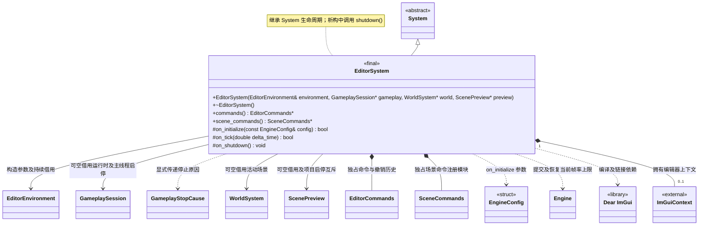

# 编辑器系统

编辑器提供普通命令与原生启动推进；独立 MCP 端点拥有协议通道并适配原生结果身份。

[类图索引](../../class-diagrams/index.md) · [引擎与系统](../../runtime/class-diagrams/engine-system.md) · [完整引用关系](../../class-diagrams/references.md)

仅定义 `EditorSystem` 的方法；其他节点为跨图引用或第三方类型。

- 独立宿主模块，由编辑器宿主管理根系统生命周期；运行时 `Engine` 不拥有或依赖它。
- 构造函数借用宿主拥有的 `EditorEnvironment`；环境持续借用已就绪的 `ProjectSystem`。项目、环境和 App 必须存活且保持就绪直到编辑器关闭；失效环境拒绝启动与更新。
- `editor_app` 必须接收 `--project <path>`，依次初始化项目、编辑器环境、运行宿主和编辑器，反序关闭；`engine_app` 启动不接收项目路径。编辑器仍通过继承的 `add_subsystem()` 独占和统一管理其他编辑器子系统。
- 创建和销毁 Dear ImGui 上下文；尚未接入窗口后端或绘制编辑器界面。场景编辑由独立命令模块提供。
- 公开接口包含构造、析构与命令服务借用；具体业务由模块注册，继承 `System` 的公共生命周期方法。初始化失败和清理遵守[系统约定](../../runtime/class-diagrams/engine-system.md)。
- `gameplay` 默认为空，此时管理编辑器上下文与编辑器帧率配置；非空时借用运行宿主提供的玩法会话，提供项目启停命令，App 必须先就绪。宿主必须让 GameplaySession 和 EditorEnvironment 存活到 EditorSystem 关闭。编辑器作为环境友元读取私有规范化项目身份用于编辑器配置；MCP 目标校验与回执由宿主装配的端点负责，不公开第二套项目路径接口。
- 编辑器启动默认空白，不自动执行 Gameplay。EditorCommands 在所属线程执行启停命令，`on_tick()` 推进已受理的 GameplaySession 准备。文件轮询、会话校验、去重、逐请求回执及 `project-status.json` 发布由 [EditorMcpEndpoint](../../plugins/editor/class-diagrams/editor-mcp-tools.md#独立-mcp-端点) 独占；编辑器核心不包含或链接 MCP。状态文件是端点组合的观察结果，不是编辑器运行状态的来源。
- 原生 `editor-status.json` 只表达编辑器的项目身份和当前业务状态，供资产管线结合 OS 宿主租约检查是否允许覆盖资源缓存。它由本系统的同一状态值发布，与 MCP 是否装配无关；进入 starting 前的原子发布失败必须拒绝启动，不能让导入器继续相信旧 idle 状态。该文件不监听命令、不保存去重和回执。MCP 的 `project-status.json` 是端点在此普通查询之上组合运行帧、能力和命令事实的观察输出，两个消费者不各自维护状态机。
- 编辑器启动读取项目 `settings/editor-settings.toml` 的 `[common].target_frame_rate`，文件和字段必需，项目显式配置为 `60`；仅接受 `-1` 或正的 32 位整数，非法配置返回失败。此配置仅属于编辑器，核心不读取项目文件。
- 启动玩法前保存核心当前帧率上限，切换到 `-1` 后调用 GameplaySession；业务可设置自己的上限。启动失败、停止、脚本自动停止、切到预览及关闭编辑器时，在玩法清理之后恢复保存值；重复启动和停止不会覆盖备份，玩法设置不写回编辑器配置。
- 宿主每帧以核心 `begin_frame()/end_frame()` 包围编辑器命令、预览或玩法更新及渲染，待机与预览共用编辑器上限；窗口暂停沿用事件轮询等待，不额外叠加限帧等待。
- 配置 ScenePreview 时，预览状态发布为 `preview`；start_project 先关闭预览，stop_project 同时关闭预览并停止玩法，禁止项目和预览同时驱动世界。宿主在预览期间跳过 RuntimeHost::tick，仅更新窗口、预览输入与渲染。
- 宿主在每轮引擎更新之前调用编辑器更新，窗口最小化时仍处理停止请求。项目画面占满同一窗口，停止后清理运行资源并恢复空白。
- `world` 默认空，非空时须与 GameplaySession 一起存活到编辑器关闭。业务与撤销契约见[编辑器命令](editor-commands.md)，不在 EditorSystem 展开具体组件处理或协议传输。
- `commands()` 返回已初始化命令服务的可空借用，供宿主在进入帧循环前注册其他业务模块；初始化之前或关闭后返回空，不暴露组件内部可写数据。

C++ 限定符：构造为 `explicit`；构造、析构及 `on_shutdown()` 为 `noexcept`；析构和受保护钩子标注 `override`，返回状态的钩子标注 `[[nodiscard]]`。

资源重整接入：start_project 使用管线相同的 ProjectLock 保护 environment.refresh_resources 与玩法准备的目录捕获；导入占用锁时返回失败，已运行时重复启动仍幂等。资源导入和构建不自动停止或重启项目。

start_project 调用 GameplaySession.begin_prepare 并返回已受理及 prepareId，由后续 on_tick 调用 step_prepare；ready 后显式 activate_prepared，失败保存对应原生结果再清理。端点通过相同 prepareId 查询，不能以 start_project 的 success 当作启动完成。刷新与捕获完成后释放项目锁，不跨帧持锁等待 GPU；准备状态归已有玩法会话。stop_project 显式传 GameplayStopCause::requested，故障清理传 failure；重复启动已经运行的项目返回当前 Run 事实，不重新启动。唯一结果契约见[玩法会话](../../runtime/class-diagrams/gameplay-session.md#启动请求的身份与结果)。

`scene_commands()` 与 `commands()` 都为 nodiscard、noexcept，返回本编辑器拥有的服务借用；无世界、初始化前或关闭后为空。宿主据此给独立插件提供通用节点身份与事务入口，EditorSystem 不识别插件的具体命令。
