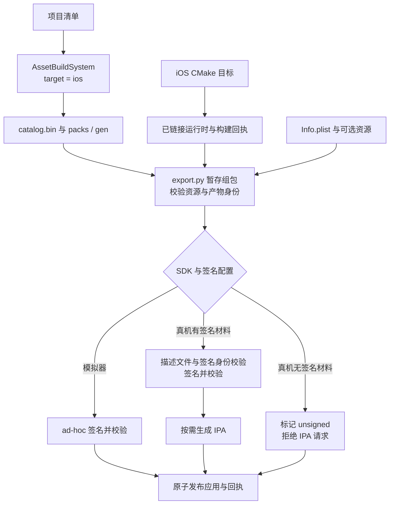

# iOS 游戏包导出

> **已实现构建、导出与签名身份校验。** 编辑器和资源导入运行在桌面，产物为独立 iOS 游戏包。设备运行与签名覆盖范围见[测试文档](../../testing.md#ios-原生运行包)；入口及生命周期见 [iOS 宿主](../../runtime/class-diagrams/ios-host.md)。

[类图索引](../../class-diagrams/index.md) · [资源构建](../../plugins/editor/class-diagrams/asset-build-system.md) · [资源管线](asset-pipeline-system.md)

## 复用边界

沿用 AssetPipelineSystem、AssetBuildSystem、ShaderImporter、TextureImporter 与共享目录校验、运行设置合并、原子发布工具；不增加 IosAssetBuilder 或平台资源模型。iOS 打包器是平台工具模块，图中的步骤不是新建 C++ 类。



- 桌面资产构建工具接收现有 target_platform=ios，Shader 使用 shaderc 的 ios / metal 目标，纹理遵守相邻 meta 和既有目标选择；普通、实例化、surface、水面、字体及计算阶段都必须按 iOS 目标构建。
- 资源版本使用既有 catalog.bin 与 packs / gen，包含依赖闭包与引擎基线资源。运行时只读取包内产物，不链接导入器、SQLite、桌面工具或项目源文件。
- 复用共享的目标互斥与资源快照：同一项目的原生编辑器会话持有租约时，拒绝原地切换到 iOS 导入目标；编辑器 idle 也不例外。iOS 工具不复制另一套锁。
- 资源快照、设置、可执行文件和平台资源全部校验，并完成所选签名模式要求后才原子替换输出；失败保留上一份完整产物。模拟器采用 ad-hoc 签名；真机无凭据时仅发布明确标为 unsigned 的检查产物，有凭据时必须通过签名校验。unsigned 不具有可安装或可上架的承诺。

## 平台目标与产物身份

CMake Presets 使用 Ninja + ccache，宿主工具保持 macOS 原生；目标编译使用 Xcode SDK。真机使用 iphoneos / arm64，首版模拟器使用 iphonesimulator / arm64。两者有独立 triplet、依赖安装和构建目录，即使都是 arm64 也不能互换静态库。

预设最低部署版本为 iOS 17.0；目标、依赖与包清单保持一致。该值是构建要求，设备运行覆盖另行记录。编译缓存和符号放 build/。编译使用 CMake 原生 iOS 支持；Ninja 所需的签名与打包由平台导出器明确处理，见 [CMake Apple 交叉构建说明](https://cmake.org/cmake/help/latest/manual/cmake-toolchains.7.html#cross-compiling-for-ios-tvos-or-watchos)。

产物统一放：

```text
output/ios/arm64/<debug|release>/runtime/
    device/<product>/<product>.app/
    simulator/<product>/<product>.app/
```

device / simulator 位于 runtime 子目录下，避免相同架构和配置互相覆盖。每个产品目录还包含输入链接回执和导出回执；前者校验组包前的运行文件，后者记录签名后的可执行文件与 Info.plist 校验值。真机签名包可在对应产品目录导出 .ipa；模拟器包不能导出成可安装真机的包。

每次成功链接生成构建回执，至少记录 ios、SDK 类型、arm64、配置、最低系统版本、产品身份、插件集合、脚本后端、测试开关和文件校验值。打包器核对输入与回执，拒绝旧二进制、错误 SDK 或测试程序冒充正式产物。资源目录的平台仍为 ios，SDK 类型是编译和打包身份，不据此复制场景 Schema。

## 应用包与签名

```text
<product>.app/
    <product>
    Info.plist
    <编译后的图标及启动资源>
    <可选的应用 PrivacyInfo.xcprivacy>
    settings/runtime.json
    assets/catalog.bin
    assets/packs/... 或 assets/gen/...
    <许可证>
```

除 Apple 系统框架外，当前所选依赖均静态合入主程序；导出器拒绝未部署的私有动态依赖，不自动搜集任意 framework 或 macOS 工具库。资源保持独立，不嵌入可执行文件后解压。

包标识来自 CMake 导出配置，短版本来自 PROJECT_VERSION；当前模板固定 build number 为 1、设备族为 iPhone/iPad，并声明横屏和正向竖屏，没有独立版本／方向／设备族命令行配置。平台模板放 platforms/ios/templates/，使用系统默认 UILaunchScreen 声明，尚无自定义启动 storyboard 编译入口。运行配置仍由桌面工具从 TOML 汇总，不进入运行时 TOML 解析链。图标可提供编译后的 Assets.car；隐私清单可提供应用自己的 plist。导出器校验 plist 格式并随包签名，不自动审计应用的隐私声明，也不据此宣称已满足 App Store 上架要求。

证书、描述文件、Team 和本机路径只通过本地配置或构建参数提供，不进入 Git。缺少签名材料时，明确区分仅用于构建检查的未签名 .app 与可以部署的签名包；正式真机导出不能把未签名产物报告为可安装。签名与校验发生在 staging 中，不能发布后再修改资源破坏签名。

### 签名身份校验

签名准备和回读校验归平台 export.py 的函数；团队身份与 App ID Prefix 分开验证，不增加引擎类或运行时签名服务。

- Team ID 只用于团队身份；App ID Prefix 取自描述文件授权的 application-identifier，并与 ApplicationIdentifierPrefix 对照校验，不假定两者相等。允许明确的 bundle ID 或受约束的末尾通配授权，不接受任意 shell glob 匹配作为应用身份验证。
- application-identifier 使用授权前缀与本包 bundle identifier 组合。profile 声明 keychain groups 时，只请求经授权匹配的本应用默认组，不申请 profile 中的其他共享组；当前没有自定义 keychain group 配置入口。不能将完整 bundle ID 直接替换每个星号并假定结果正确。
- 签名后回读实际 entitlements，核对应用身份、团队及使用的 keychain groups；继续验证证书属于 profile、profile 未过期及 codesign 完整性。任何失败都发生在原子发布之前。

[Apple 的 App ID Prefix 说明](https://developer.apple.com/library/archive/qa/qa1879/_index.html)明确区分 App ID Prefix 与 Team ID；本设计按描述文件给出的两种身份分别校验。开发、ad-hoc、商店分发或企业安装资格仍由实际证书、profile 和设备决定，签名完成不替代真机安装验证。

## 测试包

只有显式测试构建装配现有 runtime/mcp 端点与临时脚本执行；沿用普通场景状态及截图契约。测试复用现有沙盒文件通道，不增加本地网络声明；正式包不得带测试入口。打包验证复用现有构建／导出测试模块，真实渲染使用公开项目；私有项目与缓存不进入版本管理。
