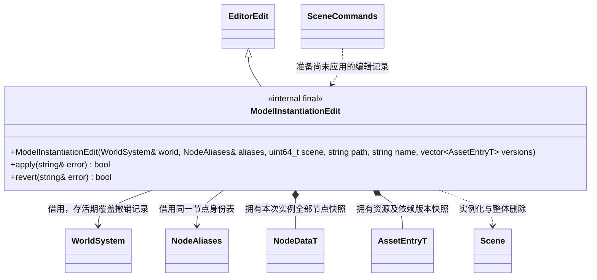

# 模型实例化命令

[编辑器命令](editor-commands.md) · [模型资源](../../runtime/class-diagrams/model-resources.md)

- `instantiate_model(sceneId, path, name)` 按运行目录加载模型资源（Model）并展开为 Node + Component 层级。返回根名称及资源路径，`get_scene` 查询创建后的节点 ID。
- 构建记录时保留模型及依赖元数据。应用及重做检查相同版本；失败保留原场景和撤销栈，不接受已经变化的资源。
- 创建记录保存完整子树快照；撤销只允许删除未被外部修改的本次层级，有额外子节点、节点被移动或组件变化时拒绝。
- 重做更新所有子节点的共享身份，后续变换、组件及插件编辑仍能定位重建后的节点。历史只持有 ID、快照和共享身份，不持有 Node 借用。
- `Scene.InstantiateModel(path, name)` 为同一核心调用的脚本入口；MCP `instantiate_model` 经过编辑器命令通道，不在 MCP 协议线程直接修改场景。
