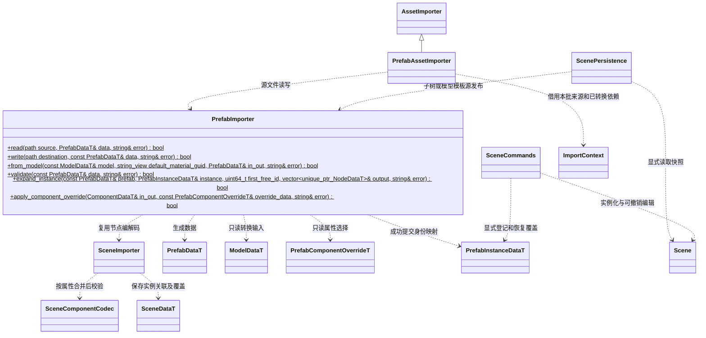
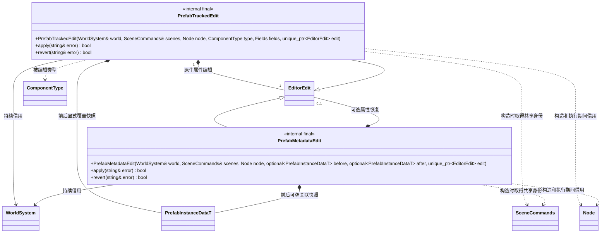
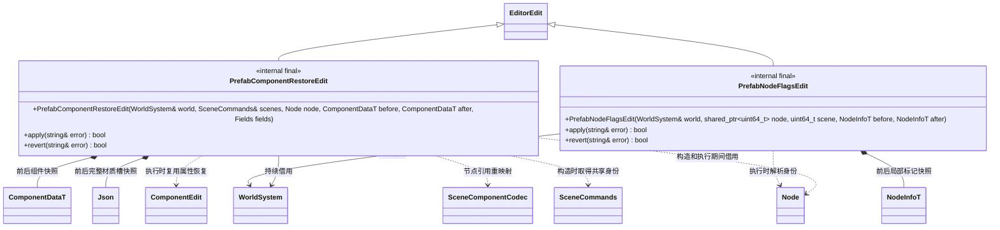

# 预制体编辑与导入

[类图索引](../../class-diagrams/index.md) · [运行时数据](../../runtime/class-diagrams/prefab.md)

状态：按用户已授权的预制体功能实施；复用现有资源导入、组件编解码、场景保存与可撤销命令。

- `.prefab` 是 TOML 源描述，具有独立 GUID/meta，经标准管线生成 PrefabData。直接模板由普通节点组成；模型模板引用 Model GUID，并持久保存源路径到模板 ID 的映射和显式覆盖。
- 模型作为构建依赖，运行依赖只保留合成节点实际引用的 Mesh、Material 等资源。扫描阶段不读取尚未生成的缓存；转换任务依赖已完成的模板/模型产物；转换后收集准确运行依赖再封装、原子发布。
- 合成复用 `SceneComponentCodec::write/read/validate`：把模板生成数据转成属性表，只替换明确记录的字段，再按原 codec 读取并校验。所有持久数据仍来自 schema，不建立另一套手写组件模型或通用反射系统。
- 场景源文件保留预制体引用和覆盖，不把模板展开节点重新写成无关副本。运行二进制保存展开结果，运行包不需要 TOML。
- 从选中子树创建模板时根父级归零，保留局部状态和资源依赖；动态 Mesh、材质覆盖复用场景保存导出机制。创建模板不隐式替换场景对象，也不将场景标为已保存。
- 普通保存只保存实例修改；恢复覆盖与更新模板必须使用明确命令。模板更新不能从运行时模拟快照自动推断编辑意图。
- 两项目美术资源改为先建模型模板或直接模板，再由场景引用；角色/玩法入口和场景 GUID 保持稳定。私有项目的所有修改仅保留本地。

- `from_model` 显式借用默认材质 GUID，离线导入从本批 `ImportContext.identities` 解析，编辑器创建从当前目录解析；不依赖运行中 ResourceSystem 的全局目录。模型模板增加独立 Transform 根，FBX/USD 节点使用稳定源路径，旧节点数组顺序不是身份。
- 场景合成从上一已发布且信封校验通过的场景补回未保存到源的新增节点映射，连续模板更新不重用已有 ID。模板删除将映射标记 `retired` 并保留 ID；实例删除子树展开为每个源 ID 的显式 `removed`。运行时验证这些元数据不加载来源模板。

## 编辑记录与来源关联

`Fields` 是 `vector<string>`，使用组件 codec 的 TOML 顶层键；数组按整个字段覆盖。内部编辑类只继承既有 `EditorEdit`，没有独立生命周期服务。

- `PrefabTrackedEdit` 在原生编辑成功后记录本次请求的字段，包括同值和 false。已存在覆盖只合并新选择的字段，避免把未请求的运行时值顺带保存。原生编辑和元数据更改一起成功或回滚，撤销先核对当前关联与后快照。
- `PrefabMetadataEdit` 用前后可空关联表示链接、解除链接、显式标记和恢复。共享身份表保存场景 local ID 到共享运行时 ID 的对应关系；实例重做后重新生成映射，并按组件 codec 修正覆盖中的节点引用。记录不拥有 Scene 或 Node。

- `PrefabComponentRestoreEdit` 保存前后组件生成数据和共享身份，执行时先重映射节点引用，再复用 `ComponentEdit` 校验和恢复。MeshRenderer 额外保存各槽完整材质值，复用既有材质快照读写函数；恢复主材质不清除副槽覆盖，恢复非材质字段也不丢失参数、纹理及混合设置，撤销恢复全部原值。
- `PrefabNodeFlagsEdit` 仅恢复 enabled/visible。实例化命名形成 name 覆盖，链接原子树时保留外部 parent；没有新增 Node 重命名或重设父级的公开编辑接口。
- 四类记录的 apply/revert 都返回 bool，失败通过 error 提供上下文；WorldSystem 借用须覆盖历史存活期。

命令入口：

| 命令 | 参数 | 行为 |
| --- | --- | --- |
| instantiate_prefab | sceneId, path, name | 实例化模板并登记可撤销来源关联 |
| create_prefab | sceneId, nodeId, path | 事务发布新模板，不替换或链接原树 |
| create_prefab_from_model | model, path | 从已导入 Model 创建带稳定来源映射的新模板 |
| link_prefab | sceneId, nodeId, path | 按稳定 local ID 关联原子树，明确记录当前值与模板的差异 |
| unlink_prefab | sceneId, nodeId | 仅实例根可解除关联，保留当前节点和值 |
| get_prefab_instance | sceneId, nodeId | 查询来源 GUID、根 local ID、源节点 ID 及显式字段 |
| set_prefab_override | sceneId, nodeId, componentType?, fields | 显式标记当前字段值；修改值继续使用已有 set_* 命令 |
| revert_prefab_override | sceneId, nodeId, componentType?, fields | 从当前模板恢复所选字段并删除相应覆盖 |

- `componentType` 使用 get_scene 的生成枚举名称。省略时只接受节点 enabled/visible；组件 fields 使用 codec 键。材质覆盖指完整 material/additional_materials 绑定，不引入 Shader 参数继承。
- link 的局部身份须对应原模板子树。链接动作对照当前值生成显式差异，保留根的外部父级与组件增删；普通运行改值及保存不执行差异推断。后续未知结构编辑明确拒绝，先解除关联再编辑。
- 场景保存只导出覆盖明确引用的动态 Mesh/材质，导出的独立 GUID 写入此次保存副本，保持当前撤销历史。缺失映射节点必须已 retired 或明确 removed；部分 mapped 节点 transient 时拒绝，完整 transient 实例连同关联一起略过。从子树创建模板拒绝指向导出集合外的组件节点引用。
- 本轮没有 ApplyToTemplate 命令。模板通过编辑 .prefab 源文件后按标准资源管线重建更新；实例恢复覆盖不会反写模板。
