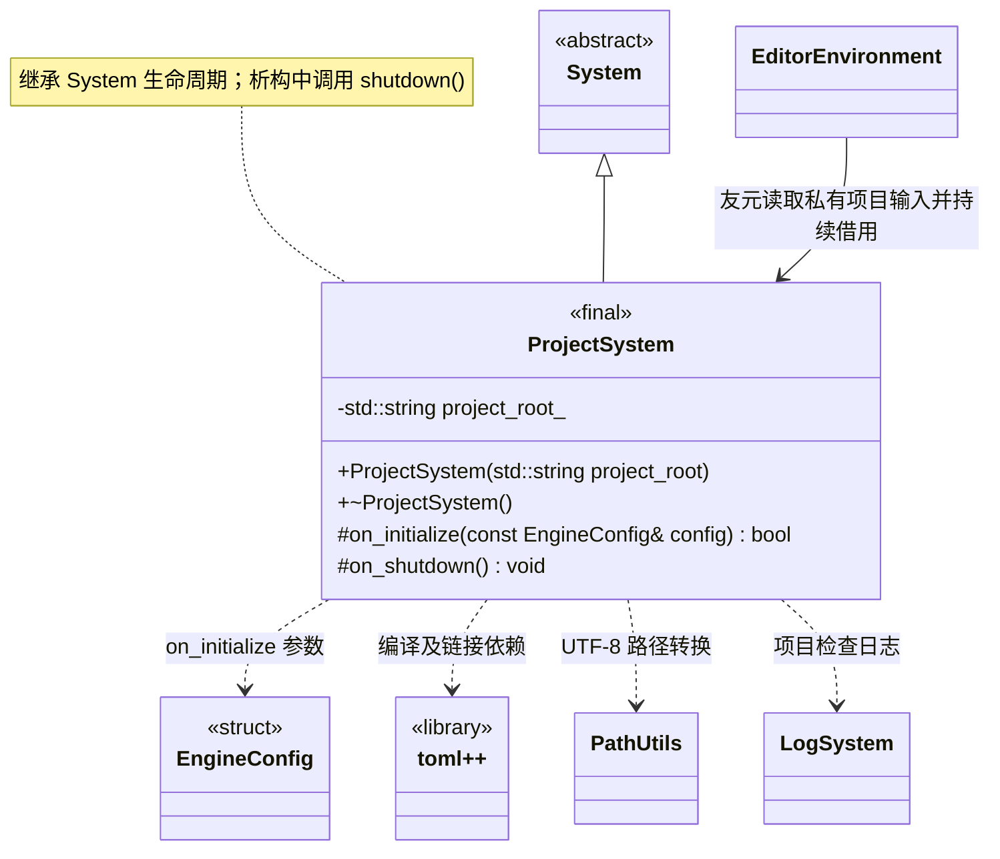

# 项目系统

[类图索引](../../class-diagrams/index.md) · [引擎与系统](../../runtime/class-diagrams/engine-system.md) · [完整引用关系](../../class-diagrams/references.md)

本图仅定义 `ProjectSystem` 的方法；其他节点为跨图引用或第三方类型。

- 编辑器宿主独立拥有的根系统；运行时 `Engine` 不拥有或依赖它。构造函数接收实际项目根目录并保存自己的字符串副本，不借用调用者字符串。
- 构造函数只保存路径；`on_initialize()` 检查根目录及其 `settings/`、`cache/`、`assets/` 均存在且为目录；空路径、任一目录缺失、类型不符或无法完成检查均返回 `false`。继承的配置参数用于统一生命周期签名，不读取其中的窗口配置。
- 文件系统检查使用返回状态和 `std::error_code`，不使用异常。编辑器宿主先初始化项目，再启动引擎窗口和编辑器系统；项目验证失败时编辑器启动失败，尚未初始化窗口。
- toml++ 参与依赖编译与链接验证。项目设置由资源管线读取；APK 内部资源由运行时 ResourceSystem 读取，不属于 ProjectSystem。
- 不提供项目路径 getter。私有项目输入仅供目录校验以及友元 `EditorEnvironment` 建立编辑器环境，运行时资源位置统一读取 `App`。项目根用于编辑器配置与编译，不是新的运行时资源路径。初始化失败和清理遵守[系统约定](../../runtime/class-diagrams/engine-system.md)。
- 不重写 `on_tick()`，沿用基类默认成功的空更新；无逐帧业务任务。

C++ 限定符：构造为 `explicit`；析构及 `on_shutdown()` 为 `noexcept`；析构和受保护钩子标注 `override`，返回状态的钩子标注 `[[nodiscard]]`。

公共路径编码复用 [PathUtils](../../runtime/class-diagrams/path-utils.md)；路径规范化和安全检查仍由本类负责。
