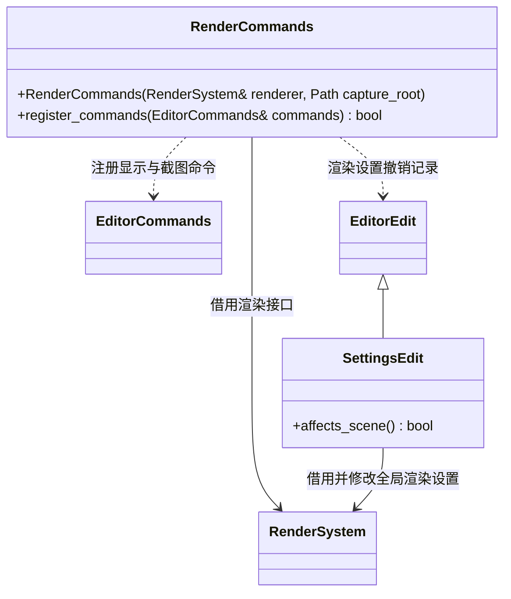

# 渲染编辑命令

[类图索引](../../class-diagrams/index.md)

编辑器决定截图目录并检查相对路径；渲染器只接收明确的文件路径。渲染设置支持撤销；截图是异步请求，回执中的 pending 不代表文件完成，get_frame_capture 返回真实完成状态。

`SettingsEdit::affects_scene()` 为 const、noexcept、override 并返回 false。曝光、环境光等全局渲染设置仍进入撤销历史，但不改变场景保存状态，不阻止预览自动刷新。

宿主独占 RenderCommands，命令注册和撤销历史释放之后销毁它；渲染系统的有效期覆盖命令对象。
