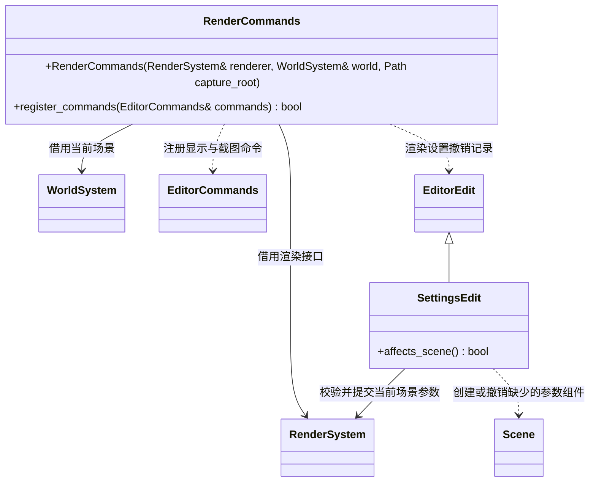

# 渲染编辑命令

[类图索引](../../class-diagrams/index.md)

编辑器决定截图目录并检查相对路径；渲染器只接收明确的文件路径。渲染设置支持撤销；截图是异步请求，回执中的 pending 不代表文件完成，get_frame_capture 返回真实完成状态。

`set_render_stats` 要求唯一的布尔参数 `enabled`，调用渲染系统的统计面板开关并返回保存的状态。该命令跨待机、场景预览及玩法生效，不进入撤销历史，不改变场景保存状态。

`set_render_settings` 有活动场景时编辑 EnvironmentComponent、活动相机节点上的 PostProcessComponent 与方向光参数，修改进入撤销历史并标记场景未保存。环境参数缺少组件时由编辑器创建普通环境节点，相机后处理缺少组件时附加到活动相机；阴影参数要求场景已有方向光。撤销同时移除本次自动创建的节点或组件。设置由场景保存、导入和重载。

无活动场景时仅修改渲染默认设置，`SettingsEdit::affects_scene()` 返回 false；不创建场景。编辑器不把场景参数写到项目脚本或核心全局覆盖值。

宿主独占 RenderCommands，命令注册和撤销历史释放之后销毁它；渲染系统与世界的有效期覆盖命令对象。
