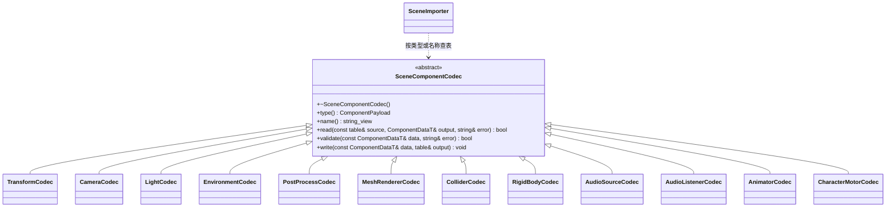

# 场景组件描述编解码

[类图索引](../../class-diagrams/index.md) · [场景导入](scene-importer.md)

`ColliderCodec` 支持基本形状和静态三角网格；TOML 的 `shape = "mesh"` 搭配 `mesh = "<GUID>"` 对应 ColliderData 的 mesh_guid。SceneAssetImporter 将该独立 Mesh 引用加入场景依赖，运行时沿用统一资源目录加载。

每个组件类型在 `editor/asset_pipeline/components/` 独立文件实现 TOML 读取、载荷验证与写出。基础实现静态登记，宿主可显式追加插件实现，未知类型明确失败。SceneImporter 负责节点身份、层级、enabled 和原子写入；运行时 Component 不依赖 TOML。生成的 ComponentDataT 是双方共享的唯一模型。

物理与音频 codec 复用运行时组件的纯设置校验，不加载设备或建立模拟对象。AudioSource 的 `clip_guid` 是场景资源依赖；导入器和运行时 Scene codec 分别检查其目录身份和 `audio` 类型。空 GUID 表示尚未指定 clip。

`EnvironmentCodec` 和 `PostProcessCodec` 分别处理 `environment` 与 `post_process`；环境颜色接受 RGB 或 RGBA 数组，RGB 的 alpha 默认为 1，写出统一为 RGBA。清屏色为无符号 32 位 RGBA 整数。环境、后处理与 Light 的值域校验由运行时内部纯函数共用，资源解码不反向链接世界系统。SceneImporter 校验最多一个启用环境、一个启用的投影方向光，以及后处理与 Camera 同节点；这些参数不声明额外资源依赖，天空几何仍按 Mesh/Material 原有依赖加载。

公开契约位于 `include/engine/editor/asset_pipeline/components/scene_component_codec.hpp`：

- `register_scene_component_codec(unique_ptr<SceneComponentCodec>&)` 成功才转移独占所有权；空指针、NONE 类型、空名字、类型或名字冲突均拒绝。
- `find_scene_component_codec(ComponentPayload)` / `find_scene_component_codec(string_view)` 返回只读可空借用；先检查基础表，再检查插件扩展表。
- 登记由宿主在并行导入或保存之前完成，扩展对象由进程级登记容器持有，不支持运行中卸载。基础编辑器不 include 具体插件；插件自行提供类型的 TOML、校验与输出方法。

AnimatorCodec 和 CharacterMotorCodec 属于编辑器基础类型；角色输入/相机策略对应的 CharacterControllerCodec 属于[独立编辑器插件](../../plugins/editor/class-diagrams/character-controller.md)。组件源码归属由行为职责决定，生成的 union 只提供跨语言数据契约。
