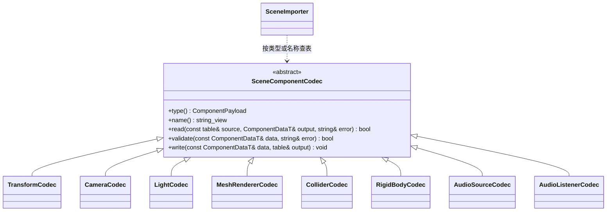

# 场景组件描述编解码

[类图索引](../../class-diagrams/index.md) · [场景导入](scene-importer.md)

每个组件类型在 `editor/asset_pipeline/components/` 独立文件实现 TOML 读取、载荷验证与写出。只读登记表集中列出类型，未知类型明确失败。SceneImporter 负责节点身份、层级、enabled 和原子写入；运行时 Component 不依赖 TOML。生成的 ComponentDataT 是双方共享的唯一模型。

物理与音频 codec 复用运行时组件的纯设置校验，不加载设备或建立模拟对象。AudioSource 的 `clip_guid` 是场景资源依赖；导入器和运行时 Scene codec 分别检查其目录身份和 `audio` 类型。空 GUID 表示尚未指定 clip。
