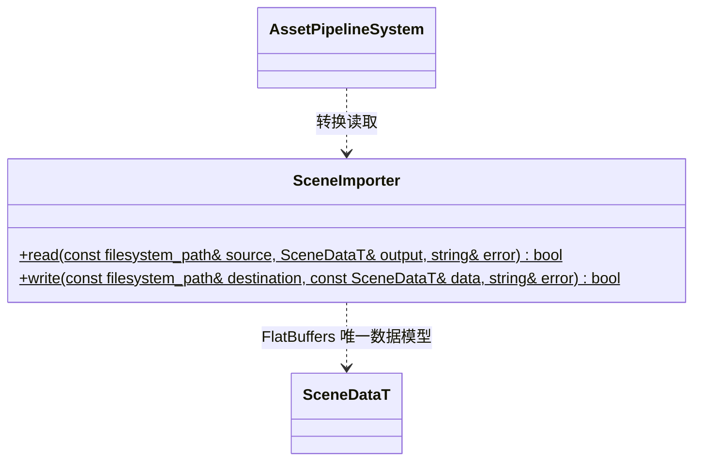

# 场景导入与保存

[类图索引](../../class-diagrams/index.md)

源 `.scene` 是 TOML。保存与读取均验证局部稳定节点 ID、父子关系、唯一组件、唯一 Transform、活动相机及资源 GUID；不把运行时实体号直接写入源文件。读失败清空输出；写入采用同目录临时文件后替换，失败保留已有源文件。引用存在性由管线依赖分析再验证。

相机保存透视/正交投影及正交竖直半高；灯光保存方向/点/聚光类型、范围及内外半角。MeshRenderer 保存槽 0 的 `material` 和槽 1 起的 `additional_materials` GUID 数组，全部进入场景依赖。旧场景未写新增字段时采用生成数据模型的默认值。
