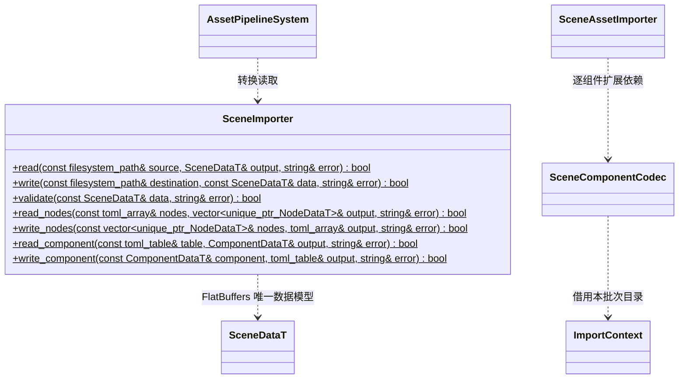

# 场景导入与保存

[类图索引](../../class-diagrams/index.md)

源 `.scene` 是 TOML。保存与读取均验证局部稳定节点 ID、父子关系、唯一组件、唯一 Transform、活动相机及资源 GUID；不把运行时实体号直接写入源文件。读失败清空输出；写入采用同目录临时文件后替换，失败保留已有源文件。引用存在性由管线依赖分析再验证。

相机保存透视/正交投影及正交竖直半高；灯光保存方向/点/聚光类型、范围及内外半角。MeshRenderer 保存槽 0 的 `material` 和槽 1 起的 `additional_materials` GUID 数组，全部进入场景依赖。可选字段未填写时采用当前生成模型的默认值。

SceneComponentCodec 的完整契约只在[组件编解码类图](scene-component-codecs.md)维护。组件 Codec 可覆写 `scan_dependencies`，向给定依赖列表追加已经校验的 GUID；默认方法不追加。场景管线统一调用登记的 Codec，插件自己负责其组件引用的资源类型验证，编辑器不认识具体插件类型。现有内置组件引用收集保持原语义。

源场景只保存普通节点、模板关联、稳定映射与显式覆盖；含模板关联时在合成后验证完整父链及组件节点引用。`write` 接收展开数据，自动省略属于模板映射的节点。`resource_fields` 由每个包含资源的组件 Codec 声明属性名，覆盖依赖扫描不推测文本内容；运行依赖仍按最终组件的类型规则验证。
