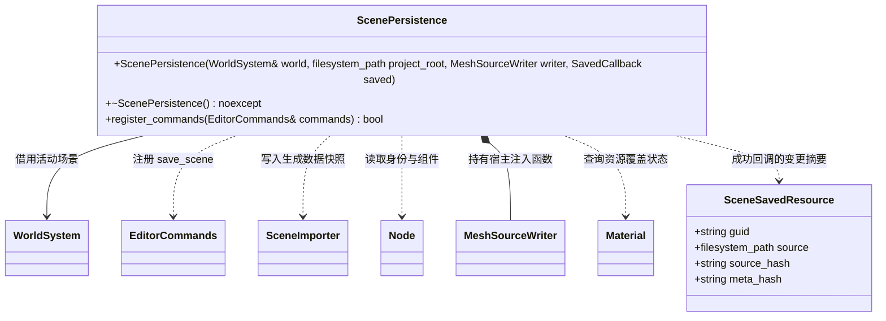

# 活动场景保存

[类图索引](../../class-diagrams/index.md)

`MeshSourceWriter = std::function<bool(const Node&, const std::filesystem::path&, std::string&)>`，图中的名称是函数类型别名，不是新增业务类。`ScenePersistence` 属于 `engine::editor`，只使用该函数契约，不包含或链接 `ModelingCommands`；启用建模时，宿主可提供捕获建模对象的回调，并保证该对象在回调释放前存活。

`SavedCallback = std::function<void(std::string_view, std::span<const SceneSavedResource>)>` 可空，成功发布场景后通知其 `project/` 逻辑路径和本批变化资源；span 仅在回调期间借用。宿主用它更新 ScenePreview 的保存检查点并区分自保存与外部修改；失败不触发，无变化保存传空列表，保存到其他路径不解除当前预览的未保存保护。
保存由编辑器驱动：以 FlatBuffers 原生数据快照记录层级、组件、启用状态及活动相机。
已加载网格保留原 GUID，不重新调用网格导出器；材质使用 `Material::has_overrides()` 查询有效值，未覆盖时直接保留原资源 GUID。仅动态网格和有覆盖值的材质写入场景相邻资源目录，覆盖材质独立保存，不修改其他节点共享的美术源材质。邻接 meta 复用资源管线身份规则。

私有保存状态按场景代次、组件实例、目标路径和网格修订记录已成功导出的动态源；相同修订复用已保存结果，不再调用网格写入器。成功记录同时保存源文件和 meta 的内容摘要；同一场景代次内，已保存的场景或本次需写入的导出源发生外部修改时拒绝覆盖，不触发成功回调。调用方可恢复原内容，或刷新场景接受新版本；新场景代次成功保存后建立新基线。这些状态不进入核心，也不扫描全部资源。

各候选源文件逐字节比较，内容相同不替换、不触碰时间戳或 meta。场景描述最后发布，只有实际文件变化才要求增量导入；保存不重建运行场景、不修改运行包。回执 `resourceCount` 统计实际变化的资源数（含场景），`meshCount`、`materialCount` 统计变化的导出资源，`sceneChanged` 表示场景变化；`reusedMeshCount`、`reusedMaterialCount` 统计复用次数。原样保存返回 `resourceCount=0`、`importRequired=false`。

发布失败恢复本批已覆盖的源文件、meta 和时间戳；回滚失败保留暂存备份并报告位置；保存快照仅在整批成功后更新。`save_scene` 本身为非撤销文件命令：参数、材质和网格编辑由既有 `EditorEdit` 支持撤销/重做；保存保留编辑历史，撤销或重做后再次保存仅发布差异。ScenePreview 在自身保存后的增量导入中核对本批 GUID 与源/meta 摘要，仅提交新资源目录，保留活动场景、镜头和历史；不把保存后的新编辑标为已保存。其他外部变化继续按预览的冲突与刷新契约处理。

运行时只读取已有 Scene/Node/Component 和资源接口，MCP 只传递命令及回执。编辑器宿主启用资源管线即可注册 `save_scene`；已加载资源引用的保存不要求建模插件。`MeshSourceWriter` 可以为空，只有保存动态网格时才要求有效回调，缺失时返回失败；建模插件通过宿主回调保存可编辑源，不构成编辑器基础库对插件的编译依赖。加载项目场景时，已装配的建模插件可依据 mesh 路径恢复可编辑源和编辑器身份。
